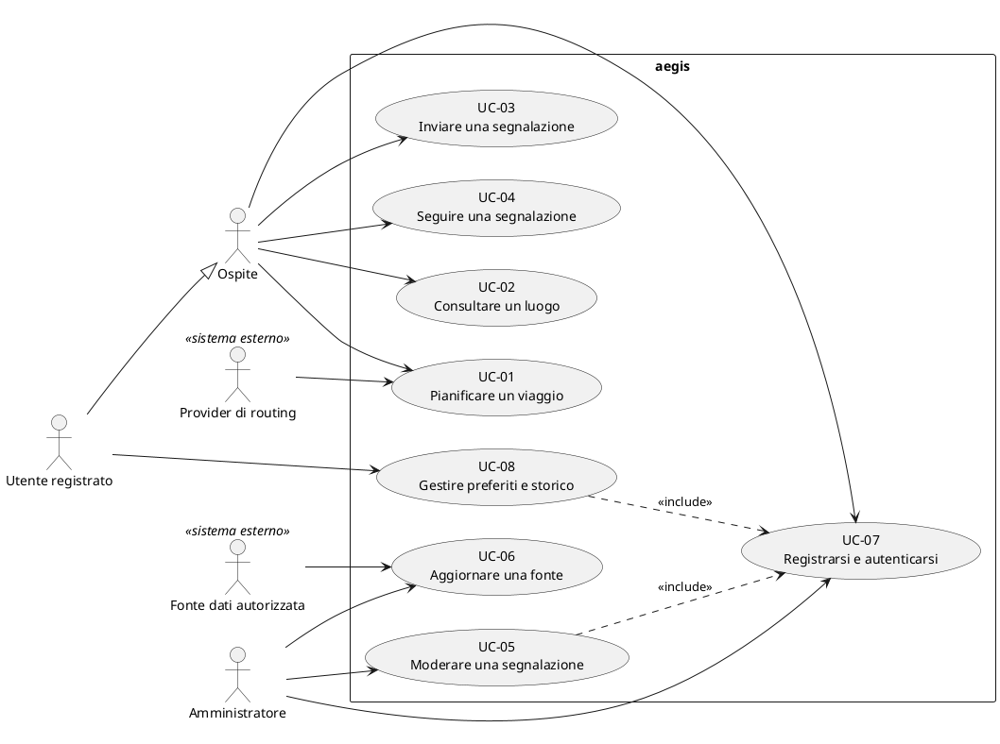
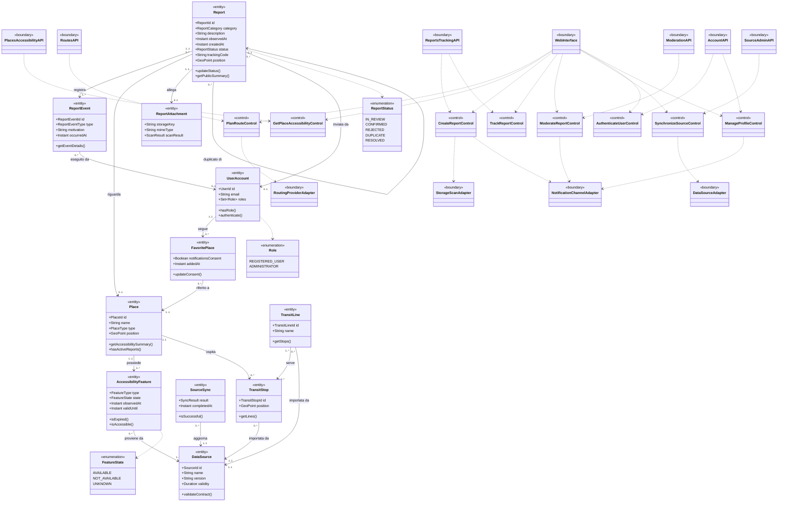
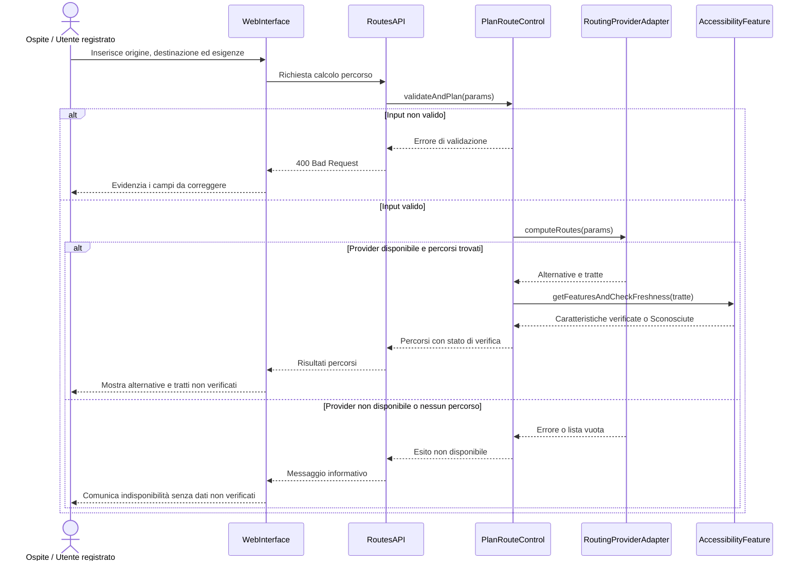
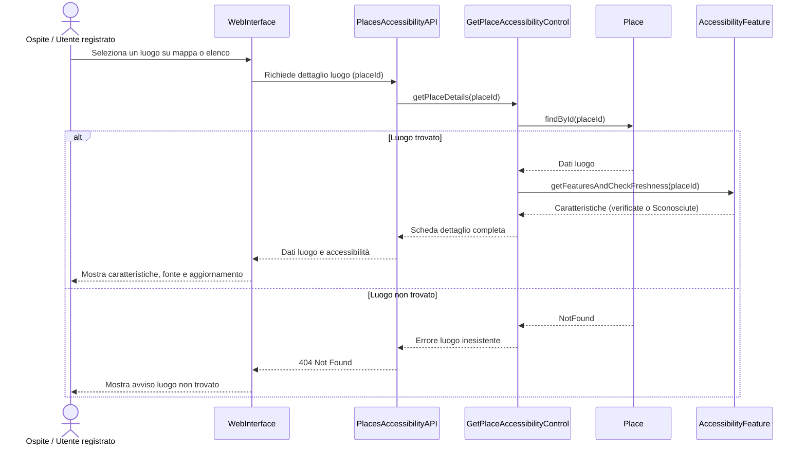
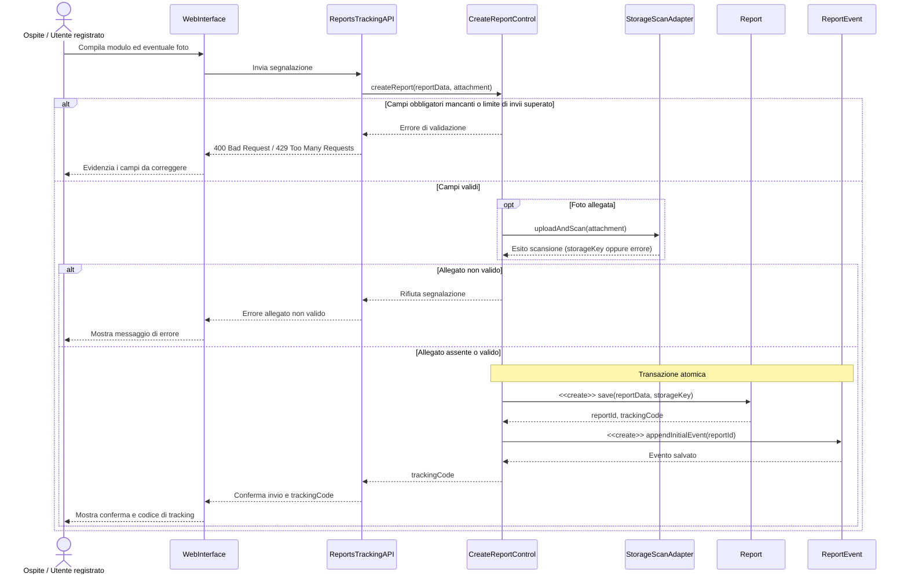
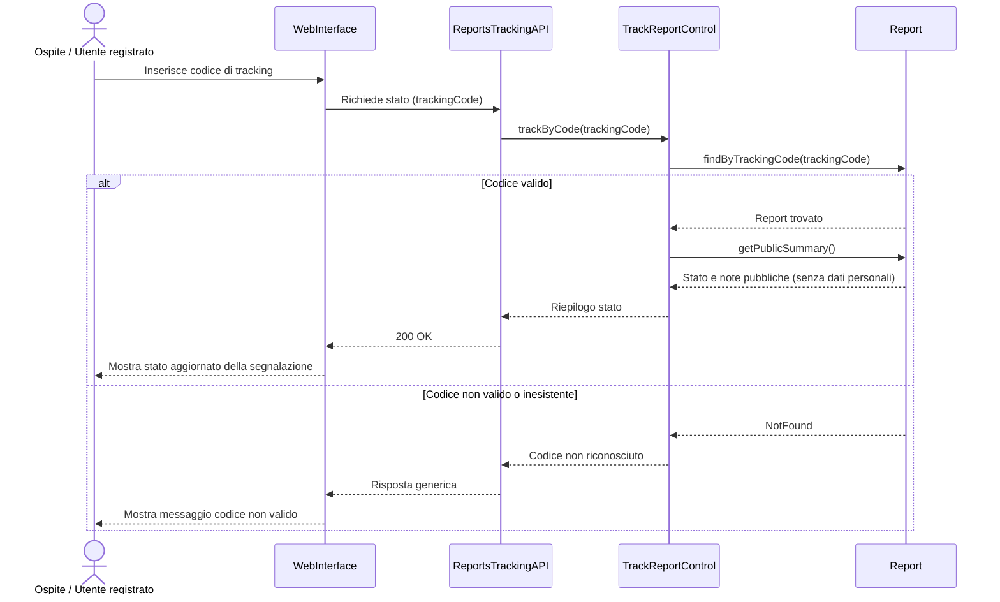
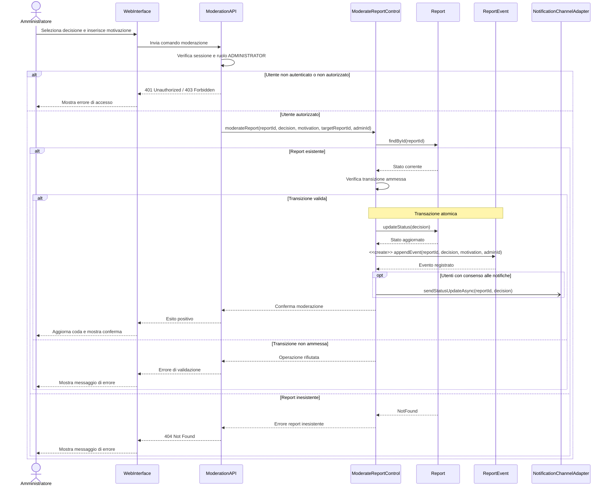
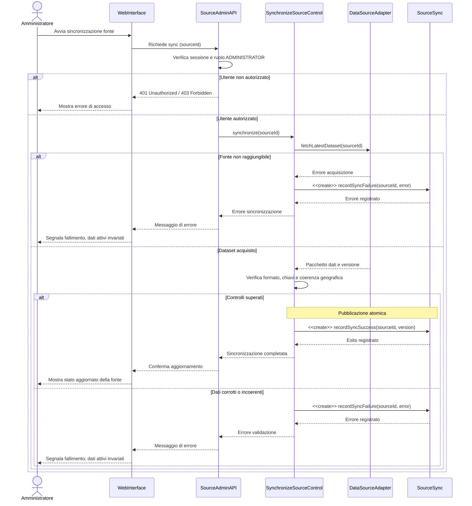
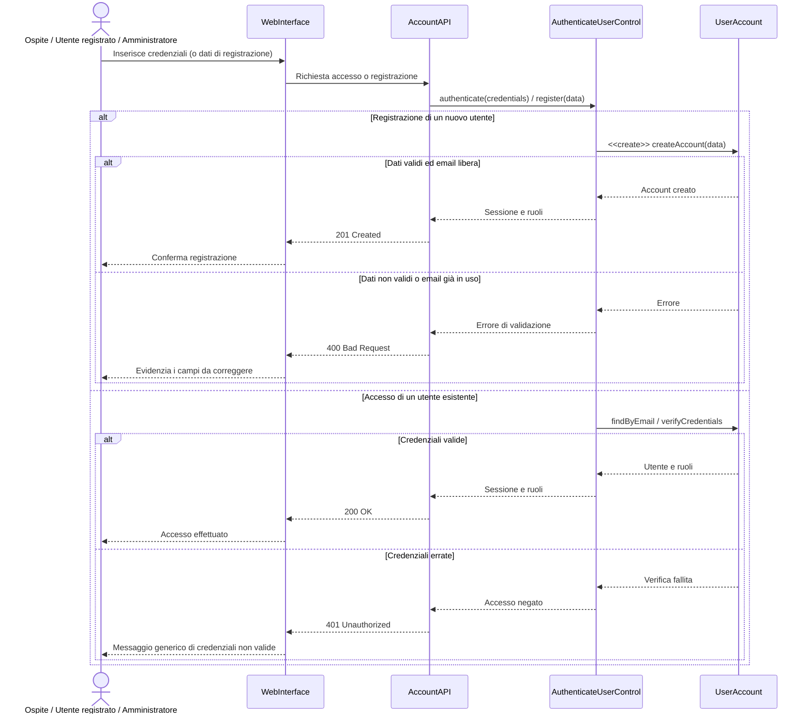
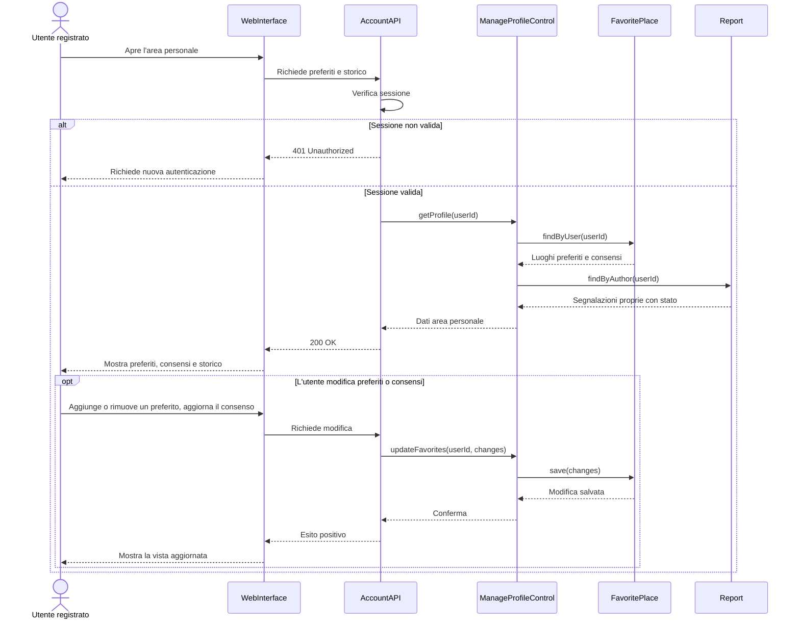

# RAD

## Documento di Analisi dei Requisiti

| Dato | Valore |
|---|---|
| Progetto | aegis |
| Corso | Ingegneria del Software e Interazione Uomo-Macchina |
| Docenti | Prof.ssa Mariacarla Staffa |
| Candidati | [Inserisci Nome e Cognome] |
| Anno accademico | 2025/2026 |

## SOMMARIO

1. Introduzione
   - 1.1 Scopo del sistema
   - 1.2 Area di dominio
2. Sistema corrente
3. Sistema proposto
   - 3.1 Panoramica
   - 3.2 Requisiti funzionali
   - 3.3 Requisiti non funzionali
   - 3.4 Vincoli
   - 3.5 Modelli di sistema
     - 3.5.1 Utenti del sistema
     - 3.5.2 Scenari
     - 3.5.3 Modelli dei casi d’uso
     - 3.5.4 Modello degli oggetti
     - 3.5.5 Diagramma delle classi
     - 3.5.6 Diagrammi di sequenza
4. Interfaccia utente
   - 4.1 Descrizione del prototipo realizzato
   - 4.2 Test di usabilità
   - 4.3 Valutazione dell’usabilità secondo ISO 9241-110
5. Glossario

---

## INTRODUZIONE

### 1.1 SCOPO DEL SISTEMA

La web app **aegis** aiuta le persone con disabilità motoria, visiva o uditiva a pianificare spostamenti urbani, consultare l’accessibilità di stazioni, fermate e mezzi del trasporto pubblico locale (TPL) e segnalare barriere architettoniche o guasti agli ausili (ad esempio ascensori fuori servizio, rampe ostruite). Il sistema mostra esplicitamente la fonte e la data di aggiornamento di ciascuna caratteristica. Qualsiasi dato assente o scaduto viene classificato come **sconosciuto** e non viene mai interpretato come prova di accessibilità.

Gli obiettivi principali sono trovare e confrontare percorsi accessibili, consultare le caratteristiche dei luoghi, inviare e tracciare segnalazioni tramite codice univoco e permettere agli amministratori autorizzati di moderarle mantenendo uno storico immutabile delle decisioni. L’usabilità e l’accessibilità del sistema sono validate tramite sessioni di test con utenti su compiti rappresentativi e verifica con tecnologie assistive.

| Obiettivo | Criterio di verifica |
|---|---|
| Trovare e confrontare percorsi | Le alternative proposte distinguono chiaramente tratti compatibili, barriere note e tratti non verificati. |
| Consultare l’accessibilità | Ogni caratteristica espone stato attuale, fonte dei dati e data di aggiornamento. |
| Inviare e tracciare segnalazioni | L’invio restituisce un codice alfanumerico univoco utilizzabile per consultare lo stato della segnalazione. |
| Moderare segnalazioni | Ogni decisione amministrativa aggiorna lo stato registrando un evento storico non sovrascrivibile. |
| Usare i flussi essenziali con tecnologie assistive | I flussi principali sono verificati da tastiera e con screen reader rispetto alla baseline di progetto WCAG 2.2 AA proposta in OPEN-06. |

*Tabella 1.1: Obiettivi del sistema e relativi criteri di verifica*

### 1.2 AREA DI DOMINIO

Il dominio comprende la pianificazione della mobilità urbana, i dati geospaziali del trasporto pubblico, il monitoraggio dell’accessibilità delle infrastrutture e il *crowdsourcing* moderato delle segnalazioni. L’area geografica di riferimento comprende la rete metropolitana, ferroviaria urbana e di superficie della città di Napoli, integrando i dataset ufficiali dell’azienda di trasporto locale con le segnalazioni georeferenziate degli utenti.

## SISTEMA CORRENTE

Il progetto è di tipo **greenfield** (sviluppo ex novo), in quanto non esiste attualmente un sistema centralizzato e in tempo reale dedicato al monitoraggio collaborativo dell’accessibilità urbana nell’area di riferimento. Attualmente gli utenti si affidano a bollettini statici sui siti istituzionali (spesso non aggiornati sui guasti improvvisi) o a segnalazioni informali su canali social.

## SISTEMA PROPOSTO

### 3.1 PANORAMICA

La piattaforma offre consultazione pubblica con ricerca per area, mappa interattiva affiancata da vista testuale equivalente, dettagli di accessibilità e pianificazione di percorsi alternativi. Il sistema distingue le caratteristiche verificate (positive o negative) da quelle sconosciute o scadute. Le segnalazioni inviate dagli utenti seguono un ciclo di moderazione tracciato mediante uno storico *append-only*.

**Provenienza dei dati.** Le fermate, le linee e le informazioni di accessibilità di base (ad esempio l’accessibilità alla salita in carrozzina, ascensori e percorsi di collegamento) provengono dai dataset ufficiali in formato GTFS. Le caratteristiche non coperte dal GTFS (ad esempio percorsi tattili e annunci sonori) e i guasti temporanei derivano dalle segnalazioni confermate dagli amministratori. Ogni dato conserva fonte e data di osservazione.

**Accesso.** La consultazione, l’invio di una segnalazione e il tracking sono disponibili anche all’Ospite senza registrazione (l’invio è protetto da rate limiting). L’autenticazione è richiesta per le funzioni dell’Utente registrato (preferiti, notifiche, storico delle proprie segnalazioni) e per tutte le operazioni amministrative.

### 3.2 REQUISITI FUNZIONALI

| ID | Responsabile dell’azione | Azione richiesta | Priorità | Caso d’uso |
|---|---|---|---|---|
| FR-01 | Sistema | Mostrare su mappa e in elenco i luoghi e le informazioni di accessibilità per l’area richiesta. | Must | UC-02 |
| FR-02 | Sistema | Mostrare caratteristiche quali ascensori, rampe, percorsi tattili e annunci sonori con stato, fonte, aggiornamento e validità. | Must | UC-01, UC-02 |
| FR-03 | Sistema | Classificare come sconosciuti i dati assenti, incoerenti o scaduti oltre la soglia di validità (30 giorni dall’osservazione, salvo diversa scadenza configurata per la fonte), senza inferire accessibilità. | Must | UC-01, UC-02 |
| FR-04 | Ospite o utente registrato e sistema | Acquisire origine, destinazione ed esigenze di accessibilità; calcolare e restituire percorsi alternativi. | Must | UC-01 |
| FR-05 | Sistema | Distinguere nei percorsi barriere note, tratti compatibili e tratti non verificati. | Must | UC-01 |
| FR-06 | Ospite o utente registrato e sistema | Consentire la selezione di un luogo e mostrare dettagli di accessibilità e provenienza. | Must | UC-02 |
| FR-07 | Ospite o utente registrato | Inserire luogo, categoria, descrizione e data di osservazione del problema, allegando facoltativamente una foto (max 5 MB). La data di invio è registrata dal sistema. | Must | UC-03 |
| FR-08 | Sistema | Generare e restituire un codice di tracking univoco per consultare lo stato della segnalazione senza esporre dati personali. | Must | UC-03, UC-04 |
| FR-09 | Amministratore e sistema | Consentire conferma, rifiuto, risoluzione o unione di duplicati, registrando ogni decisione nello storico. | Must | UC-05 |
| FR-10 | Amministratore e sistema | Importare dataset ufficiali (formato GTFS) e registrare versione, esito e timestamp della sincronizzazione. | Should | UC-06 |
| FR-11 | Sistema | Aggiornare i dati visibili dell’area interessata al termine di ogni sincronizzazione validata. | Should | UC-06 |
| FR-12 | Sistema | Inviare notifiche agli utenti registrati che hanno dato il consenso (autori delle segnalazioni e utenti che seguono un luogo) al cambio di stato di una segnalazione. | Could | UC-05, UC-08 |
| FR-13 | Sistema | Autenticare gli utenti e verificare i ruoli per le operazioni riservate, mantenendo pubblici consultazione, invio e tracking. | Must | UC-05, UC-06, UC-07, UC-08 |
| FR-14 | Utente non registrato e sistema | Consentire la registrazione e l’accesso con credenziali personali e la gestione dei luoghi preferiti e dei consensi per le notifiche. | Should | UC-07, UC-08 |
| FR-15 | Utente registrato e sistema | Consentire la consultazione dello storico delle proprie segnalazioni con il relativo stato. | Should | UC-08 |

*Tabella 3.1: Requisiti funzionali*

#### CRITERI DI ACCETTAZIONE FR

| ID | Criterio di accettazione |
|---|---|
| FR-01 | Per l’area urbana selezionata sono mostrati i luoghi censiti e i relativi dati di accessibilità disponibili. |
| FR-02 | Ogni caratteristica mostrata espone stato, fonte, data di osservazione e scadenza di validità. |
| FR-03 | Dati assenti, scaduti o incoerenti sono mostrati come sconosciuti e non sono usati per dichiarare compatibilità. |
| FR-04 | Una richiesta valida restituisce zero o più percorsi alternativi con tempi di percorrenza, cambi e stato di verifica. |
| FR-05 | Ogni tratto del percorso distingue barriere note, compatibilità nota e stato non verificato. |
| FR-06 | La selezione di un luogo mostra scheda di dettaglio, caratteristiche note, fonte e validità. |
| FR-07 | L’invio valido salva segnalazione ed evento iniziale in modo atomico, un errore impedisce salvataggi parziali. La foto allegata è pubblicata solo dopo la verifica di formato e sicurezza. Per l’Ospite si applica il rate limiting. |
| FR-08 | La creazione riuscita restituisce un codice di tracking non enumerabile, la pagina di consultazione mostra esclusivamente lo stato pubblico consentito. |
| FR-09 | Solo le transizioni di stato ammesse (`In verifica` → `Confermata` / `Rifiutata` / `Duplicata`, `Confermata` → `Risolta`) aggiornano lo stato e aggiungono un evento immutabile con autore e timestamp. Un duplicato è associato alla segnalazione di riferimento. |
| FR-10 | Solo un pacchetto dati completo e validato viene pubblicato, in caso di errore restano attivi i dati precedenti. |
| FR-11 | Alla pubblicazione di un aggiornamento validato i nuovi dati risultano immediatamente consultabili sulle viste di mappa ed elenco. |
| FR-12 | Le notifiche sono inviate in modo asincrono solo agli utenti che hanno espresso consenso, un errore del canale non annulla la decisione di moderazione. |
| FR-13 | La consultazione pubblica, l’invio e il tracking non richiedono autenticazione, le operazioni riservate sono bloccate lato server (HTTP 401/403) per utenti non autenticati o non autorizzati. |
| FR-14 | Un utente può creare un account, accedere, disconnettersi, aggiungere o rimuovere luoghi preferiti e attivare o revocare il consenso alle notifiche. |
| FR-15 | L’utente registrato vede solo le proprie segnalazioni, con codice di tracking e stato corrente. |

*Tabella 3.2: Criteri di accettazione dei requisiti funzionali*

### 3.3 REQUISITI NON FUNZIONALI

La baseline di accessibilità proposta per il prodotto è **[WCAG 2.2 livello AA](https://www.w3.org/TR/WCAG22/)**. Il referente accessibilità, il responsabile di prodotto e le persone coinvolte devono approvare il perimetro e il protocollo in OPEN-06 prima delle verifiche. Il piano di valutazione elenca pagine, componenti, stati dinamici e flussi completi, inclusi gli errori, e registra per ogni criterio A e AA applicabilità, esito, metodo, ambiente ed evidenza. Strumenti automatici, revisione manuale, tastiera, zoom, contrasto, tecnologie assistive e confronto tra mappa e vista testuale hanno risultati distinti. Le sessioni con utenti sono registrate separatamente dai risultati di conformità e usabilità. Gli strumenti automatici non dimostrano da soli la conformità. Eventuali dichiarazioni di conformità richiedono una valutazione completa del perimetro dichiarato e una revisione competente. ISO 9241-110 resta il riferimento complementare per l’usabilità.

| ID | Qualità | Azione richiesta | Criterio di verifica | Responsabile |
|---|---|---|---|---|
| NFR-01 | Accessibilità | Consentire di completare i flussi essenziali da tastiera e con screen reader secondo la baseline **WCAG 2.2 livello AA** proposta per il prodotto. | Dopo l’approvazione del protocollo OPEN-06, verificare tastiera, ordine del focus, nome e stato dei controlli e annunci con screen reader per i criteri applicabili di livello A e AA. | Team di sviluppo / QA |
| NFR-02 | Accessibilità | Fornire una vista testuale equivalente alle informazioni presentate sulla mappa. | Verifica di parità informativa tra vista mappa e vista elenco testuale per le medesime ricerche. | Team di sviluppo / QA |
| NFR-03 | Accessibilità | Garantire contrasto cromatico adeguato e leggibilità con zoom fino al 200%. | Verificare il rapporto di contrasto ≥ 4.5:1 per il testo standard e l’assenza di perdita di contenuto allo zoom secondo la baseline **WCAG 2.2 livello AA** proposta. | Team di sviluppo / QA |
| NFR-04 | Privacy | Minimizzare i dati personali e separare l’identità dell’autore dai contenuti pubblici delle segnalazioni. | Verifica che endpoint pubblici e pagine di tracking non espongano email o identificativi dell’utente (conformità GDPR). | Responsabile tecnico |
| NFR-05 | Sicurezza | Proteggere le comunicazioni con HTTPS/TLS e applicare il controllo degli accessi basato sui ruoli (RBAC). | Verifica del protocollo HTTPS su tutti gli endpoint e rifiuto lato server delle operazioni riservate per ruoli non autorizzati. | Responsabile tecnico |
| NFR-06 | Sicurezza | Applicare validazione server-side degli input, rate limiting e protezione da injection. | Test con input malformati e tentativi di injection verificando il rifiuto senza effetti sui dati. | Responsabile tecnico |
| NFR-07 | Sicurezza | Controllare gli upload per formato (JPEG/PNG/WebP), dimensione (≤ 5 MB) e integrità prima della pubblicazione. | Test di rifiuto automatico per file non validi o eccedenti il limite di dimensione. | Responsabile tecnico |
| NFR-08 | Qualità dei dati | Esporre provenienza e freschezza di ogni dato di accessibilità. | Ispezione di un campione di luoghi, in cui ogni caratteristica riporta fonte e data di osservazione. | Team di sviluppo / QA |
| NFR-09 | Affidabilità | Garantire la disponibilità del servizio e il rollback automatico in caso di importazione fallita. | Disponibilità del servizio ≥ 99,5% e mantenimento dei dati validi precedenti in caso di errore della fonte. | Team di sviluppo / QA |
| NFR-10 | Performance | Mantenere tempi di risposta rapidi per il caricamento della mappa, dei luoghi e dei percorsi. | Latenza inferiore a **2 secondi** per il 95% delle richieste (p95) in condizioni di carico standard. | Team di sviluppo / QA |
| NFR-11 | Usabilità | Rendere i flussi principali comprensibili e coerenti, fornendo feedback immediato sulle operazioni. | Tasso di completamento ≥ 85% nei compiti assegnati durante i test di usabilità con gli utenti. | Team di sviluppo / QA |
| NFR-12 | Manutenibilità | Mantenere separati dominio, casi d’uso e adattatori, documentando le API. | Revisione dell’architettura a livelli e documentazione completa degli endpoint REST tramite specifica OpenAPI. | Responsabile tecnico |
| NFR-13 | Portabilità | Garantire la fruibilità dell’interfaccia web su browser desktop e dispositivi mobili (*responsive design*). | Test di compatibilità su Chrome, Firefox, Safari ed Edge sia su desktop che su smartphone. | Team di sviluppo / QA |

*Tabella 3.3: Requisiti non funzionali*

### 3.4 VINCOLI

| Vincolo | Specifica |
|---|---|
| Piattaforma applicativa | Backend sviluppato in Java LTS / Jakarta EE per API REST e worker asincroni, frontend web responsive. |
| Persistenza e file | Database relazionale PostgreSQL con estensione spaziale PostGIS e storage dedicato per le immagini allegate. |
| Struttura software | Architettura disaccoppiata tra presentazione, casi d’uso, dominio e adattatori esterni, documentata con OpenAPI. |
| Accesso e ruoli | Consultazione, invio di segnalazioni e tracking liberi anche per l’Ospite. Autenticazione e controllo dei ruoli (Utente registrato, Amministratore) per preferiti, notifiche, storico personale e moderazione. |
| Qualità dei dati | Ogni proprietà di accessibilità registra fonte e timestamp, dati assenti o oltre la soglia di validità (30 giorni dall’osservazione, salvo diversa scadenza della fonte) sono classificati come *Sconosciuti*. |
| Normativa | Trattamenti di dati personali da valutare secondo GDPR. I requisiti legali di accessibilità applicabili, inclusa la Legge 4/2004 (Legge Stanca), sono da verificare in OPEN-06. WCAG 2.2 livello AA è il target di prodotto proposto e non costituisce una dichiarazione di conformità legale. |

*Tabella 3.4: Vincoli di progetto*

### 3.5 MODELLI DI SISTEMA

#### 3.5.1 UTENTI DEL SISTEMA

| Utente | Obiettivi | Contesto d’uso |
|---|---|---|
| **Ospite** | Consultare luoghi, pianificare percorsi accessibili, inviare segnalazioni e seguirne lo stato tramite codice di tracking. | Utilizza la consultazione pubblica senza account, prevalentemente da smartphone in mobilità (in stazione o alla fermata). |
| **Utente registrato** | Dispone di tutte le funzionalità dell’Ospite, con in più la possibilità di salvare luoghi preferiti, ricevere notifiche personalizzate e consultare lo storico delle proprie segnalazioni. | Pendolare abituale o cittadino con disabilità che utilizza quotidianamente il trasporto pubblico da smartphone o desktop. |
| **Amministratore** | Moderare le segnalazioni ricevute (conferma, rifiuto, risoluzione, unione duplicati) e gestire la sincronizzazione delle fonti dati autorizzate. | Operatore dell’ente di trasporto o amministratore della piattaforma che opera da postazione desktop tramite pannello riservato. |

*Tabella 3.5: Utenti del sistema e ruoli*

| Attore esterno | Ruolo |
|---|---|
| **Provider di routing** | Sistema esterno che calcola gli itinerari a partire da origine, destinazione e vincoli (UC-01). |
| **Fonte dati autorizzata** | Sistema esterno che pubblica i dataset ufficiali di fermate, linee e accessibilità, in formato GTFS (UC-06). |

*Tabella 3.6: Attori esterni*

#### 3.5.2 SCENARI

Gli scenari seguenti, inventati a scopo illustrativo, rappresentano una validazione preliminare dei requisiti e coprono utenti con diverse esigenze di accessibilità.

| Titolo | Attori | Obiettivo | Descrizione dello scenario |
|---|---|---|---|
| **Pianificazione di un percorso** | Ospite, Provider di routing | Confrontare percorsi senza presentare dati incerti come verificati. | Giorgio si muove in carrozzina e deve raggiungere l’ospedale. Dallo smartphone apre aegis senza registrarsi, indica origine, destinazione e l’esigenza di percorso senza barriere. Il sistema propone due alternative: una è compatibile, l’altra contiene un tratto contrassegnato come “non verificato” perché l’ultimo dato sull’ascensore è scaduto. Giorgio sceglie la prima. |
| **Consultazione di un luogo** | Ospite | Conoscere caratteristiche, stato e provenienza dei dati di una stazione. | Elena è non vedente e usa uno screen reader. Cerca la stazione dalla vista elenco testuale, naviga da tastiera fino alla scheda di dettaglio e ascolta per ogni caratteristica (ascensore, percorso tattile, annunci sonori) lo stato, la fonte e la data di aggiornamento. Il percorso tattile risulta “sconosciuto”: Elena sa che non è confermato. |
| **Invio di una segnalazione** | Ospite | Comunicare un guasto e ottenere un riferimento per seguirlo. | Sara trova fuori servizio l’ascensore di una fermata. Apre il modulo di segnalazione, seleziona il luogo, la categoria “ascensore guasto”, descrive il problema e allega una foto. Il sistema valida i dati e le mostra un codice di tracking, che lei salva. |
| **Tracking di una segnalazione** | Ospite | Verificare lo stato senza esporre dati riservati. | Dopo due giorni Sara inserisce il codice nella pagina di tracking e vede che la sua segnalazione è passata da “In verifica” a “Confermata”, con una nota pubblica dell’operatore. Non vede alcun dato personale, né altre segnalazioni. |
| **Registrazione e preferiti** | Utente non registrato, Utente registrato | Seguire i luoghi usati abitualmente e ricevere avvisi. | Giorgio crea un account, aggiunge ai preferiti la fermata sotto casa e attiva il consenso alle notifiche. Quando una segnalazione su quella fermata viene confermata, riceve un avviso. Dall’area personale consulta lo storico delle sue segnalazioni. |
| **Moderazione di una segnalazione** | Amministratore | Valutare le segnalazioni in modo autorizzato e tracciabile. | Davide, operatore dell’ente di trasporto, accede al pannello di moderazione, apre la segnalazione di Sara con la foto e la cronologia e la conferma indicando la motivazione. Un’altra segnalazione sullo stesso guasto viene unita come duplicato. Ogni decisione resta nello storico. |
| **Aggiornamento di una fonte** | Amministratore, Fonte dati autorizzata | Mantenere aggiornati e validati i dataset ufficiali. | Davide avvia la sincronizzazione del nuovo pacchetto GTFS. Il sistema controlla formato, chiavi e coerenza geografica. Un primo tentativo fallisce perché il file è corrotto: i dati precedenti restano visibili e l’errore è registrato. Il secondo tentativo ha successo e le nuove fermate compaiono su mappa ed elenco. |

*Tabella 3.7: Scenari di utilizzo di aegis*

#### 3.5.3 MODELLI DEI CASI D’USO

##### Diagramma globale

Il confine di sistema separa i casi d’uso di aegis dagli attori umani e dai sistemi esterni. L’Utente registrato specializza l’Ospite, quindi eredita UC-01, UC-02, UC-03 e UC-04. Le funzioni riservate includono UC-07 (Autenticarsi).

*Figura 3.1: Diagramma dei casi d’uso di aegis*

##### Specifiche dei casi d’uso

###### UC-01: Pianificare un viaggio

| Campo | Specifica |
|---|---|
| Attori partecipanti | Ospite, Utente registrato, Provider di routing |
| Condizioni d’ingresso | Origine, destinazione ed esigenze di accessibilità specificate e valide. La consultazione non richiede autenticazione. |
| Condizioni d’uscita | Restituiti zero o più percorsi con tempi, cambi e stato di verifica. Fonte e freschezza sono esposte quando disponibili, dati assenti o scaduti risultano sconosciuti. |
| Requisiti qualitativi | Il sistema distingue barriere note, tratti compatibili e tratti non verificati (FR-05), risposta entro 2 secondi (NFR-10). |
| Flusso degli eventi | 1. L’utente inserisce origine, destinazione ed esigenze. 2. Il sistema valida la richiesta e la inoltra al Provider di routing. 3. Il provider restituisce le alternative disponibili. 4. Il sistema arricchisce i percorsi con stato di verifica e provenienza dei dati e mostra risultati ed eventuali incertezze. |
| Flussi alternativi e di errore | • Input non valido: il sistema segnala i campi da correggere senza invocare il provider. • Provider non disponibile o nessun percorso trovato: il sistema comunica l’indisponibilità senza presentare risultati non verificati come accessibili. |

###### UC-02: Consultare un luogo

| Campo | Specifica |
|---|---|
| Attori partecipanti | Ospite, Utente registrato |
| Condizioni d’ingresso | Luogo identificabile tramite ricerca testuale o selezione sulla mappa. |
| Condizioni d’uscita | Dettaglio e caratteristiche note sono mostrati con fonte e validità. Dati assenti o scaduti sono indicati come sconosciuti. |
| Requisiti qualitativi | Le informazioni sulla mappa sono disponibili anche in forma testuale per tastiera e screen reader (NFR-01, NFR-02). |
| Flusso degli eventi | 1. L’utente seleziona o cerca un luogo. 2. Il sistema recupera dettaglio e caratteristiche di accessibilità. 3. Il sistema valuta la freschezza rispetto alla scadenza e classifica come sconosciuti i dati scaduti o assenti. 4. Il sistema mostra caratteristiche, fonte, data di aggiornamento ed eventuali segnalazioni attive. |
| Flussi alternativi e di errore | • Luogo non trovato: il sistema mostra un avviso informativo. • Errore di caricamento: il sistema comunica un errore temporaneo senza esporre dati obsoleti come validi. |

###### UC-03: Inviare una segnalazione

| Campo | Specifica |
|---|---|
| Attori partecipanti | Ospite, Utente registrato |
| Condizioni d’ingresso | Campi obbligatori compilati correttamente, informativa sul trattamento dei dati accettata. |
| Condizioni d’uscita | Segnalazione ed evento iniziale salvati, codice di tracking univoco restituito all’utente. |
| Requisiti qualitativi | Nessun dato identificativo dell’utente è esposto pubblicamente (NFR-04), l’eventuale foto (max 5 MB) è verificata prima della pubblicazione (NFR-07), rate limiting sugli invii dell’Ospite (NFR-06). |
| Flusso degli eventi | 1. L’utente inserisce luogo, categoria, descrizione, data di osservazione e allega facoltativamente una foto. 2. Il sistema valida i campi e controlla formato e sicurezza dell’eventuale immagine. 3. Il sistema salva in un’unica transazione la segnalazione e l’evento iniziale, e genera un codice di tracking non enumerabile. 4. Il sistema restituisce il codice di tracking. |
| Flussi alternativi e di errore | • Campi mancanti o file non valido: il sistema rifiuta l’invio evidenziando l’errore, senza salvare dati parziali. • Errore di persistenza: il sistema annulla la transazione e invita a riprovare. • Limite di invii superato: il sistema rifiuta la richiesta e invita a riprovare più tardi. |

###### UC-04: Seguire una segnalazione

| Campo | Specifica |
|---|---|
| Attori partecipanti | Ospite, Utente registrato |
| Condizioni d’ingresso | Codice di tracking fornito dall’utente. |
| Condizioni d’uscita | Mostrato esclusivamente lo stato pubblico consentito della segnalazione, senza dati riservati. |
| Requisiti qualitativi | Il codice non consente di enumerare altre segnalazioni (FR-08), le richieste ripetute con codici errati sono limitate (NFR-06), pagina fruibile tramite tecnologie assistive (NFR-01). |
| Flusso degli eventi | 1. L’utente inserisce il proprio codice di tracking. 2. Il sistema verifica l’esistenza e la validità del codice. 3. Il sistema recupera lo stato corrente (In verifica, Confermata, Risolta, Rifiutata, Duplicata) e le note pubbliche. 4. Il sistema visualizza le informazioni a schermo. |
| Flussi alternativi e di errore | • Codice non riconosciuto o errato: il sistema mostra un messaggio generico di codice non valido, senza rivelare dettagli sull’archivio. |

###### UC-05: Moderare una segnalazione

| Campo | Specifica |
|---|---|
| Attori partecipanti | Amministratore |
| Condizioni d’ingresso | Amministratore autenticato (UC-07) e autorizzato, segnalazione esistente. |
| Condizioni d’uscita | Stato ed evento storico aggiornati nella stessa transazione con autore e timestamp. |
| Requisiti qualitativi | Tracciabilità completa di ogni decisione, gli eventi precedenti restano immutabili, controllo del ruolo lato server (NFR-05). |
| Flusso degli eventi | 1. L’amministratore seleziona una segnalazione dalla coda di moderazione. 2. Il sistema mostra dettagli, foto allegata e cronologia degli eventi. 3. L’amministratore seleziona la decisione (Conferma, Rifiuta, Risolvi o Unisci duplicato indicando la segnalazione di riferimento) e inserisce la motivazione. 4. Il sistema verifica il ruolo e la validità della transizione, aggiorna la segnalazione, aggiunge l’evento allo storico e pianifica le notifiche previste (FR-12). |
| Flussi alternativi e di errore | • Utente non autenticato o non autorizzato: il sistema risponde 401/403. • Transizione non ammessa o segnalazione inesistente: il sistema rifiuta il comando lasciando invariato lo stato precedente. |

###### UC-06: Aggiornare una fonte

| Campo | Specifica |
|---|---|
| Attori partecipanti | Amministratore, Fonte dati autorizzata |
| Condizioni d’ingresso | Fonte configurata e abilitata, Amministratore autenticato per l’avvio manuale (oppure esecuzione schedulata). |
| Condizioni d’uscita | Versione, timestamp, controlli ed esito registrati, solo un pacchetto completo e validato diventa visibile. |
| Requisiti qualitativi | In caso di errore mantengono validità i dati precedenti, senza pubblicazioni parziali (NFR-09). |
| Flusso degli eventi | 1. L’amministratore avvia la sincronizzazione dalla dashboard (oppure scatta la pianificazione automatica). 2. Il sistema acquisisce i dati dalla Fonte dati autorizzata. 3. Il sistema verifica formato, chiavi e coerenza geografica. 4. Se i controlli sono superati, il sistema pubblica i nuovi dati in un’unica operazione atomica e registra l’esito positivo. |
| Flussi alternativi e di errore | • Fonte non raggiungibile, file corrotto o controlli non superati: il sistema annulla la pubblicazione, registra l’errore nel log e mantiene attivi i dati precedenti. |

###### UC-07: Registrarsi e autenticarsi

| Campo | Specifica |
|---|---|
| Attori partecipanti | Ospite (per la registrazione), Utente registrato, Amministratore |
| Condizioni d’ingresso | Per la registrazione: email non ancora in uso e informativa sul trattamento dei dati accettata. Per l’accesso: account esistente. |
| Condizioni d’uscita | Sessione autenticata con i ruoli dell’utente, oppure account creato. |
| Requisiti qualitativi | Comunicazioni su HTTPS e controllo degli accessi per ruolo (NFR-05), messaggi di errore che non rivelano se l’email esiste, moduli fruibili con tecnologie assistive (NFR-01). |
| Flusso degli eventi | 1. L’utente inserisce le credenziali (in registrazione anche i dati richiesti). 2. Il sistema valida i dati e verifica le credenziali oppure crea l’account. 3. Il sistema avvia la sessione e restituisce i ruoli dell’utente. |
| Flussi alternativi e di errore | • Credenziali errate: il sistema mostra un messaggio generico, senza avviare la sessione. • Email già in uso o dati non validi: il sistema evidenzia i campi da correggere. |

###### UC-08: Gestire preferiti e storico

| Campo | Specifica |
|---|---|
| Attori partecipanti | Utente registrato |
| Condizioni d’ingresso | Utente autenticato (UC-07). |
| Condizioni d’uscita | Preferiti e consensi aggiornati, oppure storico delle proprie segnalazioni mostrato con i relativi stati. |
| Requisiti qualitativi | L’utente accede solo ai propri dati (NFR-04, NFR-05), il consenso alle notifiche è revocabile in ogni momento. |
| Flusso degli eventi | 1. L’utente apre la propria area personale. 2. Il sistema mostra luoghi preferiti, consensi per le notifiche e storico delle segnalazioni inviate con il codice e lo stato. 3. L’utente aggiunge o rimuove un preferito oppure modifica il consenso alle notifiche. 4. Il sistema salva la modifica e aggiorna la vista. |
| Flussi alternativi e di errore | • Sessione non valida o scaduta: il sistema richiede nuovamente l’autenticazione. • Errore di salvataggio: il sistema mantiene lo stato precedente e invita a riprovare. |

*Tabella 3.8: Specifiche dei casi d’uso*

#### 3.5.4 MODELLO DEGLI OGGETTI

##### Oggetti Entity

| Oggetto | Responsabilità | Casi d’uso |
|---|---|---|
| Place | Rappresenta un luogo, una fermata o una stazione consultabile con posizione geografica. | UC-01, UC-02, UC-06 |
| AccessibilityFeature | Rappresenta una caratteristica di accessibilità associata a un luogo, con stato (Disponibile, Non disponibile, Sconosciuto), fonte, data di osservazione e validità. | UC-01, UC-02, UC-06 |
| Report | Rappresenta una segnalazione georeferenziata con categoria, descrizione, data di osservazione, stato, codice di tracking, eventuale autore e, per i duplicati, la segnalazione di riferimento. | UC-03, UC-04, UC-05, UC-08 |
| ReportAttachment | Rappresenta la foto allegata a una segnalazione, con chiave di archiviazione ed esito della scansione. | UC-03, UC-05 |
| ReportEvent | Registra in modo append-only tipo di evento, autore, motivazione e data relativi a una segnalazione. | UC-03, UC-05 |
| UserAccount | Rappresenta l’identità e i ruoli applicativi di un utente autenticato. | UC-05, UC-06, UC-07, UC-08 |
| FavoritePlace | Collega un utente registrato a un luogo preferito e memorizza il consenso alle notifiche. | UC-05, UC-08 |
| DataSource | Rappresenta una fonte autorizzata e la relativa configurazione di validità. | UC-06 |
| SourceSync | Registra versione, esito, timestamp e controlli di qualità di una sincronizzazione. | UC-06 |
| TransitLine | Rappresenta una linea di trasporto importata da una fonte autorizzata. | UC-01, UC-06 |
| TransitStop | Rappresenta una fermata con coordinate geografiche e riferimenti alle linee servite. | UC-01, UC-02, UC-06 |

*Tabella 3.9: Oggetti Entity*

##### Oggetti Boundary

| Oggetto | Responsabilità |
|---|---|
| WebInterface | Presenta mappa interattiva, viste testuali equivalenti, percorsi, moduli di segnalazione, area personale e pannello di amministrazione agli attori umani. |
| PlacesAccessibilityAPI | Riceve richieste di ricerca e dettaglio sui luoghi e restituisce dati con fonte e freschezza. |
| RoutesAPI | Riceve origine, destinazione e vincoli di accessibilità e restituisce alternative con stato di verifica. |
| ReportsTrackingAPI | Riceve nuove segnalazioni e richieste di tracking, restituendo il codice o lo stato pubblico consentito. |
| ModerationAPI | Espone la coda e le operazioni di moderazione, protette da autenticazione e ruolo. |
| SourceAdminAPI | Espone l’avvio e lo stato delle sincronizzazioni delle fonti dati, riservato agli amministratori. |
| AccountAPI | Espone registrazione, accesso, preferiti, consensi e storico delle proprie segnalazioni. |
| StorageScanAdapter | Interagisce con il servizio di archiviazione e scansione per verificare le immagini allegate prima della pubblicazione. |
| RoutingProviderAdapter | Inoltra i parametri di viaggio al provider esterno di routing e acquisisce gli itinerari calcolati. |
| NotificationChannelAdapter | Inoltra le notifiche autorizzate al canale esterno (email o push) registrando l’esito di invio. |
| DataSourceAdapter | Acquisisce i flussi dati dalle fonti ufficiali autorizzate per aggiornare linee, fermate e caratteristiche. |

*Tabella 3.10: Oggetti Boundary*

##### Oggetti Control

| Oggetto | Responsabilità |
|---|---|
| PlanRouteControl | Coordina validazione della richiesta, chiamata al provider di routing e classificazione dell’accessibilità delle tratte. |
| GetPlaceAccessibilityControl | Recupera le caratteristiche di un luogo e applica le regole di scadenza e freschezza. |
| CreateReportControl | Coordina validazione dei dati, verifica dell’eventuale allegato e salvataggio atomico di segnalazione ed evento iniziale. |
| TrackReportControl | Verifica il codice di tracking e filtra le informazioni pubbliche restituite. |
| ModerateReportControl | Verifica il ruolo, valida le transizioni di stato e registra aggiornamento ed evento append-only nella stessa transazione. |
| SynchronizeSourceControl | Coordina importazione, controlli di qualità e pubblicazione atomica dei dataset ufficiali. |
| AuthenticateUserControl | Gestisce registrazione, verifica delle credenziali e rilascio della sessione con i ruoli. |
| ManageProfileControl | Gestisce preferiti, consensi per le notifiche e storico delle segnalazioni dell’utente autenticato. |

*Tabella 3.11: Oggetti Control*

#### 3.5.5 DIAGRAMMA DELLE CLASSI

Il diagramma mostra gli oggetti Entity, Boundary e Control, con i relativi attributi, metodi pubblici, stereotipi, molteplicità e relazioni. Nelle associazioni `1..1` indica un legame obbligatorio con un solo oggetto, `0..1` un legame facoltativo e `*` un numero non limitato di oggetti. Le dipendenze tra Boundary e Control non hanno molteplicità. Le coordinate geografiche sono modellate come *value object* (`GeoPoint`) e compaiono come attributo `position` nelle classi che le usano.

*Figura 3.2: Diagramma UML delle classi del sistema*

L’associazione `Report` → `UserAccount` (autore) è facoltativa, perché un Ospite non ha account, ed è visibile solo all’autore e agli amministratori, mai nelle risposte pubbliche (NFR-04). Il tipo `ReportEventType` comprende l’evento iniziale (CREATED) e le decisioni di moderazione (CONFIRMED, REJECTED, MARKED_DUPLICATE, RESOLVED).

#### 3.5.6 DIAGRAMMI DI SEQUENZA

I diagrammi descrivono le interazioni dinamiche tra attori, oggetti Boundary, Control ed Entity per gli otto casi d’uso. In questa fase di analisi le Entity sono interrogate direttamente dai Control: la scelta di eventuali repository è rimandata al System Design.

##### UC-01: Pianificazione di un viaggio

*Figura 3.3: Diagramma di sequenza per UC-01*

##### UC-02: Consultazione di un luogo

*Figura 3.4: Diagramma di sequenza per UC-02*

##### UC-03: Invio di una segnalazione

*Figura 3.5: Diagramma di sequenza per UC-03*

##### UC-04: Tracking di una segnalazione

*Figura 3.6: Diagramma di sequenza per UC-04*

##### UC-05: Moderazione di una segnalazione

*Figura 3.7: Diagramma di sequenza per UC-05*

##### UC-06: Aggiornamento di una fonte

*Figura 3.8: Diagramma di sequenza per UC-06*

##### UC-07: Registrazione e autenticazione

*Figura 3.9: Diagramma di sequenza per UC-07*

##### UC-08: Gestione di preferiti e storico

*Figura 3.10: Diagramma di sequenza per UC-08*

---

*(Da qui prosegue il capitolo 4 – Interfaccia utente, invariato rispetto alla tua bozza.)*

---

## GLOSSARIO

*(Da inserire in fondo al documento, dopo il capitolo 4.)*

| Termine | Definizione |
|---|---|
| **RAD** | *Requirements Analysis Document*, Documento di Analisi dei Requisiti. |
| **TPL** | Trasporto Pubblico Locale (metropolitane, autobus, tram, ferrovie urbane). |
| **WCAG 2.2 AA** | *Web Content Accessibility Guidelines*, criteri W3C di accessibilità dei contenuti web di livello A e AA. È il target di prodotto proposto, soggetto all’approvazione OPEN-06. |
| **ARIA** | *Accessible Rich Internet Applications*, insieme di attributi che rendono comprensibili agli screen reader i componenti dinamici delle pagine web. |
| **Legge Stanca** | Legge 4/2004 sull’accessibilità degli strumenti informatici per le persone con disabilità. |
| **GDPR** | Regolamento Europeo sulla protezione dei dati personali. |
| **RBAC** | *Role-Based Access Control*, controllo degli accessi basato sui ruoli. |
| **MoSCoW** | Tecnica di prioritizzazione dei requisiti (Must, Should, Could, Won’t). |
| **Crowdsourcing** | Modello collaborativo in cui gli utenti contribuiscono ad aggiornare lo stato delle infrastrutture. |
| **Ospite** | Utente che consulta la piattaforma e invia o traccia segnalazioni senza effettuare la registrazione. |
| **Utente registrato** | Utente autenticato che può salvare luoghi preferiti, ricevere notifiche e consultare lo storico delle proprie segnalazioni. |
| **Amministratore** | Operatore autorizzato a moderare le segnalazioni e gestire la sincronizzazione delle fonti dati ufficiali. |
| **Luogo** | Stazione, fermata o altro punto di interesse del trasporto pubblico per cui sono consultabili le caratteristiche di accessibilità. |
| **Segnalazione (Report)** | Comunicazione con cui un utente informa il sistema di una barriera architettonica o di un guasto, soggetta a moderazione. |
| **Dato valido** | Informazione verificata e non scaduta rispetto alla soglia di validità della relativa fonte (30 giorni dall’osservazione, salvo diversa scadenza configurata). |
| **Sconosciuto** | Stato esplicito assegnato a una caratteristica priva di dati o con dati scaduti, per evitare di dichiarare accessibile un luogo non verificato. |
| **Tratto non verificato** | Segmento di un itinerario per il quale non sono disponibili dati aggiornati sull’accessibilità. |
| **Codice di tracking** | Codice alfanumerico univoco e non enumerabile generato all’invio di una segnalazione per consultarne lo stato pubblico. |
| **Storico append-only** | Registro cronologico in cui ogni evento di moderazione viene aggiunto in coda, senza possibilità di modificare o cancellare gli eventi precedenti. |
| **GTFS** | *General Transit Feed Specification*, formato standard aperto per i dati su orari, linee e fermate del trasporto pubblico. |
| **PostGIS** | Estensione spaziale del database PostgreSQL per la gestione di dati geografici. |
| **OpenAPI** | Specifica standard per la descrizione e la documentazione delle API REST. |
| **p95** | 95° percentile: soglia temporale entro cui viene completato almeno il 95% delle richieste al sistema. |
| **Entity, Boundary, Control** | Classificazione degli oggetti del modello: dati persistenti di dominio (Entity), punti di interazione con attori e sistemi esterni (Boundary), logica applicativa che coordina i casi d’uso (Control). |

*Tabella 5.1: Glossario dei termini utilizzati nel progetto aegis*
