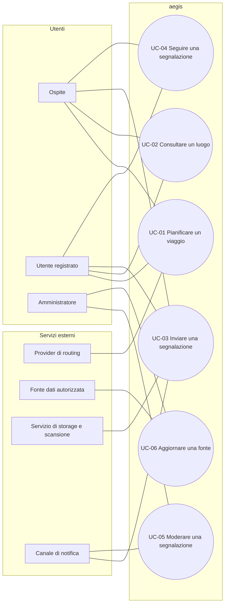
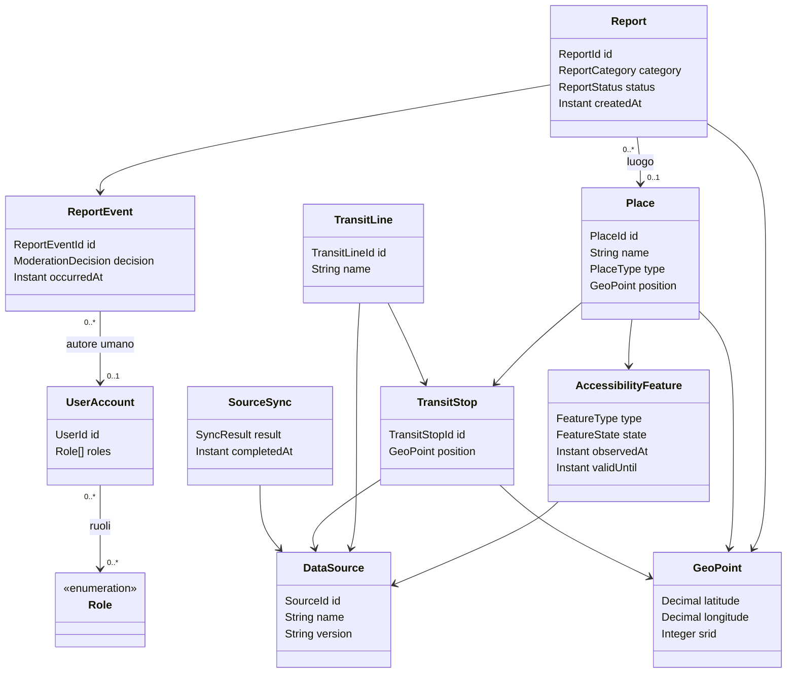
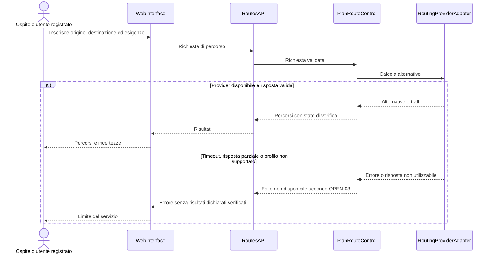
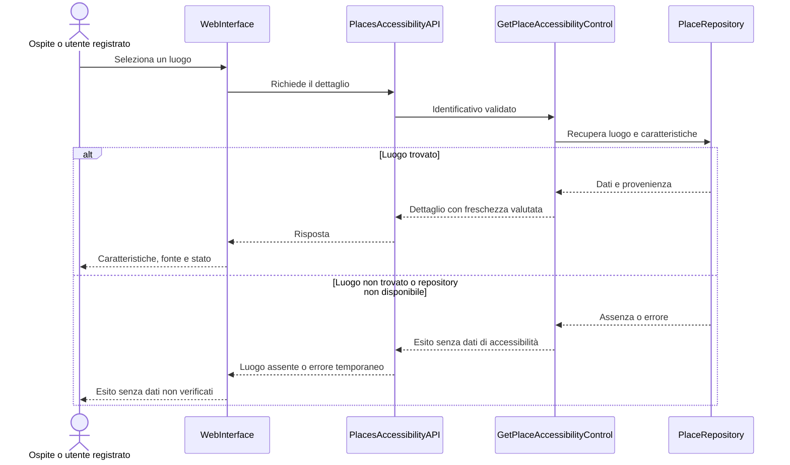
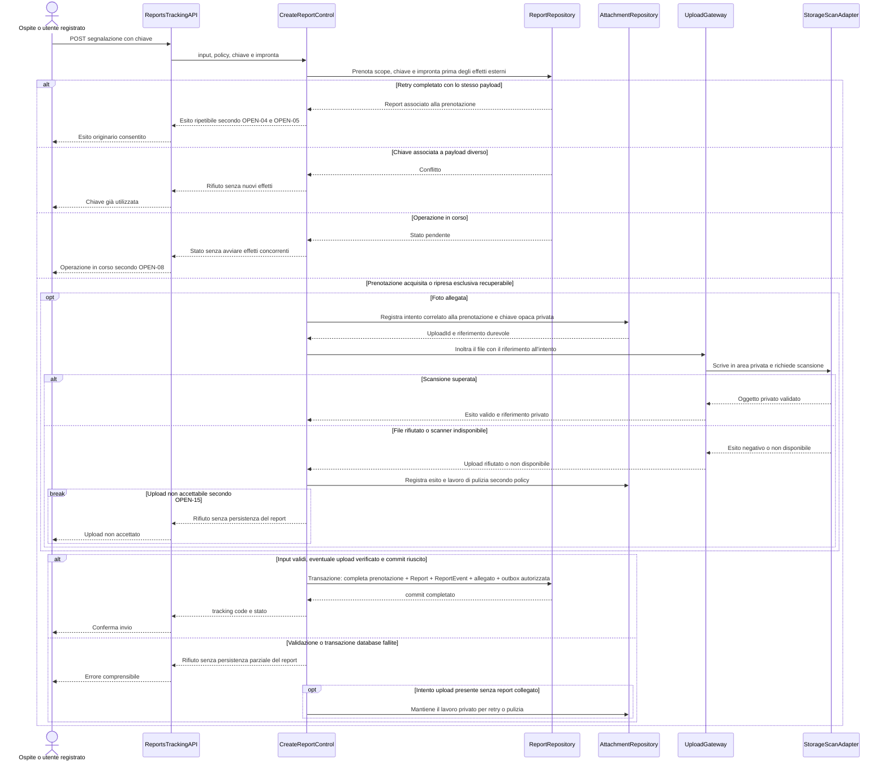
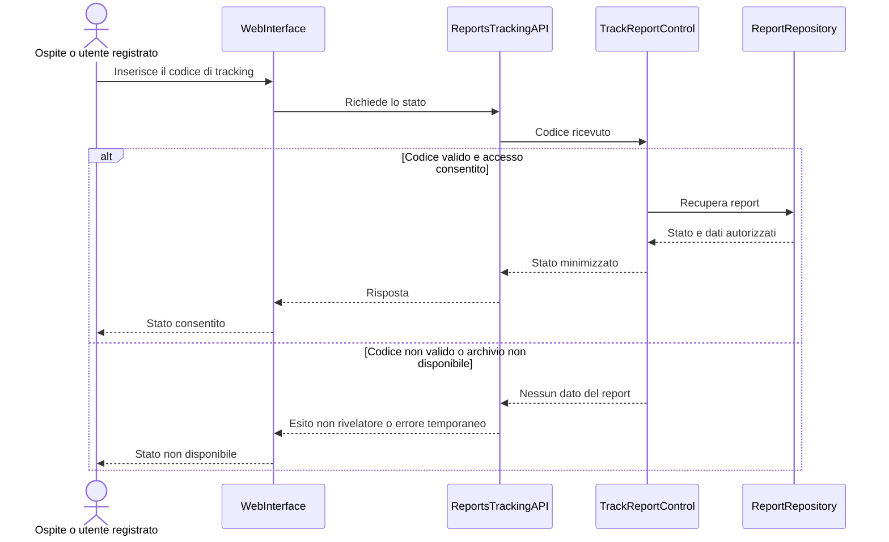
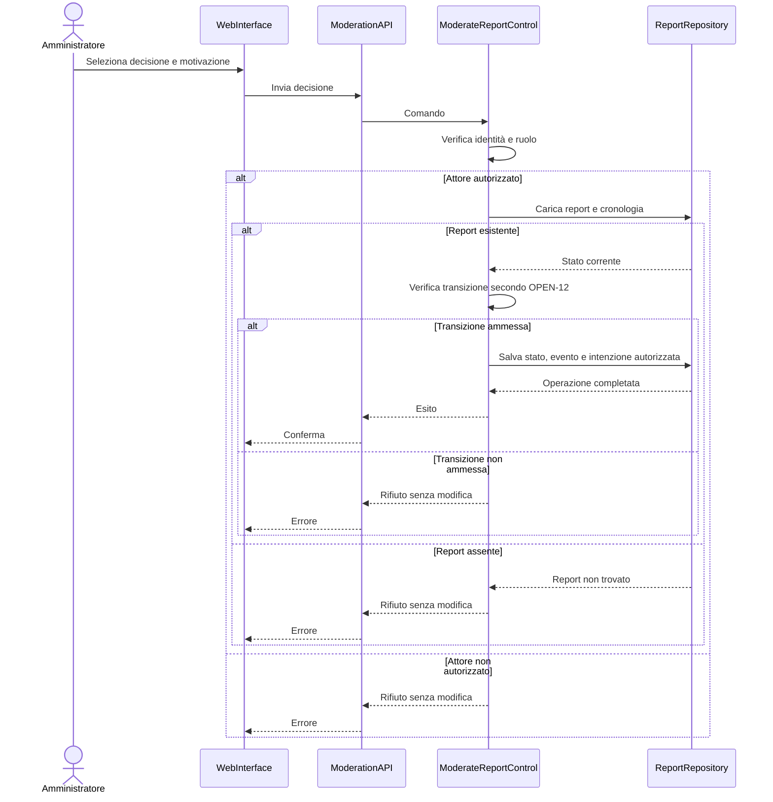
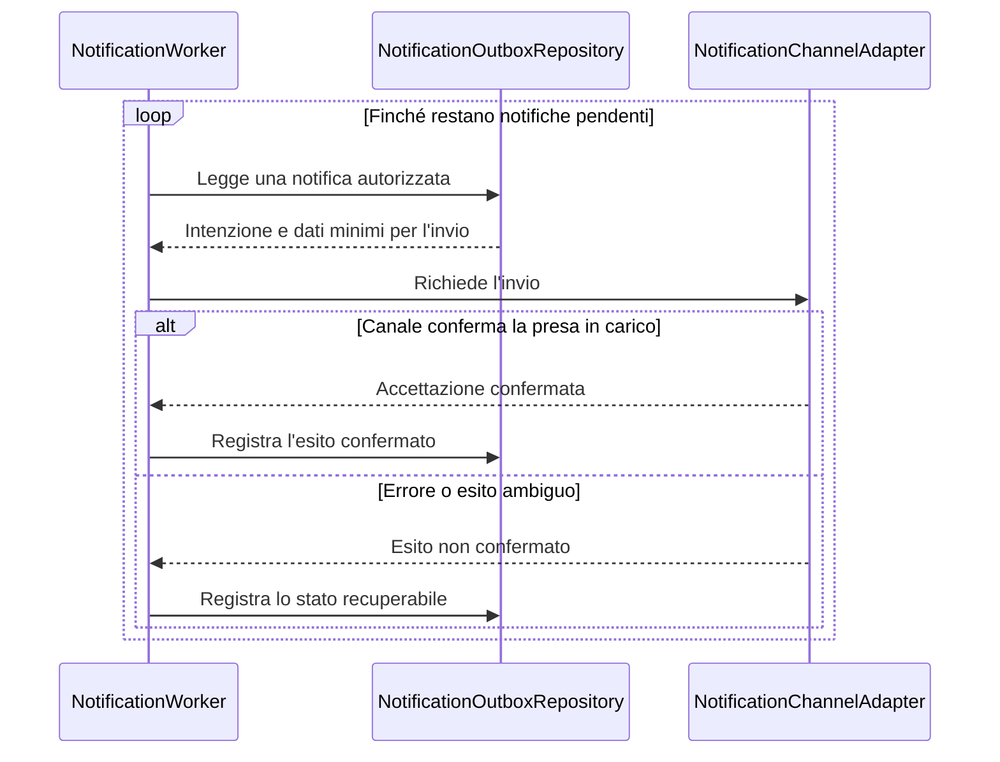
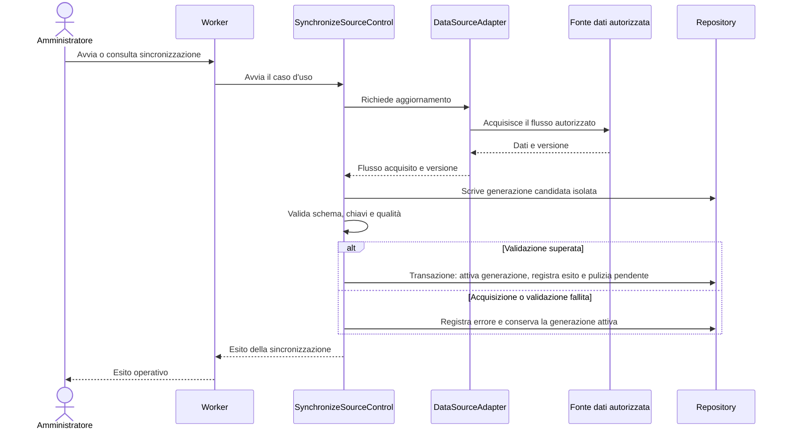
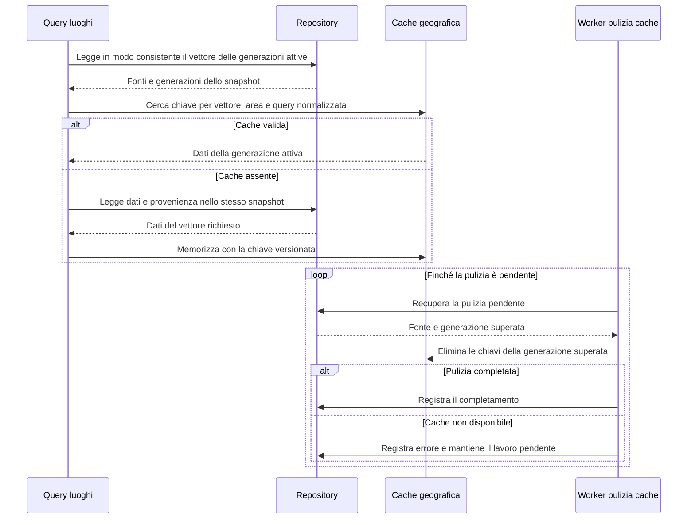

# RAD

## Documento di Analisi dei Requisiti

| Dato | Valore |
|---|---|
| Progetto | aegis |
| Corso | Da confermare in OPEN-13 |
| Docenti | Da confermare in OPEN-13 |
| Candidati | Da confermare in OPEN-13 |
| Anno accademico | Da confermare in OPEN-13 |

Bozza aggiornata il 17 novembre 2026. I requisiti sono da convalidare con persone con disabilità, enti di trasporto e responsabili delle fonti dati. Il prodotto non è ancora implementato. Decisioni e prove mancanti sono tracciate nella [roadmap](MILESTONES.md).

## SOMMARIO

| Sezione | Contenuto |
|---|---|
| [Introduzione](#introduzione) | [Scopo del sistema](#11-scopo-del-sistema), [area di dominio](#12-area-di-dominio) |
| [Sistema corrente](#sistema-corrente) | Contesto esistente |
| [Sistema proposto](#sistema-proposto) | [Panoramica](#31-panoramica), [requisiti funzionali](#32-requisiti-funzionali), [requisiti non funzionali](#33-requisiti-non-funzionali), [vincoli](#34-vincoli), [modelli di sistema](#35-modelli-di-sistema) |
| [Utenti del sistema](#351-utenti-del-sistema) | Ruoli e contesti |
| [Scenari](#352-scenari) | Flussi rappresentativi |
| [Modelli dei casi d’uso](#353-modelli-dei-casi-duso) | Diagramma globale e schede con condizioni d’ingresso e d’uscita |
| [Modello degli oggetti](#354-modello-degli-oggetti) | Entity, boundary e control |
| [Diagramma delle classi](#355-diagramma-delle-classi) | Struttura statica concettuale |
| [Diagrammi di sequenza](#356-diagrammi-di-sequenza) | Flussi principali del sistema |
| [Interfaccia utente](#interfaccia-utente) | [Prototipo](#41-descrizione-del-prototipo-realizzato), [test di usabilità](#42-test-di-usabilità), [valutazione ISO](#43-valutazione-dellusabilità-secondo-iso-9241-110) |
| [Obiettivi del test](#421-obiettivi-del-test) | Scopo della valutazione |
| [Metodologia usata](#422-metodologia-usata) | Partecipanti, compiti e misure |
| [Sintesi delle misure](#423-sintesi-delle-misure) | Risultati raccolti |
| [Analisi dei risultati](#424-analisi-dei-risultati) | Problemi osservati ed evidenze |
| [Sintesi delle interviste](#425-sintesi-delle-interviste) | Risultati qualitativi |
| [Raccomandazioni finali](#426-raccomandazioni-finali) | Interventi prioritizzati |
| [Dettaglio punteggi](#431-dettaglio-punteggi-assegnati) | Valutazione secondo ISO 9241-110 |
| [Profilo di valutazione visiva](#432-profilo-di-valutazione-visiva) | Rappresentazione dei punteggi raccolti |
| [Glossario](#glossario) | Termini e acronimi |

## INTRODUZIONE

### 1.1 SCOPO DEL SISTEMA

La web app aiuta le persone con disabilità a pianificare spostamenti urbani, consultare l’accessibilità di stazioni, fermate e mezzi e segnalare barriere o guasti. Il sistema mostra la fonte e la data di aggiornamento delle caratteristiche. Un dato assente o scaduto è sconosciuto e non viene interpretato come prova di accessibilità.

Gli obiettivi sono trovare e confrontare percorsi, consultare le caratteristiche dei luoghi, inviare e tracciare segnalazioni e permettere agli amministratori autorizzati di gestirle senza perdere la cronologia. Il successo sarà valutato con prove sul campo e sessioni con persone con disabilità. Area pilota e fonti sono da approvare in OPEN-01. Partecipanti e protocollo di usabilità seguono OPEN-06. Metriche operative e soglie seguono OPEN-07.

| Obiettivo | Criterio di verifica |
|---|---|
| Trovare e confrontare percorsi | Le alternative rendono visibili barriere note e tratti non verificati. |
| Consultare l’accessibilità | Ogni caratteristica mostra stato, fonte e freschezza disponibili. |
| Inviare e tracciare segnalazioni | L’invio restituisce un codice utilizzabile per consultare lo stato. |
| Moderare segnalazioni | Le decisioni sono gestibili senza perdere la cronologia. |
| Usare i flussi essenziali con tecnologie assistive | Le prove verificano tastiera e screen reader. |

### 1.2 AREA DI DOMINIO

Il dominio comprende pianificazione della mobilità urbana, dati geospaziali di trasporto pubblico, accessibilità di luoghi e infrastrutture e raccolta moderata di segnalazioni. Il pilota geografico, i servizi di trasporto coinvolti e le fonti disponibili devono ancora essere concordati.

## SISTEMA CORRENTE

Il progetto è greenfield. Non è stato fornito un sistema esistente da descrivere o migrare. Prima del pilota vanno censiti i servizi già usati da operatori e persone con disabilità, i dataset disponibili e i flussi correnti di segnalazione.

## SISTEMA PROPOSTO

### 3.1 PANORAMICA

La consultazione pubblica offre ricerca per area, dettagli di accessibilità e pianificazione di percorsi alternativi. Il sistema distingue caratteristiche verificate positive o negative da quelle sconosciute. Un dato scaduto è segnalato come tale e trattato come sconosciuto. Non dimostra accessibilità. Le segnalazioni seguono un ciclo moderato e mantengono uno storico append-only.

### 3.2 REQUISITI FUNZIONALI

Ogni requisito indica chi avvia o esegue l’azione, la priorità e i casi d’uso collegati. I criteri di accettazione derivano dai flussi UC.

| ID | Responsabile dell’azione | Azione richiesta | Priorità | Caso d’uso |
|---|---|---|---|---|
| FR-01 | Sistema | Mostrare luoghi e informazioni di accessibilità per l’area richiesta. | Must | UC-02 |
| FR-02 | Sistema | Mostrare caratteristiche quali ascensori, rampe, accessi e annunci con stato, fonte, aggiornamento e validità. | Must | UC-01, UC-02 |
| FR-03 | Sistema | Classificare come sconosciuti i dati assenti o scaduti, senza inferire accessibilità. | Must | UC-01, UC-02 |
| FR-04 | Ospite o utente registrato e sistema | Acquisire origine, destinazione ed esigenze. Calcolare e restituire percorsi alternativi. | Must | UC-01 |
| FR-05 | Sistema | Distinguere nei percorsi barriere note, tratti compatibili e tratti non verificati. | Must | UC-01 |
| FR-06 | Ospite o utente registrato e sistema | Consentire la selezione di un luogo e mostrare dettagli di accessibilità e provenienza. | Must | UC-02 |
| FR-07 | Ospite o utente registrato | Inserire luogo, categoria, descrizione e data. Allegare facoltativamente una foto. | Must | UC-03 |
| FR-08 | Sistema | Generare e restituire un codice di tracking per consultare lo stato della segnalazione. | Must | UC-03, UC-04 |
| FR-09 | Amministratore e sistema | Consentire conferma, rifiuto, risoluzione o unione di duplicati. Registrare ogni decisione. | Must | UC-05 |
| FR-10 | Sistema | Importare dati ufficiali e registrare versione, esito e timestamp della sincronizzazione. | Should | UC-06 |
| FR-11 | Sistema | Invalidare la cache dell’area interessata quando riceve un aggiornamento urgente. | Should | UC-06 |
| FR-12 | Sistema | Inviare notifiche secondo preferenze, autorizzazioni e consensi configurati. | Could | UC-03, UC-05 |
| FR-13 | Sistema | Autenticare gli utenti e verificare i ruoli per le operazioni riservate, mantenendo pubblica la consultazione. | Must | UC-03, UC-05, UC-06 |

#### CRITERI DI ACCETTAZIONE FR

I criteri descrivono risultati osservabili ricavati dai flussi dei casi d’uso collegati. Policy o valori ancora aperti restano esplicitamente da convalidare.

| ID | Criterio di accettazione |
|---|---|
| FR-01 | Per l’area pilota e le fonti approvate in OPEN-01 sono mostrati i luoghi pertinenti e i relativi dati di accessibilità disponibili. |
| FR-02 | Ogni caratteristica mostrata espone stato, fonte, aggiornamento e validità secondo le regole per fonte e tipo di dato da approvare in OPEN-02. |
| FR-03 | Dati assenti, scaduti o incoerenti secondo le regole OPEN-02 e i contratti OPEN-14 sono mostrati come sconosciuti e non sono usati per dichiarare compatibilità. |
| FR-04 | Una richiesta valida restituisce zero o più percorsi alternativi con tempi, cambi e stato di verifica secondo il contratto del provider e i profili approvati in OPEN-03. |
| FR-05 | Ogni tratto del percorso distingue barriere note, compatibilità nota e stato non verificato. Un risultato del provider non dimostra da solo l’accessibilità secondo OPEN-03. |
| FR-06 | La selezione di un luogo mostra dettaglio, caratteristiche note, fonte e validità secondo OPEN-02. Dati assenti o scaduti risultano sconosciuti. |
| FR-07 | L’invio valido persiste segnalazione ed evento iniziale. Prima di effetti esterni il sistema registra una prenotazione durevole e univoca della richiesta. Un errore non lascia una segnalazione parziale. Ripetere la stessa richiesta con la stessa chiave di idempotenza non crea report, eventi, allegati o notifiche duplicati. Riutilizzare la chiave con un payload diverso è rifiutato senza nuovi effetti. La foto facoltativa resta privata finché non supera i controlli OPEN-15 ed è collegata alla segnalazione. Consenso e ciclo di vita seguono OPEN-05. Un errore tra storage e database lascia l’upload recuperabile o eliminabile secondo OPEN-08 e OPEN-15. Ambito, durata e replay sicuro dell’esito seguono OPEN-04, OPEN-05 e OPEN-08. |
| FR-08 | La creazione riuscita restituisce un codice di tracking. La consultazione mostra solo lo stato consentito dalla policy di accesso da approvare in OPEN-04. |
| FR-09 | Solo una transizione presente nella matrice approvata in OPEN-12 aggiorna stato ed evento nella stessa transazione. Una transizione non ammessa non modifica i dati. Ruoli e attribuzione dell’attore seguono OPEN-04 e OPEN-05. |
| FR-10 | Solo una generazione completa e validata secondo il contratto della fonte OPEN-14 viene pubblicata. Versione, timestamp, controlli ed esito sono registrati. Un errore mantiene i dati validi precedenti. Fonti e responsabili devono essere approvati in OPEN-01. |
| FR-11 | Dopo la pubblicazione di un aggiornamento definito urgente secondo OPEN-02 viene invalidata la cache dell’area interessata. Il lavoro resta recuperabile secondo OPEN-08 in caso di interruzione. |
| FR-12 | L’intenzione di notifica è registrata solo quando preferenze, autorizzazioni e consensi configurati in OPEN-04 e OPEN-05 la consentono. La consegna avviene in modo asincrono. Un errore del canale non annulla il caso d’uso già completato e resta osservabile e recuperabile secondo OPEN-08. Un esito ambiguo non è presentato come consegna confermata. Retry e gestione dei possibili duplicati seguono la policy da approvare in OPEN-08. |
| FR-13 | La consultazione pubblica non richiede autenticazione. Identità, ruoli, invio e accesso al tracking seguono OPEN-04. Le operazioni riservate sono rifiutate lato server quando identità o ruolo non sono autorizzati. |

### 3.3 REQUISITI NON FUNZIONALI

| ID | Qualità | Azione richiesta | Criterio di verifica | Responsabile dell’accettazione |
|---|---|---|---|---|
| NFR-01 | Accessibilità | Consentire di completare i flussi essenziali da tastiera e con screen reader. | Dopo l’approvazione del target e del protocollo OPEN-06, verificare compiti approvati, navigazione, focus, etichette e annunci con tastiera e tecnologie assistive. | Referente accessibilità, da designare |
| NFR-02 | Accessibilità | Fornire una vista testuale equivalente alle informazioni presentate sulla mappa. | Dopo l’approvazione dei compiti OPEN-06, confrontare per le stesse richieste luoghi, percorsi e stati disponibili nella mappa e nella vista testuale. | Referente accessibilità, da designare |
| NFR-03 | Accessibilità | Verificare contrasto e fruibilità con zoom. | Verificare i criteri dello standard e del livello da approvare in OPEN-06. Rivedere la proposta [ADR-0010](adr/ADR-0010-accessibility-evaluation-baseline.md). Finché OPEN-06 resta aperto il requisito non è valutabile. | Referente accessibilità, da designare |
| NFR-04 | Privacy | Minimizzare i dati personali, incluse richieste di percorso e preferenze di accessibilità, e separare identità e segnalazioni pubbliche. | Prima del lancio approvare finalità, basi giuridiche, accessi, trasferimenti ai provider, conservazione e cancellazione secondo OPEN-05. Verificare che richieste, coordinate e preferenze non siano persistite o registrate oltre la policy approvata. Documentare la classificazione dei campi e le valutazioni privacy applicabili. | Responsabile privacy, da designare |
| NFR-05 | Sicurezza | Proteggere le comunicazioni con TLS e le funzioni riservate con ruoli. | Verificare TLS sugli endpoint esposti secondo la configurazione per ambiente OPEN-08 e rifiuto lato server delle operazioni riservate per ruoli non autorizzati secondo OPEN-04. | Responsabile sicurezza, da designare |
| NFR-06 | Sicurezza | Applicare rate limiting, validazione server-side e protezione da injection agli endpoint. | Provare input malformati e injection. Verificare il rifiuto senza effetti parziali e il comportamento del rate limiting rispetto alle regole da approvare in OPEN-15. | Responsabile sicurezza, da designare |
| NFR-07 | Sicurezza | Controllare gli upload per tipo, dimensione e contenuto prima dell’uso o pubblicazione. | Provare file ammessi, non validi, con scansione fallita o indisponibile. In caso di errore database dopo la scansione, verificare che l’oggetto resti privato e sia recuperato o eliminato secondo OPEN-05, OPEN-08 e OPEN-15. | Responsabile sicurezza, da designare |
| NFR-08 | Affidabilità dati | Esporre provenienza e freschezza e applicare scadenze per fonte e tipo di dato. | Applicare i contratti di fonte OPEN-01 e OPEN-14 e le regole di validità OPEN-02. Testare dati assenti, scaduti e incoerenti e confermare che risultino sconosciuti. Con pubblicazioni concorrenti, verificare che ogni risposta e chiave cache usino un vettore coerente delle generazioni attive. | Responsabile dati, da designare |
| NFR-09 | Operatività | Produrre log strutturati senza dati sensibili e metriche operative. | In ambiente concordato secondo OPEN-07 e OPEN-08 verificare log e metriche di disponibilità, latenza, sincronizzazioni, coda di moderazione e stato delle notifiche pendenti. Controllare che log e allarmi non espongano dati sensibili secondo OPEN-05. | Responsabile operativo, da designare |
| NFR-10 | Continuità | Configurare allarmi e backup automatici e svolgere prove di ripristino. | Eseguire e registrare una prova di ripristino secondo OPEN-07 e OPEN-08. Verificare integrità, riferimenti tra dati e oggetti, intenti di upload pendenti e ripresa dei lavori asincroni, inclusi gli esiti di notifica ambigui. Approvare gli obiettivi prima del lancio e applicare la conservazione OPEN-05. | Responsabile operativo, da designare |
| NFR-11 | Performance | Misurare e mantenere entro soglie concordate la latenza API e il caricamento delle viste principali. | Misurare p95 in staging con concorrenza e dataset approvati in OPEN-07. Il requisito non è valutabile finché target e carico non sono concordati. | Responsabile operativo, da designare |
| NFR-12 | Compatibilità | Versionare le API e applicare migrazioni compatibili con le versioni applicative in distribuzione. | Verificare in prova di rilascio secondo la baseline e gli ambienti OPEN-08 che le versioni applicative attive durante la migrazione possano completare le operazioni previste. | Responsabile tecnico, da designare |
| NFR-13 | Usabilità | Rendere i flussi principali comprensibili e coerenti, con feedback sul completamento delle operazioni. | Svolgere sessioni con compiti e criteri approvati in OPEN-06, registrare misure e problemi osservati e riportare gli esiti nel RAD. | Responsabile di prodotto, da designare |
| NFR-14 | Scalabilità | Dimensionare API, database, worker e indici spaziali in base alla crescita di utenti, luoghi e richieste. | Eseguire prove di carico con dataset e profilo concordati in OPEN-07. Confrontare i risultati con gli obiettivi approvati prima del pilota. | Responsabile operativo, da designare |
| NFR-15 | Manutenibilità | Mantenere separati dominio, casi d’uso e adattatori e documentare le interfacce e le procedure operative. | Effettuare revisione architetturale e verificare build ripetibile, test e documentazione delle interfacce e procedure. | Responsabile tecnico, da designare |
| NFR-16 | Portabilità | Distribuire API e worker in container e mantenere la configurazione specifica dell’ambiente esterna al codice. | Avviare la stessa versione degli artefatti negli ambienti approvati secondo OPEN-08 e verificare le funzioni essenziali con test smoke e configurazioni distinte. | Responsabile tecnico, da designare |

### 3.4 VINCOLI

| Vincolo | Specifica e stato |
|---|---|
| Piattaforma applicativa | Usare Java LTS e Jakarta EE per API e worker. Usare Jakarta Faces e Facelets per le viste server-side. Versioni e runtime sono da convalidare secondo OPEN-08. |
| Persistenza e file | Usare PostgreSQL con PostGIS, migrazioni versionate e storage compatibile S3 per le immagini. |
| Struttura software | Separare frontend, casi d’uso, dominio e adattatori. Documentare API versionate con OpenAPI. |
| Accesso | La consultazione è pubblica. Autenticazione e ruoli per invio e moderazione sono da definire secondo OPEN-04 e OPEN-12. |
| Dati di accessibilità | Ogni proprietà registra provenienza e validità. Dato assente o scaduto è sconosciuto. |
| Dati personali e immagini | Applicare consenso, accesso controllato, conservazione limitata e cancellazione secondo le policy da approvare in OPEN-05. |

### 3.5 MODELLI DI SISTEMA

#### 3.5.1 UTENTI DEL SISTEMA

| Utente | Obiettivi | Contesto |
|---|---|---|
| Utente registrato | Consultare luoghi, pianificare percorsi, inviare segnalazioni e seguirne lo stato. | Usa l’applicazione autenticato. Permessi, invio e accesso al tracking seguono OPEN-04. |
| Ospite | Consultare luoghi, pianificare percorsi e, se consentito, inviare o seguire una segnalazione. | Usa la consultazione pubblica senza account. Invio anonimo e accesso al tracking seguono OPEN-04. |
| Amministratore | Moderare segnalazioni e gestire gli aggiornamenti delle fonti assegnate. | Utente autenticato con permessi espliciti per ciascuna funzione riservata secondo OPEN-01, OPEN-04 e OPEN-14. |

#### 3.5.2 SCENARI

| Scenario | Obiettivo | Attori partecipanti | Flusso sintetico |
|---|---|---|---|
| Pianificazione di un percorso | Consentire di confrontare percorsi secondo i vincoli indicati senza presentare dati incerti come verificati. | Ospite, utente registrato, sistema, provider di routing | La persona inserisce origine, destinazione e vincoli e riceve alternative con il relativo stato di verifica. |
| Consultazione di un luogo | Mostrare caratteristiche e provenienza disponibili per il luogo selezionato. | Ospite, utente registrato, sistema | La persona seleziona un luogo e consulta caratteristiche, fonte e validità dei dati. |
| Invio di una segnalazione | Consentire di comunicare una barriera o un guasto e ricevere un riferimento per seguirne lo stato. | Ospite, utente registrato, sistema, servizio di storage e scansione, canale di notifica | La persona invia i dati della segnalazione e un eventuale allegato, quindi riceve il codice di tracking. |
| Tracking di una segnalazione | Consentire di consultare lo stato accessibile della segnalazione senza esporre dati riservati. | Ospite, utente registrato, sistema | La persona presenta il codice di tracking e riceve solo le informazioni consentite. |
| Moderazione di una segnalazione | Consentire la valutazione autorizzata e tracciabile di una segnalazione. | Amministratore, sistema, canale di notifica | L’amministratore valuta la segnalazione e registra la decisione ammessa dalla policy. |
| Aggiornamento di una fonte | Mantenere disponibili dati di fonte completi e validati. | Amministratore, sistema, fonte dati autorizzata | L’amministratore avvia o controlla la sincronizzazione e consulta l’esito dei controlli. |

#### 3.5.3 MODELLI DEI CASI D’USO

##### Diagramma globale

Il confine di sistema separa i casi d’uso di `aegis` dagli attori e dai servizi esterni.

##### Specifiche dei casi d’uso

Ogni caso d’uso specifica attori, condizioni d’ingresso e d’uscita, requisiti qualitativi, flusso principale e alternative o errori pertinenti.

###### UC-01: Pianificare viaggio

| Campo | Specifica |
|---|---|
| Attori partecipanti | Ospite, utente registrato, sistema, provider di routing. |
| Condizioni d’ingresso | Origine, destinazione ed esigenze specificate e valide. La consultazione non richiede autenticazione. |
| Condizioni d’uscita | Restituiti zero o più percorsi con tempi, cambi e stato di verifica. Fonte e freschezza sono esposte quando disponibili. Dati assenti o scaduti non risultano accessibili. |
| Requisiti qualitativi | Il sistema distingue barriere note, tratti compatibili e tratti non verificati e presenta alternative disponibili. |
| Flusso degli eventi | L’ospite o l’utente registrato inserisce origine, destinazione ed esigenze. Il sistema valida la richiesta e la inoltra al provider. Il provider restituisce le alternative. Il sistema aggiunge stato di verifica e provenienza disponibili e mostra risultati e incertezze. |
| Flussi alternativi e di errore | Input non valido: il sistema segnala i campi da correggere e non invoca il provider. Nessun percorso disponibile: il sistema mostra l’esito vuoto senza dichiarare compatibilità. Provider non disponibile, timeout, risposta parziale o profilo non supportato: il sistema comunica il limite e non presenta risultati incompleti come verificati. Un fallback è ammesso solo secondo OPEN-03 e viene marcato non verificato. |

###### UC-02: Consultare luogo

| Campo | Specifica |
|---|---|
| Attori partecipanti | Ospite, utente registrato, sistema. |
| Condizioni d’ingresso | Luogo identificabile tramite ID o selezione geografica. Parametri validi. |
| Condizioni d’uscita | Dettaglio e caratteristiche note sono mostrati con fonte e validità. Dati assenti o scaduti sono indicati come sconosciuti. Nessuna modifica ai dati. |
| Requisiti qualitativi | Le informazioni presentate sulla mappa sono disponibili anche in forma testuale e risultano utilizzabili da tastiera e tecnologie assistive. |
| Flusso degli eventi | L’ospite o l’utente registrato seleziona o cerca un luogo. Il sistema recupera dettaglio e caratteristiche, valuta la freschezza secondo la validità della fonte e mostra caratteristiche, fonte, aggiornamento e stati sconosciuti. |
| Flussi alternativi e di errore | Identificativo non valido o luogo non trovato: il sistema non mostra un dettaglio inesistente. Caratteristiche assenti, scadute o contraddittorie: il sistema le presenta come sconosciute e non inferisce accessibilità. Repository non disponibile: il sistema comunica l’errore senza presentare dati scaduti come aggiornati. |

###### UC-03: Inviare segnalazione

| Campo | Specifica |
|---|---|
| Attori partecipanti | Ospite, utente registrato, sistema, servizio di storage e scansione, canale di notifica. |
| Condizioni d’ingresso | Campi obbligatori validi. Autorizzazione, rate limit, consenso e requisiti dell’eventuale upload conformi alla policy definita. |
| Condizioni d’uscita | Segnalazione ed evento iniziale persistiti. Codice di tracking restituito. In caso di errore non rimane una segnalazione parziale. Se una notifica prevista fallisce, il fallimento non annulla la segnalazione e resta osservabile e recuperabile secondo la policy da definire in OPEN-08. |
| Requisiti qualitativi | Il modulo è accessibile. I dati identificativi sono minimizzati e separati dalla segnalazione. La foto non è pubblicata prima dei controlli previsti. |
| Flusso degli eventi | L’ospite o l’utente registrato prepara luogo, categoria, descrizione e data e invia la richiesta con una chiave di idempotenza. Facoltativamente allega una foto e il relativo digest. Il sistema valida i campi e l’autorizzazione, quindi prenota chiave e impronta in `ReportSubmission` prima di qualsiasi effetto esterno. Un vincolo univoco coordina richieste concorrenti. Il sistema controlla l’eventuale upload in area privata. Registra segnalazione, evento iniziale, completamento della prenotazione e intenzione autorizzata di notifica nella stessa transazione e restituisce il codice di tracking. Dopo il commit pianifica l’eventuale notifica secondo consenso e policy. Se il canale fallisce, registra l’esito per il recupero previsto in OPEN-08. |
| Flussi alternativi e di errore | Input non valido, autorizzazione negata o limite superato: il sistema rifiuta la richiesta senza persistenza parziale secondo OPEN-04 e OPEN-15. Prima di scrivere un allegato o invocare altri sistemi esterni, il sistema prenota la chiave e l’impronta in un registro durevole con vincolo di unicità nello scope approvato. File non valido, scansione fallita o scanner indisponibile: il file resta privato e viene rifiutato, messo in quarantena o eliminato secondo OPEN-15 e OPEN-05. Scrittura interrotta in object storage o errore database dopo la scansione: report ed evento non restano parziali e l’upload non diventa pubblico. L’intento durevole consente retry o pulizia idempotente secondo OPEN-08 e OPEN-15. Commit riuscito ma risposta persa: un retry con la stessa chiave e lo stesso payload recupera l’operazione esistente senza ripetere gli effetti. La stessa chiave con payload diverso è rifiutata. Un’operazione ancora in corso non viene avviata in parallelo. Ambito della chiave, durata, risposta ripetibile e autorizzazione seguono OPEN-04, OPEN-05 e OPEN-08. Notifica fallita o con esito ambiguo: la segnalazione resta registrata, l’esito non è presentato come consegna confermata e il recupero segue OPEN-08. |

###### UC-04: Seguire segnalazione

| Campo | Specifica |
|---|---|
| Attori partecipanti | Ospite, utente registrato, sistema. |
| Condizioni d’ingresso | Codice di tracking valido fornito dal richiedente. Modalità di accesso da definire secondo OPEN-04. |
| Condizioni d’uscita | È mostrato solo lo stato consentito dalla policy di accesso approvata. Identità e dettagli riservati non sono esposti. Nessuna modifica al report. |
| Requisiti qualitativi | La risposta non consente l’enumerazione delle segnalazioni e comunica lo stato in forma accessibile. |
| Flusso degli eventi | L’ospite o l’utente registrato inserisce il codice. Il sistema lo verifica, recupera lo stato consentito e lo mostra senza esporre dati riservati. |
| Flussi alternativi e di errore | Codice non valido, scaduto o non riconosciuto: il sistema non restituisce dati della segnalazione e la risposta non rivela se il report esiste, secondo la policy OPEN-04. Archivio non disponibile: il sistema comunica un errore temporaneo e non restituisce dati non verificati. |

###### UC-05: Moderare segnalazione

| Campo | Specifica |
|---|---|
| Attori partecipanti | Amministratore, sistema, canale di notifica. |
| Condizioni d’ingresso | Amministratore autenticato e autorizzato alla moderazione secondo OPEN-04. Report esistente. La matrice di transizione di OPEN-12 è approvata e consente l’azione richiesta. La proposta [ADR-0011](adr/ADR-0011-report-moderation-state-machine.md) elenca le dimensioni da decidere. Motivazione presente quando richiesta dalla matrice. |
| Condizioni d’uscita | Stato ed evento append-only aggiornati nella stessa transazione, con attore e timestamp. Una transizione non valida non modifica i dati. Se una notifica prevista fallisce, il fallimento non annulla la transizione registrata e resta osservabile e recuperabile secondo la policy da definire in OPEN-08. |
| Requisiti qualitativi | Ogni decisione è tracciabile. Gli eventi precedenti restano consultabili e non sono sovrascritti. |
| Flusso degli eventi | L’amministratore apre il report. Il sistema mostra i dati e la cronologia autorizzati. L’amministratore sceglie conferma, rifiuto, risoluzione o unione e inserisce la motivazione richiesta. Il sistema valida la transizione e registra stato ed evento nella stessa transazione. Dopo il completamento del caso, pianifica l’eventuale notifica secondo consenso e policy. Se il canale fallisce, registra l’esito per il recupero previsto in OPEN-08. |
| Flussi alternativi e di errore | Attore non autorizzato, report inesistente o transizione non ammessa: il sistema rifiuta il comando senza modificare stato o cronologia. Errore durante la persistenza: transizione ed evento sono annullati insieme. Notifica fallita o con esito ambiguo: la moderazione resta registrata e il recupero segue OPEN-08 senza dichiarare la consegna. |

###### UC-06: Aggiornare una fonte

| Campo | Specifica |
|---|---|
| Attori partecipanti | Amministratore, sistema e fonte dati autorizzata. |
| Condizioni d’ingresso | Fonte configurata e abilitata. Amministratore autenticato e autorizzato quando l’avvio è manuale. Esecuzione schedulata ammessa dalla configurazione. |
| Condizioni d’uscita | Versione, timestamp, controlli ed esito della sincronizzazione registrati. Solo un insieme completo e validato diventa visibile. Un aggiornamento urgente invalida la cache dell’area interessata dopo la pubblicazione. Un errore mantiene disponibili i dati validi precedenti e non pubblica dati parziali. |
| Requisiti qualitativi | Retry idempotenti. Provenienza e freschezza conservate. Dati assenti, incoerenti o scaduti non sono presentati come accessibili. |
| Flusso degli eventi | L’amministratore avvia o consulta il processo, oppure scatta la pianificazione. Il sistema invoca l’adattatore. L’adattatore acquisisce i dati in un insieme candidato non visibile agli utenti. Il sistema valida contratto, chiavi e qualità, quindi registra versione, timestamp, controlli ed esito. Se i controlli passano, pubblica l’insieme candidato con un passaggio atomico e invalida la cache interessata dopo la pubblicazione. Se l’acquisizione o la validazione falliscono, mantiene attivi i dati precedenti e registra l’esito senza pubblicare dati parziali. |
| Flussi alternativi e di errore | Avvio manuale non autorizzato: il sistema rifiuta il comando. Fonte non disponibile, contratto non valido, duplicato o aggiornamento fuori ordine: la generazione candidata non viene pubblicata, la generazione attiva resta disponibile e l’esito è registrato secondo OPEN-14. Errore di pulizia cache dopo il commit: il lavoro resta pendente e recuperabile secondo OPEN-08. |

#### 3.5.4 MODELLO DEGLI OGGETTI

##### Oggetti entity principali

Il catalogo include le entità di dominio centrali e collega ciascuna ai casi d’uso che la legge o modifica. `ReportSubmission`, `ReportAttachment` e `NotificationIntent` sono record tecnici durevoli descritti nel modello relazionale e nei flussi di creazione e moderazione delle segnalazioni. Non sono ripetuti qui come entità di dominio. Enumerazioni e `GeoPoint` sono tipi di supporto del diagramma.

| Oggetto | Responsabilità | Casi d’uso |
|---|---|---|
| `Place` | Rappresenta un luogo d’interesse consultabile, distinto dalle fermate e dalle stazioni del trasporto pubblico. | UC-01, UC-02, UC-06 |
| `AccessibilityFeature` | Rappresenta una caratteristica di accessibilità associata a un luogo, con fonte e validità. | UC-01, UC-02, UC-06 |
| `Report` | Rappresenta una segnalazione con posizione, categoria, stato e date. | UC-03, UC-04, UC-05 |
| `ReportEvent` | Registra in modo append-only autore, data e decisione relativa a una segnalazione. | UC-03, UC-05 |
| `UserAccount` | Rappresenta l’identità e i ruoli di un utente autenticato. | UC-03, UC-05, UC-06 |
| `DataSource` | Rappresenta una fonte autorizzata e la relativa configurazione. | UC-06 |
| `SourceSync` | Registra versione, esito, timestamp e controlli di qualità di una sincronizzazione. | UC-06 |
| `TransitLine` | Rappresenta una linea importata da una fonte autorizzata. | UC-01, UC-06 |
| `TransitStop` | Rappresenta una fermata con geometria e riferimenti alle linee servite. | UC-01, UC-02, UC-06 |

##### Oggetti boundary dei casi d’uso

I nomi dei boundary sono in inglese e in CamelCase. I servizi esterni sono dipendenze previste, non provider già selezionati.

| Oggetto boundary | Responsabilità |
|---|---|
| `WebInterface` | Presenta mappa, viste testuali, percorsi, moduli di segnalazione e pannello di moderazione agli attori umani. |
| `PlacesAccessibilityAPI` | Riceve richieste di ricerca e dettaglio sui luoghi e restituisce dati con fonte e freschezza. |
| `RoutesAPI` | Riceve origine, destinazione e soli vincoli necessari al calcolo e restituisce alternative con incertezza esplicita, escludendo identificativi dell’account e codici di tracking. |
| `ReportsTrackingAPI` | Riceve nuove segnalazioni e richieste di tracking, restituendo conferma o stato consentito. |
| `ModerationAPI` | Espone la coda e le operazioni di moderazione protette da autorizzazione. |
| `UploadGateway` | Valida la richiesta di upload e inoltra l’immagine al flusso controllato di archiviazione e scansione. |
| `StorageScanAdapter` | Comunica con i sistemi di object storage e scansione da selezionare e mantiene privati gli oggetti fino all’esito previsto. |
| `RoutingProviderAdapter` | Inoltra i parametri necessari al provider esterno di routing e acquisisce gli itinerari calcolati. |
| `NotificationChannelAdapter` | Inoltra le notifiche autorizzate al canale esterno da selezionare e registra l’esito disponibile. |
| `DataSourceAdapter` | Acquisisce i flussi dati autorizzati per aggiornare linee, fermate e caratteristiche di accessibilità. |

##### Oggetti control dei casi d’uso

Il suffisso `Control` identifica gli oggetti che coordinano il flusso del caso d’uso.

| Oggetto | Responsabilità |
|---|---|
| `PlanRouteControl` | Coordina validazione della richiesta, provider e classificazione dell’incertezza. |
| `GetPlaceAccessibilityControl` | Recupera le caratteristiche e applica le regole di freschezza. |
| `CreateReportControl` | Applica le regole di creazione e persiste report ed evento iniziale. |
| `TrackReportControl` | Recupera e limita le informazioni restituite tramite codice di tracking. |
| `ModerateReportControl` | Valida transizioni e persiste stato ed evento append-only in modo atomico. |
| `SynchronizeSourceControl` | Coordina importazione, controlli di qualità e registrazione dell’esito. |

#### 3.5.5 DIAGRAMMA DELLE CLASSI

Il diagramma mostra le entità di dominio principali e le loro associazioni. Record tecnici di prenotazione, upload e outbox restano descritti nel modello relazionale del SDD.

#### 3.5.6 DIAGRAMMI DI SEQUENZA

I diagrammi descrivono gli scambi tra attori, boundary, casi d’uso e porte esterne per i flussi principali.

##### Pianificazione di un viaggio

Il diagramma descrive la richiesta di alternative, l’integrazione del provider e la presentazione dell’incertezza.

##### Consultazione di un luogo

Il diagramma descrive il recupero dei dati di accessibilità e la valutazione della loro freschezza.

##### Invio di una segnalazione

Il diagramma mostra la prenotazione univoca della richiesta prima degli effetti esterni, l’intento durevole dell’upload, la scansione privata e la transazione che collega allegato, segnalazione, evento e notifica. Object storage e database non condividono una transazione atomica.

Le transizioni ammesse di moderazione e gli stati completi del report sono da approvare in OPEN-12 secondo la proposta [ADR-0011](adr/ADR-0011-report-moderation-state-machine.md).

##### Tracking di una segnalazione

Il diagramma descrive la consultazione dello stato tramite codice senza esporre dati riservati.

##### Moderazione di una segnalazione

Il diagramma descrive la verifica della transizione e la registrazione atomica dello stato e dell’evento.

##### Consegna asincrona di una notifica

UC-03 e UC-05 registrano l’intenzione autorizzata nella transazione applicativa. Il diagramma mostra l’elaborazione successiva senza promettere consegna esattamente una volta.

##### Sincronizzazione di una fonte

I diagrammi separano acquisizione e pubblicazione dalla lettura e pulizia cache. La query usa solo la generazione attiva letta dal repository autorevole. Il lavoro di pulizia è registrato con la pubblicazione e un fallimento non rende selezionabili le chiavi della generazione precedente.

## INTERFACCIA UTENTE

Le viste iniziali sono: ricerca e preferenze di viaggio. Risultati e alternative. Mappa affiancata da elenco. Dettaglio luogo. Form segnalazione. Pagina tracking. Coda e dettaglio moderazione. Ogni informazione cartografica deve avere alternativa testuale e le interazioni devono supportare tastiera e screen reader. Wireframe e prototipo sono da realizzare e validare.

### 4.1 DESCRIZIONE DEL PROTOTIPO REALIZZATO

**Stato:** non ancora realizzato. Da documentare al completamento. Scopo, fedeltà, completezza e durata saranno descritti sulla base del prototipo effettivamente prodotto nell’ambito di OPEN-06.

| Aspetto | Da specificare |
|---|---|
| Scopo/ruolo/interfaccia/implementazione | Da definire |
| Modo d’uso | Statico, dinamico o interattivo: da definire |
| Fedeltà | Bassa o alta: da definire |
| Completezza funzionale | Orizzontale o verticale: da definire |
| Durata | Usa e getta o evolutivo: da definire |

### 4.2 TEST DI USABILITÀ

**Stato:** pianificato, non eseguito.

#### 4.2.1 OBIETTIVI DEL TEST

Valutare se le persone riescono a pianificare un viaggio, interpretare freschezza e incertezza, consultare un luogo, inviare e seguire una segnalazione e completare i flussi con tastiera e screen reader. Obiettivi e criteri specifici sono da convalidare con i partecipanti.

#### 4.2.2 METODOLOGIA USATA

Il test non è ancora stato condotto. Numero, esperienza e caratteristiche dei partecipanti, compiti, scenari, ambiente, strumenti, modalità e durata delle sessioni per partecipante e nel complesso sono da definire con persone con disabilità secondo OPEN-06. Prima delle sessioni vanno concordati consenso, misure raccolte, ruolo degli osservatori e metodo di analisi. Questi campi descrivono un protocollo da completare, non risultati disponibili.

| Elemento metodologico | Definizione |
|---|---|
| Partecipanti ed esperienza | Da definire con persone con disabilità e in base ai profili d’uso del pilota. |
| Compiti e scenari | Pianificare un viaggio, consultare un luogo, inviare e seguire una segnalazione e usare i flussi con tecnologie assistive. Da convalidare prima delle sessioni. |
| Contesto e strumenti | Da definire. Registrare dispositivo, browser, tecnologie assistive e condizioni di rete usati. |
| Modalità e durata | Sessioni individuali o altra modalità da definire. Durata per partecipante e complessiva da registrare. |
| Misure | Tempi, completamento, errori, richieste di aiuto, comprensione di freschezza e incertezza e riscontri qualitativi. |
| Osservatori e analisi | Ruoli, metodo di registrazione, trattamento delle evidenze e metodo di analisi da definire prima dei test. |

#### 4.2.3 SINTESI DELLE MISURE

Risultati non disponibili perché il test non è stato eseguito. Le misure saranno raccolte per partecipante e compito, quindi aggregate per compito con unità e denominatori espliciti.

| Partecipante pseudonimizzato | Compito | Tempo di esecuzione | Completamento | Errori e note |
|---|---|---|---|---|
| Da raccogliere | Pianificare un viaggio | Da misurare | Da misurare | Da raccogliere |
| Da raccogliere | Consultare un luogo | Da misurare | Da misurare | Da raccogliere |
| Da raccogliere | Inviare e seguire una segnalazione | Da misurare | Da misurare | Da raccogliere |
| Da raccogliere | Completare i flussi con tecnologie assistive | Da misurare | Da misurare | Da raccogliere |

| Compito | Tempo medio o statistica concordata | Successo o misura aggregata | Errori e note aggregate |
|---|---|---|---|
| Pianificare un viaggio | Da calcolare | Da calcolare | Da raccogliere |
| Consultare un luogo | Da calcolare | Da calcolare | Da raccogliere |
| Inviare e seguire una segnalazione | Da calcolare | Da calcolare | Da raccogliere |
| Completare i flussi con tecnologie assistive | Da calcolare | Da calcolare | Da raccogliere |

Unità e modalità di aggregazione sono da concordare prima del test secondo OPEN-06. Le soglie, se necessarie, devono essere motivate e approvate prima della raccolta. Nessun risultato o valore di soglia è attualmente disponibile.

#### 4.2.4 ANALISI DEI RISULTATI

Analisi non disponibile perché il test non è stato eseguito. La tabella seguente raccoglie i campi da compilare per ogni partecipante e compito dopo l’approvazione del protocollo OPEN-06. Non contiene osservazioni raccolte.

| Partecipante e compito | Problema osservato | Evidenza o screenshot | Gravità | Reazione o commento | Intervento necessario |
|---|---|---|---|---|---|
| Da rilevare durante il test | Da rilevare | Da raccogliere nel rispetto del consenso | Scala da definire | Da raccogliere | Da determinare dall’analisi |

#### 4.2.5 SINTESI DELLE INTERVISTE

Le interviste successive al test non sono state svolte. Modalità e domande saranno concordate nel protocollo OPEN-06. Le evidenze saranno sintetizzate dopo la raccolta, distinguendo osservazioni e interpretazioni.

#### 4.2.6 RACCOMANDAZIONI FINALI

Raccomandazioni non disponibili prima delle prove. Dopo le sessioni OPEN-06 saranno ordinate per priorità e collegate ai problemi osservati.

| Problema collegato | Intervento migliorativo | Priorità | Stato |
|---|---|---|---|
| Da determinare dopo l’analisi | Da definire sulla base delle evidenze | Da assegnare | Non valutato |

### 4.3 VALUTAZIONE DELL’USABILITÀ SECONDO ISO 9241-110

La valutazione potrà essere condotta sul prototipo usando come riferimento [ISO 9241-110:2020](https://www.iso.org/standard/75258.html), indicata da ISO come edizione corrente e confermata nel 2025. ISO 9241-110 tratta la valutazione dell’usabilità e non sostituisce un target per l’accessibilità web. La proposta di baseline WCAG è descritta in [ADR-0010](adr/ADR-0010-accessibility-evaluation-baseline.md). L’adozione degli standard, il protocollo, i partecipanti, i risultati e i limiti restano da concordare secondo OPEN-06. Non sono stati assegnati punteggi.

#### 4.3.1 DETTAGLIO PUNTEGGI ASSEGNATI

La matrice riporta i sette principi dell’edizione 2020 per pianificare la valutazione. Scala, criteri ed evidenze saranno definiti nel protocollo approvato prima delle prove. I punteggi non sono stati assegnati perché il prototipo e le prove non sono disponibili.

| Principio valutato | Punteggio | Evidenza e motivazione |
|---|---|---|
| Idoneità ai compiti dell’utente | Non assegnato | Da valutare sul supporto ai compiti e agli obiettivi degli utenti. |
| Auto-descrittività | Non assegnato | Da valutare sulla comprensione di etichette, stati e controlli. |
| Conformità alle aspettative dell’utente | Non assegnato | Da valutare su coerenza di comportamenti, termini e presentazione. |
| Apprendibilità | Non assegnato | Da valutare sulla facilità di apprendimento e di ripresa dopo un’interruzione. |
| Controllabilità | Non assegnato | Da valutare su navigazione, possibilità di rivedere le scelte e controllo dell’interazione. |
| Robustezza agli errori d’uso | Non assegnato | Da valutare sulla prevenzione, segnalazione e correzione degli errori. |
| Coinvolgimento dell’utente | Non assegnato | Da valutare sull’interazione e sulla motivazione rispetto ai compiti d’uso. |

#### 4.3.2 PROFILO DI VALUTAZIONE VISIVA

Il profilo visivo non è disponibile perché i punteggi non sono stati raccolti. Dopo la valutazione potrà essere rappresentato con un diagramma radar dei sette principi. Una tabella accessibile e una descrizione testuale accompagneranno il grafico. Non saranno introdotti valori non osservati.

## GLOSSARIO

| Termine | Definizione |
|---|---|
| RAD | Documento di Analisi dei Requisiti. |
| SDD | Documento di Progettazione del Software. |
| Ospite | Persona che usa le funzioni pubbliche senza account. Invio anonimo e accesso al tracking seguono OPEN-04. |
| Utente registrato | Persona autenticata. Permessi e dati accessibili seguono OPEN-04 e OPEN-05. |
| Amministratore | Utente autenticato con permessi espliciti per moderazione o gestione delle fonti. |
| FR | Requisito funzionale. |
| NFR | Requisito non funzionale. |
| API | Interfaccia di programmazione applicativa. |
| Dato valido | Informazione non scaduta secondo la policy della relativa fonte. |
| Sconosciuto | Stato usato quando manca un dato valido sufficiente per determinare l’accessibilità. |
| Tratto non verificato | Tratto senza dati sufficienti e validi per determinare la compatibilità. |
| Codice di tracking | Codice non enumerabile usato per consultare lo stato di una segnalazione. |
| Moderazione | Processo di valutazione e decisione su una segnalazione. |
| Duplicato | Segnalazione riferita a un caso già registrato e collegata senza cancellare la cronologia. |
| Chiave di idempotenza | Identificativo di una richiesta registrato nella prenotazione durevole per riconoscere retry e impedire effetti duplicati. Ambito, durata e autorizzazione del replay seguono OPEN-04, OPEN-05 e OPEN-08. |
| Prenotazione della richiesta | Record durevole e univoco creato prima degli effetti esterni per serializzare retry e recuperi della stessa operazione. |
| Role | Ruolo applicativo assegnato a un account. Valori e permessi sono da approvare secondo OPEN-04. |
| Stato della segnalazione | Fase corrente di un report. Valori, transizioni e condizioni sono da approvare in OPEN-12. |
| p95 | Valore sotto il quale ricade il 95 per cento delle misurazioni osservate. Popolazione e finestra temporale vanno definite nel protocollo. |
