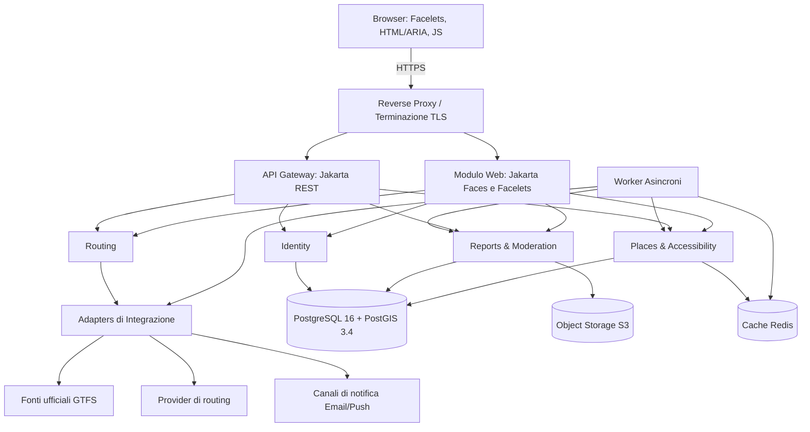
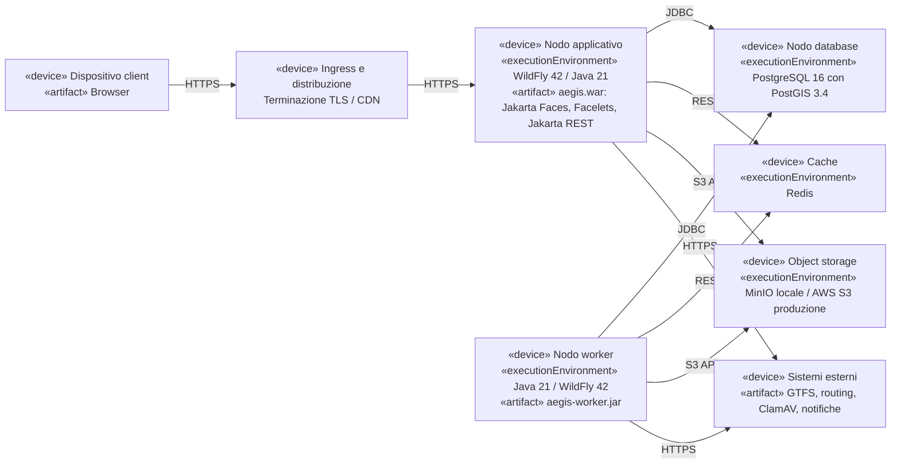
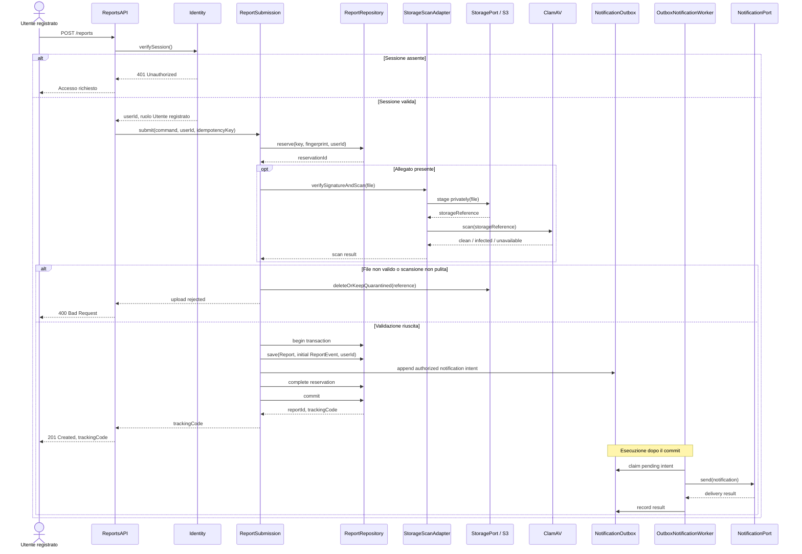
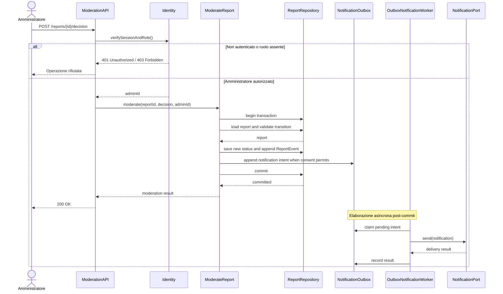

# SDD

## Documento di Progettazione del Sistema

| Dato | Valore |
|---|---|
| Progetto | AEGIS |
| Corso | Ingegneria del Software e Interazione Uomo-Macchina |
| Docenti | Prof.ssa Mariacarla Staffa |
| Candidati | Alessio Attilio, Michela Rita Brancaccio, Andrea Plini |
| Anno accademico | 2025/2026 |

## SOMMARIO

| Sezione | Contenuto |
|---|---|
| [Introduzione](#1-introduzione) | Scopo, obiettivi, definizioni, riferimenti e panoramica |
| [Sistema corrente](#2-sistema-corrente) | Stato attuale e contesto |
| [Sistema proposto](#3-sistema-proposto) | Architettura, moduli, persistenza, sicurezza e flusso di controllo |
| [Panoramica](#31-panoramica) | Architettura generale |
| [Decomposizione del sistema](#32-decomposizione-del-sistema) | Moduli e responsabilità |
| [Diagramma dei moduli](#321-diagramma-dei-moduli) | Relazioni tra componenti e dipendenze |
| [Hardware/software mapping](#33-hardwaresoftware-mapping) | Nodi e responsabilità |
| [Gestione dei dati persistenti](#34-gestione-dei-dati-persistenti) | [Struttura relazionale](#341-postgresql-e-struttura-relazionale), [object storage](#342-object-storage), [sincronizzazione](#343-meccanismi-di-sincronizzazione) |
| [Controllo accessi e sicurezza](#35-controllo-accessi-e-sicurezza) | [Identità](#351-autenticazione-e-identità), [accesso ai dati](#352-controllo-degli-accessi-ai-dati), [immagini](#353-gestione-delle-immagini), [abusi](#354-protezione-da-abusi) |
| [Flusso di controllo globale](#36-decisioni-sul-flusso-di-controllo-globale) | [Sessione](#361-gestione-della-sessione-utente), [navigazione](#362-navigazione-tra-viste), [asincronia](#363-gestione-asincrona-ed-eventi), [errori](#364-gestione-degli-errori) |
| [Condizioni limite](#37-condizioni-limite) | Identità, luoghi, segnalazioni duplicate, rete, input e geolocalizzazione |
| [Servizi del sottosistema](#4-servizi-del-sottosistema) | [Identità](#41-autenticazione-utente), [luoghi](#42-gestione-dei-luoghi), [accessibilità](#43-informazioni-di-accessibilità), [percorsi](#44-pianificazione-dei-percorsi), [segnalazioni](#45-segnalazioni-e-moderazione), [geolocalizzazione e aggiornamenti](#46-geolocalizzazione-sincronizzazione-e-notifiche) |
| [Diagrammi UML di progettazione](#5-diagrammi-uml-di-progettazione) | Classi di design e sequenze dei flussi critici |
| [Glossario](#6-glossario) | Termini architetturali e di dominio |

## 1. INTRODUZIONE

### 1.1 SCOPO DEL SISTEMA

Questo documento definisce l’architettura software di AEGIS e dettaglia i componenti, i dati, le interfacce e le decisioni operative che realizzano i requisiti definiti nel [RAD](RAD.md).

### 1.2 OBIETTIVI DI PROGETTAZIONE

| Obiettivo | Criterio architetturale |
|---|---|
| Separazione delle responsabilità | Mantenere distinti dominio, casi d’uso e adattatori tramite architettura esagonale (*Ports & Adapters*). |
| Affidabilità dei dati di accessibilità | Registrare fonte e freschezza. Trattare come sconosciuti i dati assenti o aggiornati da più di 30 giorni. |
| Sostituibilità delle integrazioni | Collegare fonti GTFS, provider di routing, storage e canali di notifica tramite porte e adattatori isolati. |
| Tracciabilità della moderazione | Conservare gli eventi decisionali in forma *append-only* nella stessa transazione dell’aggiornamento di stato. |
| Sicurezza e privacy | Applicare autorizzazione server-side (RBAC), minimizzazione dei dati personali (GDPR) e scansione degli upload. |
| Operatività misurabile | Registrare esiti di sincronizzazione, ritardi delle fonti, errori e stato dei processi asincroni mediante log strutturati e metriche. |

*Tabella 1.1: Obiettivi di progettazione e relativi criteri architetturali*

### 1.3 DEFINIZIONI, ACRONIMI E ABBREVIAZIONI

| Termine | Significato |
|---|---|
| API | Interfaccia di programmazione applicativa esposta via HTTP. |

*Tabella 1.2: Definizioni e acronimi usati nel documento*

Le altre definizioni sono raccolte nel [glossario](#6-glossario).

### 1.4 RIFERIMENTI

| Riferimento | Ruolo nel progetto |
|---|---|
| [RAD: Documento di Analisi dei Requisiti](RAD.md) | Requisiti, attori, casi d’uso e vincoli. |
| [Jakarta EE 11](https://jakarta.ee/release/11/) | Piattaforma applicativa di riferimento. |
| [Compatibilità WildFly 42](https://www.wildfly.org/news/2026/10/22/WildFly-42-is-released/) | Profili EE 11 supportati e combinazioni Java dichiarate dal progetto WildFly. |
| [Roadmap di supporto Java SE di Oracle](https://www.oracle.com/java/technologies/java-se-support-roadmap.html) | Versioni Java classificate LTS da Oracle. La baseline di progetto adotta Java 21 LTS con supporto della distribuzione selezionata per l’ambiente. |
| [WCAG 2.1 livello AA](https://www.w3.org/TR/WCAG21/) | Baseline di accessibilità del RAD. |
| Specifica OpenAPI | Da generare e versionare insieme all’API. |
| Documentazione Jakarta EE e PostGIS | Riferimenti tecnici da associare alle versioni selezionate. |

*Tabella 1.3: Riferimenti normativi e tecnici del documento*

### 1.5 PANORAMICA

Il documento è organizzato in 6 capitoli: il Capitolo 1 definisce scopo e obiettivi di progettazione; il Capitolo 2 inquadra l’assenza di sistemi preesistenti (*greenfield*); il Capitolo 3 descrive l’architettura proposta, la decomposizione in moduli, il mapping hardware/software, la persistenza, la sicurezza e il flusso di controllo; il Capitolo 4 specifica i servizi dei sottosistemi; il Capitolo 5 presenta i diagrammi UML di design (classi e sequenze); il Capitolo 6 raccoglie il glossario tecnico.

## 2. SISTEMA CORRENTE

Il progetto è di tipo **greenfield** (sviluppo ex novo): non esiste un sistema preesistente da migrare o integrare come legacy. L’architettura viene progettata da zero per acquisire i feed ufficiali GTFS del trasporto pubblico locale dell’area metropolitana di Napoli e affiancarli alle segnalazioni georeferenziate degli utenti.

## 3. SISTEMA PROPOSTO

### 3.1 PANORAMICA

AEGIS è una web app responsive per consultare l’accessibilità di luoghi e servizi di trasporto, pianificare spostamenti e inviare segnalazioni. L’Ospite può consultare luoghi, pianificare percorsi, seguire segnalazioni tramite codice e registrarsi. Solo l’Utente registrato autenticato può inviare segnalazioni. Le viste server-side usano Jakarta Faces e Facelets. Le API REST usano Jakarta REST. I worker eseguono le sincronizzazioni e le attività asincrone.

La baseline applicativa è Java 21 LTS, Jakarta EE 11 e WildFly 42. PostgreSQL 16 con PostGIS 3.4 conserva i dati relazionali e geografici. Redis fornisce la cache. Gli allegati sono conservati in object storage compatibile con S3, con MinIO in locale e AWS S3 in produzione. Le integrazioni esterne sono isolate dietro porte applicative. Queste versioni e questi prodotti sono proposte non approvate. Il Responsabile tecnico deve confermarli nella configurazione dell'ambiente di riferimento prima dell'implementazione.

Il browser riceve HTML per le viste e JSON per le API. La mappa usa una libreria cartografica client-side, mentre i dati di luoghi e accessibilità provengono dall’API. Consultazione dei luoghi e tracking tramite codice sono pubblici. UC-03, preferiti, notifiche, storico personale e operazioni amministrative richiedono autenticazione e autorizzazione. I ruoli sono Utente registrato e Amministratore. Le transizioni di moderazione sono quelle definite in FR-09 del RAD.

### 3.2 DECOMPOSIZIONE DEL SISTEMA

La tabella seguente mappa i moduli architetturali sui requisiti funzionali, non funzionali e casi d’uso del RAD.

| Modulo | Responsabilità architetturale | Requisiti funzionali e casi d’uso | Requisiti di qualità |
|---|---|---|---|
| Places | Gestire luoghi, fermate e stazioni e fornire ricerche geospaziali. | FR-01, FR-06, UC-02 | NFR-08, NFR-10 |
| Accessibility | Gestire caratteristiche, stato, fonte, timestamp e validità. | FR-02, FR-03, UC-01, UC-02 | NFR-08 |
| Routing | Validare richieste, invocare il provider e mostrare l’incertezza dei tratti. | FR-04, FR-05, UC-01 | NFR-08, NFR-10 |
| Reports | Creare segnalazioni e consentire il tracking pubblico tramite codice senza esporre dati personali. | FR-07, FR-08, UC-03, UC-04 | NFR-04, NFR-06, NFR-07 |
| Moderation | Applicare le autorizzazioni e validare le transizioni conservando la cronologia append-only. | FR-09, UC-05 | NFR-04, NFR-05, NFR-06 |
| Identity | Gestire autenticazione, registrazione, ruoli e separazione dei dati identificativi. | FR-13 (UC-03, UC-05–UC-08), FR-14 (UC-07–UC-09), FR-15 (UC-08) | NFR-04, NFR-05 |
| Integrations | Implementare adattatori per fonti di trasporto, routing, notifiche e storage. | FR-10 (UC-06), FR-12 (UC-05, UC-08) | NFR-07, NFR-12 |
| Worker | Eseguire sincronizzazioni schedulate, riconciliare upload e inviare notifiche in modo asincrono e recuperabile. | FR-07 (UC-03), FR-10, FR-11, UC-06, FR-12 (UC-05, UC-08) | NFR-07, NFR-09, NFR-10 |
| Web | Fornire viste accessibili in Facelets con mappa, alternative testuali, moduli, pannello di moderazione e monitoraggio delle sincronizzazioni. | FR-01–FR-15, UC-01–UC-09 | NFR-01, NFR-02, NFR-03, NFR-10, NFR-13 |
| Runtime e Operations | Gestire configurazione, distribuzione, osservabilità, migrazioni e ripristino. | Nessun caso d’uso diretto | NFR-05, NFR-09, NFR-10, NFR-12 |

*Tabella 3.1: Decomposizione del sistema in moduli e tracciabilità verso il RAD*

Internamente, ciascun dominio applicativo è organizzato in tre package:

- `domain`: entità, value object immutabili, enumerazioni e regole di invariante pure (prive di dipendenze da framework).
- `application`: casi d’uso (`*Control`), coordinamento transazionale e porte (*interfaces*) verso persistenza e servizi esterni.
- `adapter`: implementazioni concrete per risorse Jakarta REST, controller Jakarta Faces, repository JPA/PostGIS, client HTTP e storage S3.

#### 3.2.1 DIAGRAMMA DEI MODULI

*Figura 3.1: Diagramma dei moduli e delle dipendenze architetturali*

### 3.3 HARDWARE/SOFTWARE MAPPING

| Nodo | Ambiente e software | Responsabilità |
|---|---|---|
| Dispositivo client | Browser desktop o mobile e tecnologie assistive. | Renderizzare le viste, interagire con la mappa e inviare richieste HTTPS. |
| Container applicativo | Java 21 LTS, Jakarta EE 11, WildFly 42, Jakarta Faces, Facelets e Jakarta REST. | Servire viste e API e coordinare i casi d’uso. |
| Container worker | Java 21 e Jakarta EE 11 su WildFly 42. | Sincronizzare fonti e gestire attività lente e retry. |
| Database | PostgreSQL 16 con PostGIS 3.4. | Conservare entità, eventi e geometrie. |
| Object storage | MinIO in locale e AWS S3 in produzione, tramite API S3. | Conservare immagini in modo privato fino alla verifica e associazione autorizzata. |
| Cache | Redis. | Conservare risultati di lettura versionati per generazione e query. |
| Ingress e distribuzione | Terminazione TLS e CDN secondo l’ambiente. | Instradare il traffico verso l’applicazione e distribuire risorse statiche. |
| Servizi esterni | Fonti GTFS, provider di routing, ClamAV e canali di notifica. | Fornire dati e capacità integrate tramite adattatori. |

Il diagramma di deployment mostra i nodi runtime e i protocolli usati tra browser, applicazione, worker, database, cache, object storage e sistemi esterni.

*Figura 3.2: Diagramma di deployment dei nodi di sistema*

Il browser comunica con il nodo applicativo tramite HTTPS. Applicazione e worker usano JDBC per PostgreSQL, RESP per Redis e API S3 per gli allegati. I worker raggiungono fonti GTFS, ClamAV e servizi integrati tramite HTTPS.

In sviluppo è previsto Docker Compose con PostgreSQL 16/PostGIS 3.4, Redis e MinIO. Staging e produzione sono ambienti separati. In produzione l’applicazione usa WildFly 42, AWS S3, PostgreSQL e Redis. Segreti e credenziali sono forniti tramite configurazione esterna al repository.

La pipeline di rilascio dovrà compilare e verificare gli artefatti applicativi, eseguire test e scansioni delle dipendenze, creare immagini versionate e distribuire progressivamente. Le migrazioni devono mantenere la compatibilità con le versioni applicative attive durante il rilascio. La configurazione applicativa dovrà essere versionata e distinta per ambiente. I segreti non dovranno essere inclusi nel repository.

Le procedure operative per rilascio, migrazione, rollback, incidenti e ripristino devono essere redatte e provate nell'ambiente di riferimento prima dell'esercizio. Log, metriche, allarmi, retry, backup e recupero degli esiti ambigui sono responsabilità del sottosistema Operations.

### 3.4 GESTIONE DEI DATI PERSISTENTI

La persistenza relazionale utilizza **PostgreSQL 16 con PostGIS 3.4**. Le migrazioni dello schema sono versionate tramite **Flyway** ed eseguite in modalità retrocompatibile. Le entità del package `domain` sono mappate sulle tabelle mediante adattatori JPA/Hibernate isolati nel layer `adapter`.

#### 3.4.1 POSTGRESQL E STRUTTURA RELAZIONALE

| Tabella | Contenuto, chiavi e vincoli principali |
|---|---|
| `place` | Luogo, fermata o stazione con nome, tipo e geometria a SRID esplicito. |
| `accessibility_feature` | Tipo, stato, fonte, validità e timestamp della caratteristica. Riferimento a `place`. |
| `data_source` | Fonte autorizzata, responsabile, configurazione di aggiornamento giornaliero GTFS, regola di validità di 30 giorni dall’osservazione e riferimento alla generazione attiva. |
| `transit_line` | Linee importate e relativi riferimenti alla fonte. |
| `transit_stop` | Fermate, geometrie e relazioni con le linee e la fonte. |
| `report_submission` | Prenotazione durevole con scope dell’utente autenticato, digest della chiave, impronta dell’intera richiesta, stato e riferimento al report completato. Un vincolo di unicità su scope e digest impedisce prenotazioni concorrenti duplicate. La prenotazione è persistita prima di effetti esterni. |
| `report` | Geometria o luogo, categoria, descrizione, stato e date. È collegato alla prenotazione che ne ha originato la creazione. Dati identificativi separati. |
| `report_event` | Eventi append-only con autore, data, decisione, motivazione e riferimento a eventuale duplicato. |
| `report_attachment` | Intento durevole di upload correlato alla prenotazione della richiesta, chiave opaca di un oggetto privato, esiti di validazione e scansione, stato di associazione al report e lavoro di recupero o pulizia. Sono ammessi JPEG, PNG e WebP fino a 5 MB. |
| `notification_outbox` | Intenzioni di notifica registrate nella stessa transazione della creazione o moderazione. Contiene stato, tentativi e riferimenti tecnici necessari al recupero, senza credenziali o contenuti non necessari. |
| `user_account` | Riferimento d’identità e ruoli con accesso limitato. |
| `source_sync` | Fonte, versione, timestamp, esito, controlli di qualità, generazione pubblicata, generazione precedente e stato del lavoro durevole di pulizia cache. |

*Tabella 3.2: Schema relazionale e geospaziale*

La matrice seguente descrive il trattamento progettato. Le richieste di percorso non sono persistite nel dominio dopo la risposta. Dati di accessibilità e pacchetti GTFS sono considerati scaduti 30 giorni dopo l’osservazione. Le segnalazioni conservano un autore registrato e non espongono l’identità nelle viste pubbliche.

| Categoria | Dati previsti e uso | Accesso progettato |
|---|---|---|
| Identità e ruoli | Identificativo account, credenziali gestite dal componente Identity e ruoli applicativi Utente registrato o Amministratore. | Utente registrato e amministratore autenticati. |
| Richieste di percorso e geolocalizzazione | Origine e destinazione testuali o coordinate, preferenze e vincoli per calcolare un percorso. Sono elaborati durante la richiesta e non persistiti nel dominio dopo la risposta. L’adattatore invia al provider solo i campi necessari al calcolo. | Ospite, utente registrato e servizi applicativi. |
| Segnalazione | Luogo, categoria, descrizione, data e stato per moderare e comunicare informazioni sulle barriere. Testo e posizione possono identificare una persona. | Amministratori autorizzati e viste pubbliche limitate ai campi approvati. |
| Eventi di moderazione | Riferimento all’autore, data, decisione, motivazione e segnalazione per mantenere la cronologia append-only. Le note pubbliche registrate nella decisione di moderazione sono incluse nelle viste consentite. | Amministratori autorizzati e ruoli operativi autorizzati. |
| Credenziale di tracking | Codice non enumerabile restituito all’autore per consultare lo stato pubblico consentito. La proposta di progetto prevede 128 bit di entropia codificati in Base62, con il solo digest memorizzato e nessuna registrazione nei log. | Possessore del codice. La risposta non include dati personali. |
| Immagine allegata | File, metadati necessari, intento durevole e stato della scansione per documentare una barriera e supportare la moderazione. | Oggetto privato prima dell’associazione autorizzata al report. Pubblicazione solo dopo scansione ClamAV valida, associazione autorizzata al report e rimozione dei metadati non necessari. |
| Log operativi | Eventi tecnici e identificativi necessari per diagnosi, sicurezza e misurazione operativa. | Personale operativo autorizzato. |

*Tabella 3.3: Categorie di dati, uso previsto e accesso progettato*

| Categoria | Decisioni di ciclo di vita |
|---|---|
| Identità e ruoli | Credenziali gestite dal componente Identity. L’accesso è revocato alla disattivazione dell’account. I ruoli applicativi sono Utente registrato e Amministratore. |
| Richieste di percorso e geolocalizzazione | Elaborate per la singola richiesta e non persistite nel dominio. Sono trasmessi al provider solo i campi necessari al calcolo. |
| Segnalazione | I campi pubblici comprendono luogo, categoria, descrizione autorizzata, stato, data e note pubbliche registrate nella decisione di moderazione. Autore e dati di contatto non sono esposti nelle risposte pubbliche. |
| Eventi di moderazione | Conservano identificativo del caso, tipo di transizione, esito, motivazione, timestamp e riferimento all’attore. Non copiano descrizioni, credenziali, codici di tracking o dati di contatto. |
| Intenzioni di notifica | Sono create solo per destinatari autorizzati e consenzienti. Contengono i riferimenti tecnici necessari all’invio e al recupero. |
| Credenziale di tracking | È memorizzata come digest, esclusa dai log e usata solo per consultare lo stato pubblico consentito. |
| Immagine allegata | È mantenuta privata fino a verifica e associazione al report. I metadati non necessari sono rimossi prima della pubblicazione autorizzata. |
| Log operativi | Escludono descrizioni personali, credenziali, codice di tracking, coordinate, preferenze e richieste di percorso. L’accesso è limitato al personale operativo autorizzato. |

*Tabella 3.4: Decisioni di ciclo di vita per categoria di dati*

La separazione tra identità, contenuto e cronologia è un confine architetturale, non una garanzia di anonimato. Descrizioni, coordinate, preferenze di percorso e immagini possono identificare una persona. I log applicativi escludono credenziali, codice di tracking, descrizioni, coordinate e dati personali non necessari. Gli oggetti allegati sono privati e le risposte pubbliche omettono identità e contatti. Le richieste di percorso non sono persistite nel dominio dopo la risposta; al provider sono trasmessi solo i campi necessari. La pseudonimizzazione non è dichiarata anonimizzazione.

Le relazioni sono protette da chiavi esterne e vincoli. Le ricerche geografiche usano indici spaziali. Ulteriori indici sono definiti in base alle query validate. Le coordinate di dominio sono rappresentate da `GeoPoint`, value object immutabile con controlli di validità.

Backup e ripristino coprono PostgreSQL e object storage. Le prove di ripristino verificano integrità, riferimenti agli oggetti e riconciliazione dei lavori pendenti prima del rilascio e dopo modifiche infrastrutturali rilevanti.

Ogni caratteristica di accessibilità registra fonte, stato, data di aggiornamento e validità. L’assenza o la scadenza produce lo stato sconosciuto. Ogni operazione di moderazione aggiorna lo stato corrente e inserisce l’evento corrispondente nella stessa transazione. Gli eventi non sono modificati né eliminati dall’applicazione ordinaria.

#### 3.4.2 OBJECT STORAGE

Le immagini JPEG, PNG e WebP fino a 5 MB sono conservate fuori dal database in object storage privato. Dopo la validazione sintattica e autorizzativa, ma prima di qualsiasi effetto esterno, il sistema registra in una transazione `report_submission` con scope dell’utente autenticato, digest della chiave, impronta dell’intera richiesta e stato pendente. Un vincolo univoco su scope e digest serializza le prenotazioni concorrenti. L’impronta comprende i campi normalizzati e il digest verificato dei byte dell’allegato. Prima di scrivere il file, il sistema registra in `report_attachment` un intento durevole e una chiave opaca non esposta al client. La scrittura, la verifica della firma MIME e la scansione ClamAV avvengono senza rendere l’oggetto accessibile pubblicamente. Solo dopo un esito valido una transazione database collega l’allegato al report, registra evento e notifica autorizzata e completa la prenotazione con il riferimento al report. Database e object storage non condividono una transazione atomica.

Se la scrittura, la scansione o la transazione database falliscono, l’oggetto resta privato e l’intento consente un retry idempotente o la pulizia. Una scansione fallita o non disponibile impedisce l’associazione. Solo il titolare della prenotazione può proseguire l’operazione. Un retry concorrente con la stessa chiave e impronta osserva lo stato esistente e non avvia un secondo upload. Un retry con impronta diversa è rifiutato. Un worker riconcilia prenotazione, intento e oggetti usando le chiavi registrate prima della scrittura. Un riferimento mancante o un oggetto non disponibile esclude l’allegato dalla risposta e rende osservabile l’anomalia. Il database conserva riferimenti e metadati, non i byte dell’immagine.

#### 3.4.3 MECCANISMI DI SINCRONIZZAZIONE

Worker asincroni importano i dataset GTFS ogni giorno tramite adattatori isolati. Ogni esecuzione ha un identificativo e registra fonte, versione, timestamp, esito, controlli di qualità e riferimento alla generazione in `source_sync`. La pubblicazione e la registrazione nello stesso record del lavoro di pulizia cache pendente avvengono nella stessa transazione. Il worker di pulizia recupera i lavori non completati da `source_sync` e ripete l’operazione in modo idempotente. Retry e replay dell’importazione non duplicano dati: la deduplicazione usa gli identificativi stabili del formato GTFS. Se i dati non superano i controlli, resta attiva la generazione precedente.

I dati acquisiti sono scritti in una generazione candidata isolata dalle letture pubbliche. Il worker valida contratto e schema, chiavi, completezza secondo le regole concordate per la fonte e coerenza dei dati. Solo una generazione che supera tutti i controlli può diventare attiva tramite un passaggio atomico. L’attivazione della generazione e la registrazione dell’esito pubblicato avvengono nella stessa transazione. Un errore lascia attiva la generazione pubblicata in precedenza e registra l’esito fallito senza esporre dati parziali. La rappresentazione fisica delle generazioni è definita per ogni contratto di fonte nel registro `data_source` e deve preservare isolamento, pubblicazione atomica e recuperabilità.

I dati di accessibilità scadono 30 giorni dopo l’osservazione e oltre tale termine sono esposti come sconosciuti. La cache è solo un’ottimizzazione e non estende la validità: ogni lettura rivaluta la scadenza anche in caso di cache hit. Prima della cache, ogni lettura acquisisce dal repository autorevole, in una vista consistente, gli identificativi delle generazioni attive per tutte le fonti coinvolte. La chiave Redis include il vettore completo delle generazioni, l’area e i parametri normalizzati della query. In caso di cache miss, dati e provenienza sono letti usando lo stesso snapshot del vettore. Una pubblicazione concorrente non può comporre una risposta con dati riferiti a generazioni diverse da quelle della chiave. I risultati di routing composti non sono memorizzati in questa cache.

Il worker elimina le chiavi delle generazioni non più attive dopo il commit. Un fallimento lascia il lavoro pendente e osservabile in `source_sync` per un tentativo successivo. La pulizia fisica è idempotente. La correttezza della lettura è garantita dal vettore di generazione attiva, anche prima del completamento della pulizia fisica, perché una chiave obsoleta non corrisponde alla generazione attiva. Gli aggiornamenti della stessa fonte sono serializzati quando la versione non è confrontabile.

### 3.5 CONTROLLO ACCESSI E SICUREZZA

Il controllo accessi è applicato lato server. Consultazione dei luoghi e tracking tramite codice sono pubblici. UC-03, le funzioni personali e le operazioni amministrative richiedono autenticazione e autorizzazione. I dati identificativi e gli allegati non sono esposti dalle viste pubbliche.

#### 3.5.1 AUTENTICAZIONE E IDENTITÀ

Consultazione dei luoghi e tracking tramite codice non richiedono un account. L’invio di segnalazioni richiede un Utente registrato autenticato tramite UC-07. Il codice di tracking è una credenziale non enumerabile che tratta solo lo stato consentito. La proposta di progetto prevede 128 bit di entropia codificati in Base62, con il solo digest memorizzato e nessuna registrazione nei log. Il Responsabile tecnico deve approvare entropia e codifica prima dell'implementazione. La chiusura della decisione richiede una prova di enumerazione sul codice generato. Preferiti, notifiche, storico personale e operazioni amministrative richiedono un’identità autenticata e un permesso verificato lato server. Le credenziali e i segreti non sono conservati nei log né nel codice applicativo.

#### 3.5.2 CONTROLLO DEGLI ACCESSI AI DATI

Ogni endpoint e azione Facelets verifica identità e ruoli lato server tramite annotazioni Jakarta Security (`@RolesAllowed`):

- Ruolo `REGISTERED_USER`: accesso alla propria area personale, gestione luoghi preferiti, gestione consensi notifiche e consultazione delle proprie segnalazioni (`author_id = currentUser.id`).
- Ruolo `ADMINISTRATOR`: accesso alla coda di moderazione, esecuzione delle transizioni di stato delle segnalazioni e avvio/monitoraggio delle sincronizzazioni GTFS.
- Tutte le query SQL/JPQL utilizzano parametri vincolati (*prepared statements*) per prevenire SQL Injection.

#### 3.5.3 GESTIONE DELLE IMMAGINI

Gli upload accettano JPEG, PNG o WebP fino a 5 MB. Il sistema registra un intento durevole prima della scrittura e conserva gli oggetti in un’area privata. Firma MIME e contenuto sono verificati e il file è sottoposto a scansione ClamAV. Solo un allegato verificato e collegato al report può essere servito secondo autorizzazione. Un errore tra object storage e database non rende pubblico un oggetto orfano: il worker usa l’intento per riprendere o pulire il lavoro in modo idempotente.

#### 3.5.4 PROTEZIONE DA ABUSI

- **Rate limiting:** applicato sull’ingresso e sulle API per l’invio di segnalazioni da parte dell’Utente registrato e per l’endpoint di tracking pubblico. Il Responsabile tecnico fissa le soglie numeriche per questi due endpoint prima del pilota, secondo NFR-06 del RAD. La chiusura della decisione richiede un test di carico sugli endpoint.
- **Risposte uniformi:** l’endpoint di tracking restituisce il medesimo errore generico `404 Not Found` sia per codici inesistenti sia per codici formalmente malformati, evitando qualsiasi leak informativo.

**Analisi delle minacce.** La seguente valutazione descrive i controlli previsti dal progetto e le evidenze richieste prima del rilascio.

| Scenario di minaccia | Bene e impatto | Controllo progettato | Verifica richiesta |
|---|---|---|---|
| Enumerazione dei codici di tracking | Esposizione dello stato o di informazioni personali di segnalazioni altrui. | Usare il codice di tracking proposto con 128 bit di entropia codificati in Base62, soggetto ad approvazione del Responsabile tecnico. Limitare le richieste e rendere uniformi gli esiti per codice inesistente e non autorizzato. Non registrare il codice nei log. | Prove di autorizzazione, enumerazione e analisi dei log prima del pilota. |
| Accesso o transizione di moderazione non autorizzati | Modifica fraudolenta di stato e cronologia delle segnalazioni. | Verificare identità e ruolo sul server per ogni operazione. Applicare transizioni ammesse in modo atomico e registrare gli eventi in audit append-only. | Prove negative per ruolo e stato, incluse chiamate dirette alle API e richieste ripetute. |
| Upload malevolo o non conforme | Esecuzione o diffusione di contenuti ostili, esposizione di dati o abuso dello storage. | Accettare JPEG, PNG o WebP fino a 5 MB. Verificare firma MIME e contenuto, tenere privato l’oggetto e sottoporlo a ClamAV prima dell’associazione al report. Riconciliare o pulire in modo idempotente gli intenti incompleti. | Prove con file non ammessi, oltre 5 MB, firma discordante, scansione fallita o indisponibile, interruzione durante upload e accesso non autorizzato. Verificare che il file non diventi pubblico. |
| Dati di fonte errati, alterati o scaduti | Percorsi o descrizioni di accessibilità che inducono decisioni non sicure. | Importare solo fonti autorizzate, validare schema e qualità, conservare provenienza e validità. Mostrare come sconosciuti i dati assenti o scaduti. | Test di schema, duplicati, aggiornamento fallito, fonte scaduta e propagazione dello stato sconosciuto. |
| Injection o consumo eccessivo di risorse | Compromissione dei dati o indisponibilità di API e database. | Usare query parametrizzate, validare input, applicare limiti di dimensione e rate limiting agli endpoint e rendere le operazioni ripetibili in sicurezza. | Analisi statica, prove di input ostile e test di carico sugli endpoint. |
| Divulgazione di dati personali o segreti | Violazione di riservatezza attraverso log, backup, configurazione, oggetti non collegati o risposta API. | Minimizzare i dati, escludere segreti e identificativi dai log, mantenere privati gli upload non collegati, limitare accessi e definire conservazione e cancellazione prima del lancio. Configurazione e segreti sono separati dal codice. | Revisione di log e permessi, controlli di segreti in CI e prove di accesso, recupero e cancellazione di upload interrotti. |

*Tabella 3.5: Analisi delle minacce e controlli progettati*

**Sicurezza d'uso e pericoli operativi.** Questa analisi riguarda i danni che possono derivare dall'uso delle informazioni del servizio. È distinta dall'analisi delle minacce informatiche. I controlli descritti sono requisiti di progetto e non risultano implementati o validati. La valutazione del rischio residuo richiede un'area pilota, fonti autorizzate e profili d'uso approvati dal responsabile del trattamento.

| Pericolo | Possibile danno | Controllo progettato | Evidenza richiesta |
|---|---|---|---|
| Una caratteristica di accessibilità assente, scaduta o incoerente viene interpretata come disponibile. | La persona sceglie un luogo o un tratto che non può utilizzare. | Propagare lo stato sconosciuto senza convertirlo in accessibile. Mostrare fonte e validità quando disponibili. Escludere il dato incerto dalle dichiarazioni di compatibilità. | Test end-to-end per dato assente, scaduto, incoerente e aggiornamento fallito. Revisione dei testi con persone del profilo pilota. |
| Un percorso include un tratto non verificato o un fallback del provider. | La persona incontra una barriera o non riesce a completare il tragitto. | Etichettare i tratti non verificati. Rendere visibili le limitazioni e l'origine del percorso. Fornire un esito esplicito quando non è possibile stabilire la compatibilità. | Prove con provider indisponibile, dati parziali e profili d'uso approvati dal responsabile del trattamento. Verifica dell'equivalenza tra mappa e descrizione testuale. |
| Una sincronizzazione incompleta, duplicata o fuori ordine pubblica uno stato non coerente. | La persona pianifica sulla base di informazioni obsolete o contraddittorie. | Isolare le generazioni candidate, validare contratto e completezza, attivare in modo atomico, preservare la generazione precedente in caso di errore e ordinare le pubblicazioni concorrenti. Rendere osservabili esito e ritardo. | Prove di retry, interruzione in ogni fase, duplicati, pubblicazioni durante una query, coerenza del vettore cache, errore di pubblicazione e ripristino. Confronto tra fonte e dati attivi. |
| Un avviso o un errore non è percepibile o comprensibile con la modalità d'interazione usata. | La persona non nota l'incertezza o non riesce a scegliere un'alternativa. | Esporre avvisi nel contenuto e nella struttura accessibile, senza affidarsi al solo colore, alla sola mappa o a notifiche temporanee. Mantenere il messaggio disponibile nella vista. | Verifica con tastiera e tecnologie assistive, prove con utenti e controllo che gli stati equivalenti siano disponibili in forma testuale. |

*Tabella 3.6: Pericoli d’uso e controlli progettati*

Gli esiti delle verifiche, le limitazioni note e l'accettazione del rischio residuo devono essere registrati dal responsabile del trattamento prima del pilota, rispetto ai criteri WCAG 2.1 livello AA e ai flussi definiti nel RAD.

### 3.6 DECISIONI SUL FLUSSO DI CONTROLLO GLOBALE

#### 3.6.1 GESTIONE DELLA SESSIONE UTENTE

La sessione è necessaria per le funzioni protette e non condiziona consultazione dei luoghi e tracking pubblico. Jakarta Security integra la sessione applicativa con il controllo dei ruoli Utente registrato e Amministratore. Le sessioni sono terminate al logout e scadono secondo la configurazione sicura del runtime WildFly.

#### 3.6.2 NAVIGAZIONE TRA VISTE

Jakarta Faces gestisce il flusso delle pagine server-side (Home/Mappa e Ricerca, Dettaglio Luogo, Pianificatore Percorso, Nuova Segnalazione, Tracking Segnalazione, Area Personale, Dashboard Amministratore). Ogni vista espone i dati in doppia modalità sincronizzata (mappa interattiva e tabella HTML semantica con attributi ARIA) per garantire la piena navigabilità da tastiera e screen reader (NFR-01, NFR-02).

#### 3.6.3 GESTIONE ASINCRONA ED EVENTI

Le sincronizzazioni e le attività lente sono eseguite da worker. La transazione di pubblicazione registra anche il lavoro pendente di pulizia cache. Un worker recupera i lavori incompleti da `source_sync` e ne registra l’esito. Le chiavi cache includono la generazione attiva, così un arresto del worker non rende leggibili dati superati. Per gli allegati, `report_attachment` conserva l’intento prima della scrittura in object storage e permette di riprendere o pulire un upload anche se la transazione che crea il report fallisce. L’oggetto resta privato fino alla scansione ClamAV valida e al collegamento autorizzato. Per FR-12, l’intenzione di notifica è registrata in `notification_outbox` nella stessa transazione che completa la moderazione o l’operazione autorizzata. Un worker elabora l’intenzione dopo il commit tramite `NotificationPort`. Un errore non annulla il caso d’uso già persistito e lascia il lavoro osservabile e recuperabile. Il sistema non garantisce consegna esattamente una volta. I log escludono credenziali, codici di tracking, descrizioni delle segnalazioni e dati personali non necessari. Le metriche escludono identificativi personali e valori ad alta cardinalità. Ogni allarme indica impatto, responsabile, procedura e criterio di chiusura. Backup e ripristino coprono database e object storage, verificano integrità e riferimenti e riconciliano i lavori pendenti. Le chiamate a provider esterni non mantengono aperte transazioni database. Metriche e allarmi rendono osservabili disponibilità, latenza, ritardo delle fonti, errori di sincronizzazione, lavori di pulizia cache e upload pendenti, stato ed età delle notifiche pendenti e dimensione e anzianità della coda di moderazione.

#### 3.6.4 GESTIONE DEGLI ERRORI

Un `ExceptionMapper` centralizzato (per Jakarta REST) e un `ExceptionHandler` dedicato (per Jakarta Faces) intercettano tutte le eccezioni applicative e tecniche, traducendole in codici HTTP standard (`400`, `401`, `403`, `404`, `429`, `500`) e messaggi utente chiari, accessibili tramite `aria-live="assertive"`, senza mai esporre stack trace o dettagli interni del database.

### 3.7 CONDIZIONI LIMITE

#### 3.7.1 UTENTE NON AUTENTICATO

La consultazione pubblica di luoghi e percorsi resta disponibile. Se un utente non autenticato richiede UC-03 o un’altra operazione protetta, il sistema restituisce HTTP 401 e comunica come accedere alla funzione. L’autorizzazione è verificata lato server.

#### 3.7.2 LUOGO NON TROVATO O IDENTIFICATIVO NON VALIDO

Se un identificativo non corrisponde a un luogo, il sistema restituisce un esito coerente senza dati parziali. Se il luogo esiste ma i dati di accessibilità sono assenti, scaduti o incoerenti, li presenta come sconosciuti e non li usa come prova di compatibilità.

#### 3.7.3 SEGNALAZIONI DUPLICATE

Una segnalazione che descrive un caso già registrato può essere unita al report esistente solo tramite una decisione autorizzata di moderazione. Il sistema conserva entrambe le segnalazioni e registra l’unione nello storico. Non crea una relazione duplicata né sovrascrive eventi precedenti.

#### 3.7.4 INVII RIPETUTI E DUPLICAZIONE DEI DATI IMPORTATI

Retry della creazione e sincronizzazioni ripetute non devono creare segnalazioni o dati di trasporto duplicati. Per l’invio, una transazione prenota in `report_submission` una chiave univoca nello scope dell’Utente registrato e l’impronta canonica dell’intera richiesta prima degli effetti esterni. La stessa chiave e lo stesso payload recuperano una sola operazione. Una chiave riusata con payload diverso è rifiutata e una richiesta in corso non viene eseguita in parallelo. Il replay restituisce il risultato solo all’account associato alla prenotazione. Le sincronizzazioni GTFS giornaliere usano identificativi stabili e sono idempotenti. Un codice di tracking inesistente o non valido non permette di enumerare segnalazioni.

#### 3.7.5 CARICAMENTO LENTO O ASSENZA DI RETE

Le viste mostrano stati di caricamento e un errore accessibile quando rete, API o provider di routing non rispondono. Un fallback di percorso è marcato come non verificato. Se non esistono percorsi compatibili, il sistema comunica l’esito esplicitamente e presenta eventuali alternative con tratti non verificati.

#### 3.7.6 INPUT INCOMPLETI O INVALIDI

Richieste di percorso, moduli e identificativi sono validati prima di produrre effetti. Un upload non valido o con scansione fallita viene rifiutato e non è reso pubblico. Se la scrittura object storage o la transazione report falliscono, l’intento durevole mantiene l’oggetto privato e consente retry o pulizia idempotente. Se il commit riesce ma la risposta si perde, la chiave consente all’account proprietario di recuperare l’esito senza ripetere gli effetti. La risposta ripetuta non rivela il codice di tracking a un altro soggetto.

#### 3.7.7 PERMESSI DI GEOLOCALIZZAZIONE NEGATI

Se la persona nega il permesso di geolocalizzazione, il sistema non blocca ricerca e pianificazione. L’interfaccia consente di inserire manualmente origine, destinazione o luogo e non conserva la posizione oltre quanto necessario alla richiesta.

## 4. SERVIZI DEL SOTTOSISTEMA

### 4.1 AUTENTICAZIONE UTENTE

Il sottosistema Identity gestisce autenticazione e autorizzazione delle funzioni protette. L’amministratore deve essere autenticato e avere il permesso di moderazione o gestione della fonte richiesto dall’operazione. UC-03 richiede un Utente registrato autenticato. Il tracking pubblico usa il codice di tracking come credenziale e restituisce solo lo stato consentito. I dati identificativi restano separati dai contenuti pubblici delle segnalazioni.

### 4.2 GESTIONE DEI LUOGHI

Il sottosistema `places` espone `PlacesAccessibilityAPI` e interroga `PlaceRepository` su PostGIS tramite query spaziali (`ST_DWithin`, `ST_Intersects`) filtrando esclusivamente sui record appartenenti alla `active_generation_id` corrente. Restituisce DTO tipizzati con coordinate WGS84, linee servite e sintesi di accessibilità.

### 4.3 INFORMAZIONI DI ACCESSIBILITÀ

Il sottosistema `accessibility`, tramite `GetPlaceAccessibilityControl`, recupera tutte le `AccessibilityFeature` del luogo selezionato (UC-02), verifica per ciascuna la condizione `observed_at >= now() - 30 days` e mappa automaticamente ogni record scaduto o mancante nello stato `FeatureState.UNKNOWN`, preservando fonte e timestamp originale per trasparenza verso l’utente.

### 4.4 PIANIFICAZIONE DEI PERCORSI

Il caso d’uso `PlanRouteControl` (mappato nel design a `PlanRoute`) valida origine, destinazione e vincoli, invoca la porta sostituibile `RoutingProvider` e combina il risultato con le informazioni di accessibilità. L’adattatore invia solo i campi necessari al calcolo ed esclude identificativi dell’account e codici di tracking. La richiesta non è persistita nel dominio dopo la risposta. Ogni tratto è compatibile, incompatibile o sconosciuto sulla base di evidenze valide. Il solo risultato del provider non prova l’accessibilità. Timeout, indisponibilità, risposta incompleta e profilo non supportato producono uno stato esplicito. Un eventuale fallback è marcato non verificato e non è presentato come equivalente a un percorso compatibile. Il provider è collegato tramite `RoutingProvider` e può essere sostituito senza modificare il dominio. Il servizio non modifica lo stato persistente di dominio.

### 4.5 SEGNALAZIONI E MODERAZIONE

`CreateReportControl` è invocato solo dopo la verifica della sessione e del ruolo Utente registrato. Valida i dati e gestisce l’eventuale upload tramite intento durevole, storage privato e scansione ClamAV. Prima del primo effetto esterno registra una prenotazione durevole e univoca legata allo scope dell’account e all’impronta canonica di tutti i dati, compreso il digest verificato dell’allegato. La stessa chiave e lo stesso payload recuperano la stessa operazione; la stessa chiave con payload diverso è rifiutata; una richiesta in corso non viene avviata in parallelo. La chiave non concede accesso ai dati: il replay è consentito solo all’account proprietario. Quando l’immagine supera i controlli, una transazione database persiste segnalazione, evento iniziale, collegamento a `report_attachment`, intenzione autorizzata di notifica e completamento della prenotazione. La transazione non comprende object storage. Se fallisce, l’intento lascia l’oggetto privato e consente retry o pulizia idempotente. `TrackReportControl` tratta il codice di tracking come credenziale e restituisce solo i campi pubblici consentiti. `ModerateReportControl` verifica identità, ruolo, esistenza del report e transizione ammessa. Le transizioni sono In verifica verso Confermata, Rifiutata o Duplicata e Confermata verso Risolta, come stabilito da FR-09. Ogni transizione ammessa aggiorna stato ed evento append-only nella stessa transazione e registra la motivazione nell'evento. Un comando non ammesso non modifica stato, evento o outbox. L’unione collega il duplicato a un report di riferimento e non cancella la segnalazione né la sua cronologia. Un worker elabora l’outbox dopo il commit; un errore di invio non annulla la segnalazione o la transizione persistita. Il sistema non garantisce consegna esattamente una volta.

Prima dell’upload, `CreateReportControl` inserisce in `report_submission` la prenotazione durevole con scope dell’account, digest della chiave e impronta canonica che include i campi normalizzati e il digest verificato dell’eventuale allegato. Un vincolo univoco serializza la prenotazione. Il report, l’evento iniziale, il collegamento dell’allegato, l’outbox autorizzato e il completamento della prenotazione vengono poi persistiti nella stessa transazione. Se il processo si interrompe tra prenotazione e completamento, un retry dello stesso account osserva lo stato pendente e il recupero usa l’intento durevole senza avviare in parallelo una seconda operazione.

### 4.6 GEOLOCALIZZAZIONE, SINCRONIZZAZIONE E NOTIFICHE

La ricerca consente di usare coordinate quando disponibili e un inserimento testuale alternativo quando la persona nega la geolocalizzazione. Worker e `TransitDataProvider` importano i dataset GTFS ogni giorno, eseguono controlli di qualità e registrano versione, timestamp ed esito. Le caratteristiche di accessibilità scadono 30 giorni dopo l’osservazione. Il routing usa la porta `RoutingProvider`. `NotificationPort` inoltra notifiche in modo asincrono solo secondo autorizzazioni e consensi.

## 5. DIAGRAMMI UML DI PROGETTAZIONE

### 5.1 DIAGRAMMA DELLE CLASSI DI DESIGN

Il diagramma mostra package, visibilità, operazioni, porte applicative e adattatori. Il dominio non dipende dagli adattatori e i casi d’uso dipendono dalle interfacce delle porte. `ReportSubmission`, `ModerateReport` e `PlanRoute` corrispondono rispettivamente a `CreateReportControl`, `ModerateReportControl` e `PlanRouteControl` descritti nel capitolo 4.

```mermaid
classDiagram
  accTitle: Classi di design di AEGIS
  accDescr: Package domain, application e adapter. I casi d’uso dipendono dalle porte repository, routing, storage e notifiche implementate dagli adattatori JPA, S3, canale di notifica e worker.
  namespace domain {
    class Report {
      -ReportId id
      -UserId authorId
      -ReportStatus status
      +create(data, authorId) Report
      +transition(nextStatus, actorId) ReportEvent
    }
    class Place {
      -PlaceId id
      -GeoPoint position
      +features() List~AccessibilityFeature~
    }
    class UserAccount {
      -UserId id
      -Set~Role~ roles
      +hasRole(role) boolean
    }
  }
  namespace application {
    class ReportSubmission {
      -ReportRepository reports
      -StoragePort storage
      -NotificationPort notifications
      +submit(command, userId) TrackingCode
      -validate(command) void
    }
    class ModerateReport {
      -ReportRepository reports
      -NotificationPort notifications
      +moderate(command, adminId) void
    }
    class PlanRoute {
      -PlaceRepository places
      -RoutingProvider routing
      +plan(query) RouteResult
    }
    class PlaceRepository {
      <<interface>>
      +findById(id) Place
      +search(area) List~Place~
    }
    class ReportRepository {
      <<interface>>
      +reserve(key, fingerprint, userId) Reservation
      +save(report, event, outbox) void
      +findById(id) Report
    }
    class RoutingProvider {
      <<interface>>
      +calculate(query) RouteResult
    }
    class StoragePort {
      <<interface>>
      +stage(file, submissionId) StorageReference
      +delete(reference) void
    }
    class NotificationPort {
      <<interface>>
      +enqueue(notification) void
    }
  }
  namespace adapter {
    class JpaPlaceRepository {
      +findById(id) Place
      +search(area) List~Place~
    }
    class JpaReportRepository {
      +reserve(key, fingerprint, userId) Reservation
      +save(report, event, outbox) void
    }
    class S3StorageAdapter {
      +stage(file, submissionId) StorageReference
      +delete(reference) void
    }
    class StorageScanAdapter {
      +verifyMime(file) ScanResult
      +scanWithClamAV(file) ScanResult
    }
    class OutboxNotificationWorker {
      +processPending() int
    }
    class NotificationChannelAdapter {
      +send(notification) DeliveryResult
    }
    class RoutingProviderAdapter {
      +calculate(query) RouteResult
    }
  }
  ReportSubmission --> ReportRepository
  ReportSubmission --> StoragePort
  ReportSubmission --> NotificationPort
  ModerateReport --> ReportRepository
  ModerateReport --> NotificationPort
  PlanRoute --> PlaceRepository
  PlanRoute --> RoutingProvider
  JpaPlaceRepository ..|> PlaceRepository
  JpaReportRepository ..|> ReportRepository
  S3StorageAdapter ..|> StoragePort
  RoutingProviderAdapter ..|> RoutingProvider
  OutboxNotificationWorker --> NotificationPort
  NotificationChannelAdapter ..|> NotificationPort
  StorageScanAdapter --> S3StorageAdapter
  ReportSubmission --> StorageScanAdapter
  ReportRepository --> Report
  PlaceRepository --> Place
  Report --> UserAccount
```

*Figura 5.1: Diagramma delle classi di design di AEGIS*

### 5.2 SEQUENZA DI DESIGN UC-03

Il flusso separa il controllo di sessione, la prenotazione idempotente, la scansione esterna e il commit del report. L’outbox è elaborata dal worker solo dopo il commit.

*Figura 5.2: Diagramma di sequenza di design per UC-03*

### 5.3 SEQUENZA DI DESIGN UC-05

La sequenza verifica identità e ruolo amministrativo, registra stato ed evento nella stessa transazione e inoltra le notifiche autorizzate in modo asincrono dopo il commit.

*Figura 5.3: Diagramma di sequenza di design per UC-05*

## 6. GLOSSARIO

La cache usa Redis. I termini di cache e generazione descrivono invarianti del comportamento progettato, mantenendo la validità di 30 giorni dalla data di osservazione.

| Termine | Definizione |
|---|---|
| Amministratore | Utente autenticato con permessi espliciti per moderare segnalazioni o gestire fonti. |
| Adattatore | Componente che collega una porta applicativa a un sistema esterno o a un dettaglio tecnico. |
| Cache | Memoria temporanea di risultati di lettura. Un dato in cache è selezionabile solo se la chiave corrisponde alle generazioni richieste. |
| Chiave cache versionata | Chiave composta dal vettore delle generazioni, dall’area e dai parametri normalizzati della query. |
| DataSource | Fonte autorizzata con responsabile e regole di aggiornamento e validità. |
| Dato sconosciuto | Dato assente, scaduto o non valido che non consente di determinare l’accessibilità. |
| DTO | Oggetto di trasferimento usato ai confini applicativi e distinto dal modello di dominio. |
| Facelets | Tecnologia di viste XHTML usata da Jakarta Faces. |
| Feature di accessibilità | Caratteristica dichiarata di un luogo, corredata di stato e provenienza. |
| Generazione attiva | Insieme completo e validato dei dati di una fonte selezionato dal repository per le letture correnti. |
| Generazione candidata | Insieme di dati importato e validato in isolamento prima della sua eventuale pubblicazione. |
| GeoPoint | Value object immutabile per coordinate valide con riferimento spaziale esplicito. |
| GDPR | Regolamento generale sulla protezione dei dati, Regolamento (UE) 2016/679. |
| Jakarta EE | Piattaforma Enterprise Java di riferimento per runtime, API web e servizi applicativi. |
| Jakarta Faces | API Jakarta EE per viste server-side basate su componenti. |
| Jakarta REST | API Jakarta EE per l’esposizione di risorse HTTP. |
| ClamAV | Scanner antivirus usato per verificare gli allegati prima dell’associazione al report. |
| GTFS | Formato standard usato per i dataset di trasporto pubblico importati ogni giorno. |
| MinIO | Object storage compatibile con API S3 impiegato nell’ambiente locale. |
| NotificationChannelAdapter | Adattatore che inoltra le notifiche autorizzate al canale esterno, email o push, e registra l’esito di invio. |
| NotificationPort | Porta applicativa per l’invio di notifiche tramite un adattatore sostituibile. |
| Ospite | Persona senza account che può consultare luoghi, pianificare percorsi, seguire segnalazioni tramite codice e registrarsi. Per inviare una segnalazione deve autenticarsi come Utente registrato. |
| Outbox di notifica | Archivio durevole delle intenzioni di invio persistite nella stessa transazione dell’operazione che le ha generate. |
| Porta | Interfaccia applicativa che descrive una dipendenza richiesta da un caso d’uso. |
| PostGIS | Estensione PostgreSQL per dati e interrogazioni geospaziali. |
| Redis | Cache usata per risultati di lettura versionati per generazione e query. |
| Pubblicazione atomica | Cambio della generazione attiva e registrazione del lavoro di pulizia nella stessa transazione. |
| Pulizia cache | Rimozione ripetibile delle chiavi riferite a generazioni superate. La correttezza delle letture è garantita dal vettore di generazione attiva anche prima del completamento della rimozione. |
| Chiave di idempotenza | Identificativo che riconosce i retry della stessa richiesta e impedisce effetti duplicati. È univoco nello scope dell’account e non concede accesso al risultato, restituito solo allo stesso account. |
| Impronta del payload | Digest del contenuto canonico della richiesta, inclusi i byte verificati dell’eventuale allegato. Consente di rifiutare il riuso della chiave con contenuto diverso. |
| Prenotazione della richiesta | Record persistito prima degli effetti esterni per coordinare retry, concorrenza, recupero e associazione al report completato. |
| ReportAttachment | Intento durevole e riferimento privato di un allegato JPEG, PNG o WebP fino a 5 MB. Il ciclo di vita consente riconciliazione tra database e object storage. |
| AttachmentState | Stato del ciclo di upload, scansione ClamAV, associazione, quarantena o pulizia. |
| ReportEvent | Evento immutabile che registra una transizione o decisione su una segnalazione. |
| Role | Ruolo applicativo assegnato a un account: Utente registrato o Amministratore. |
| Stato della segnalazione | Fase corrente del report. Le transizioni ammesse sono In verifica verso Confermata, Rifiutata o Duplicata e Confermata verso Risolta. |
| RoutingProvider | Porta verso il servizio che calcola alternative di percorso. |
| Snapshot consistente | Vista del repository che usa gli stessi riferimenti di generazione per selezionare i dati e la loro provenienza durante una lettura. |
| SourceSync | Registrazione dell’esito, della versione e dei controlli di una sincronizzazione. |
| SRID | Identificatore del riferimento spaziale di una geometria. |
| Codice di tracking | Credenziale non enumerabile usata per consultare lo stato consentito di una segnalazione. La proposta di progetto prevede 128 bit di entropia codificati in Base62, con il solo digest memorizzato e nessuna registrazione nei log. Il Responsabile tecnico deve approvare entropia e codifica prima dell'implementazione. La chiusura della decisione richiede una prova di enumerazione sul codice generato. |
| TransitDataProvider | Porta verso una fonte di dati di trasporto. |
| Utente registrato | Persona autenticata che usa le funzioni consentite dal proprio account. |
| Value object | Oggetto immutabile definito dal valore e dalle proprie invarianti. |
| Vettore delle generazioni | Insieme dei riferimenti alle generazioni attive delle fonti coinvolte in una query. Identifica la versione dei dati usata per costruire la chiave cache. |
| Worker | Processo asincrono che esegue sincronizzazioni o attività lente fuori dalle richieste interattive. |

*Tabella 6.1: Glossario dei termini architetturali e di dominio*
