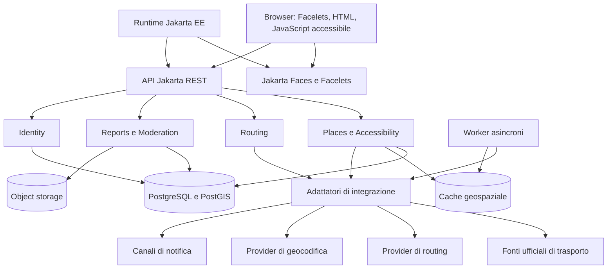

# SDD

## Documento di Progettazione del Sistema

| Dato | Valore |
|---|---|
| Progetto | aegis |
| Corso | Ingegneria del Software e Interazione Uomo-Macchina |
| Docenti | Prof.ssa Mariacarla Staffa |
| Candidati | [Inserisci Nome e Cognome] |
| Anno accademico | 2025/2026 |

Bozza aggiornata il 17 novembre 2026. L’architettura è iniziale e descrive il sistema proposto. Il prodotto non è ancora implementato. Le descrizioni dei componenti e dei flussi indicano comportamenti attesi e non attestano funzionalità realizzate o verificate. Runtime Jakarta EE, fonti dati, area pilota e servizi gestiti sono da convalidare secondo la [roadmap](MILESTONES.md).

## SOMMARIO

| Sezione | Contenuto |
|---|---|
| [Introduzione](#introduzione) | Scopo, obiettivi, definizioni, riferimenti e panoramica |
| [Sistema corrente](#sistema-corrente) | Stato attuale e contesto |
| [Panoramica](#31-panoramica) | Architettura generale |
| [Decomposizione del sistema](#32-decomposizione-del-sistema) | Moduli e responsabilità |
| [Diagramma dei moduli](#321-diagramma-dei-moduli) | Relazioni tra componenti e dipendenze |
| [Hardware/software mapping](#33-hardwaresoftware-mapping) | Nodi e responsabilità |
| [Gestione dei dati persistenti](#34-gestione-dei-dati-persistenti) | [Struttura relazionale](#341-postgresql-e-struttura-relazionale), [object storage](#342-object-storage), [sincronizzazione](#343-meccanismi-di-sincronizzazione) |
| [Controllo accessi e sicurezza](#35-controllo-accessi-e-sicurezza) | [Identità](#351-autenticazione-e-identità), [accesso ai dati](#352-controllo-degli-accessi-ai-dati), [immagini](#353-gestione-delle-immagini), [abusi](#354-protezione-da-abusi) |
| [Flusso di controllo globale](#36-decisioni-sul-flusso-di-controllo-globale) | [Sessione](#361-gestione-della-sessione-utente), [navigazione](#362-navigazione-tra-viste), [asincronia](#363-gestione-asincrona-ed-eventi), [errori](#364-gestione-degli-errori) |
| [Condizioni limite](#37-condizioni-limite) | Identità, luoghi, segnalazioni duplicate, rete, input e geolocalizzazione |
| [Servizi del sottosistema](#servizi-del-sottosistema) | [Identità](#41-autenticazione-utente), [luoghi](#42-gestione-dei-luoghi), [accessibilità](#43-informazioni-di-accessibilità), [percorsi](#44-pianificazione-dei-percorsi), [segnalazioni](#45-segnalazioni-e-moderazione), [geolocalizzazione e aggiornamenti](#46-geolocalizzazione-sincronizzazione-e-notifiche) |
| [Glossario](#glossario) | Termini architetturali e di dominio |

## INTRODUZIONE

### 1.1 SCOPO DEL SISTEMA

Questo documento descrive l’architettura software proposta per aegis e dettaglia i componenti, i dati, le interfacce e le decisioni operative che realizzano i requisiti definiti nel [RAD](RAD.md).

### 1.2 OBIETTIVI DI PROGETTAZIONE

| Obiettivo | Criterio architetturale |
|---|---|
| Separazione delle responsabilità | Mantenere distinti dominio, casi d’uso e adattatori. |
| Affidabilità dei dati di accessibilità | Registrare fonte e freschezza. Trattare i dati assenti o scaduti come sconosciuti. |
| Sostituibilità delle integrazioni | Collegare fonti e provider tramite porte e adattatori. |
| Tracciabilità della moderazione | Conservare gli eventi decisionali in forma append-only. |
| Sicurezza e privacy | Applicare autorizzazione server-side, minimizzazione dei dati e controlli sugli upload. |
| Operatività misurabile | Registrare esiti di sincronizzazione, ritardi delle fonti, errori e stato dei processi asincroni. |

### 1.3 DEFINIZIONI, ACRONIMI E ABBREVIAZIONI

| Termine | Significato |
|---|---|
| API | Interfaccia di programmazione applicativa esposta via HTTP. |
| DTO | Oggetto di trasferimento usato ai confini applicativi. |
| SRID | Identificatore del sistema di riferimento spaziale. |
| PostGIS | Estensione spaziale di PostgreSQL. |
| Jakarta EE | Piattaforma Enterprise Java proposta come base applicativa. Versione e runtime sono da convalidare secondo OPEN-08 e la proposta ADR-0001. |
| Jakarta Faces | Tecnologia Jakarta EE per interfacce server-side basate su componenti. |
| Facelets | Tecnologia di viste XHTML usata da Jakarta Faces. |
| Jakarta REST | API Jakarta EE per risorse HTTP REST. |
| Dato sconosciuto | Informazione assente, scaduta o non valida che non permette di determinare l’accessibilità. |

### 1.4 RIFERIMENTI

| Riferimento | Uso e stato |
|---|---|
| [RAD: Documento di Analisi dei Requisiti](RAD.md) | Requisiti, attori, casi d’uso e vincoli. |
| [Template RAD/SDD convertito](template.md) | Struttura accademica di riferimento. |
| [ADR-0001: Baseline Java e Jakarta EE](adr/ADR-0001-runtime-baseline.md) | Proposta non approvata per la baseline runtime. Include le fonti ufficiali consultate. |
| [ADR-0002: Validità dei dati e coerenza della cache](adr/ADR-0002-data-freshness-and-cache-consistency.md) | Proposta non approvata per regole di validità per fonte e tipo e consistenza delle cache. |
| [ADR-0003: Contratto del provider di routing accessibile](adr/ADR-0003-routing-provider-contract.md) | Proposta non approvata per il contratto, la compatibilità e il fallback del routing. |
| [ADR-0004: Contratto di identità e autorizzazione](adr/ADR-0004-identity-and-authorization-contract.md) | Proposta non approvata per autorizzazione lato server, identità operative e accesso al tracking. |
| [ADR-0005: Contratto di operabilità e ripristino](adr/ADR-0005-operability-and-recovery-contract.md) | Proposta non approvata per segnali operativi, recupero dei worker e prove di ripristino. |
| [ADR-0006: Ciclo di vita dei dati e semantica dell’audit](adr/ADR-0006-data-lifecycle-and-audit-semantics.md) | Proposta non approvata per minimizzazione, correzione, cancellazione e coerenza dell’audit. |
| [ADR-0007: Governance del branch main](adr/ADR-0007-main-branch-governance.md) | Proposta non approvata per pull request, check obbligatorio e protezioni del branch predefinito. |
| [ADR-0008: Licenza del repository e contributi](adr/ADR-0008-repository-license-and-contributions.md) | Proposta non approvata per licenza e regole dei contributi esterni. |
| [ADR-0009: Scansione dei segreti e verifiche di validità](adr/ADR-0009-secret-scanning-eligibility-and-validity.md) | Proposta non approvata per eleggibilità e configurazione delle protezioni aggiuntive dei segreti. |
| [ADR-0010: Baseline di valutazione dell’accessibilità](adr/ADR-0010-accessibility-evaluation-baseline.md) | Proposta non approvata per il target WCAG e i metodi di verifica. |
| Specifica OpenAPI | Da generare e versionare insieme all’API. |
| Documentazione Jakarta EE e PostGIS | Riferimenti tecnici da associare alle versioni selezionate. |

### 1.5 PANORAMICA

Il documento descrive il contesto attuale, l’architettura proposta, la decomposizione dei moduli, la mappatura hardware/software, la persistenza, il controllo accessi, il flusso globale, le condizioni limite e i servizi dei sottosistemi.

## SISTEMA CORRENTE

Il progetto è greenfield: non è stato fornito un sistema esistente da descrivere o migrare. Prima del pilota saranno censiti i servizi di trasporto, i dataset disponibili e i flussi di segnalazione già in uso nell’area geografica selezionata.

## SISTEMA PROPOSTO

### 3.1 PANORAMICA

aegis è una web app responsive per consultare l’accessibilità di luoghi e servizi di trasporto, pianificare spostamenti e inviare segnalazioni. Le viste server-side usano Jakarta Faces e Facelets. Le API REST usano Jakarta REST. La persistenza geografica usa PostgreSQL con PostGIS. Le immagini sono archiviate in object storage e le sincronizzazioni e attività lente sono svolte da worker.

La versione Jakarta EE e il runtime compatibile saranno selezionati in base ai requisiti di distribuzione e alle dipendenze del progetto. La proposta [ADR-0001](adr/ADR-0001-runtime-baseline.md) è in attesa di approvazione secondo OPEN-08. Provider di routing e fonti di trasporto seguono OPEN-03 e OPEN-01. Canali di notifica e servizi gestiti seguono OPEN-08. Le integrazioni restano sostituibili tramite porte applicative.

Il browser riceve HTML per le viste e JSON per le API. La mappa usa una libreria cartografica client-side, mentre i dati di luoghi e accessibilità provengono dall’API. Consultazione, invio delle segnalazioni e tracking tramite codice sono pubblici e non richiedono un account. L’autenticazione è richiesta per preferiti, notifiche, storico personale e operazioni amministrative. La protezione del codice di tracking, i ruoli e le transizioni di moderazione seguono le decisioni ancora aperte in OPEN-04 e OPEN-12.

### 3.2 DECOMPOSIZIONE DEL SISTEMA

La tabella collega i requisiti del [RAD](RAD.md#32-requisiti-funzionali) ai moduli proposti. I riferimenti NFR indicano responsabilità architetturali da verificare, non requisiti già soddisfatti dall’implementazione.

| Modulo | Responsabilità | Requisiti funzionali e casi d’uso | Requisiti di qualità |
|---|---|---|---|
| Places | Gestire luoghi, fermate e stazioni e fornire ricerche geospaziali. | FR-01, FR-06, UC-02 | NFR-08, NFR-10 |
| Accessibility | Gestire caratteristiche, stato, fonte, timestamp e validità. | FR-02, FR-03, UC-01, UC-02 | NFR-08 |
| Routing | Validare richieste, invocare il provider e mostrare l’incertezza dei tratti. | FR-04, FR-05, UC-01 | NFR-08, NFR-10 |
| Reports | Creare segnalazioni e consentire il tracking pubblico tramite codice senza esporre dati personali. | FR-07, FR-08, UC-03, UC-04 | NFR-04, NFR-06, NFR-07 |
| Moderation | Applicare le autorizzazioni e validare le transizioni conservando la cronologia append-only. | FR-09, UC-05 | NFR-04, NFR-05, NFR-06 |
| Identity | Gestire autenticazione, ruoli e separazione dei dati identificativi. | FR-13 (UC-05–UC-08), FR-14 (UC-07, UC-08), FR-15 (UC-08) | NFR-04, NFR-05 |
| Integrations | Implementare adattatori per fonti di trasporto, routing, notifiche e storage. | FR-10 (UC-06), FR-12 (UC-05, UC-08) | NFR-07, NFR-12 |
| Worker | Eseguire sincronizzazioni schedulate, riconciliare upload e inviare notifiche in modo asincrono e recuperabile. | FR-07 (UC-03), FR-10, FR-11, UC-06, FR-12 (UC-05, UC-08) | NFR-07, NFR-09, NFR-10 |
| Web | Fornire viste accessibili in Facelets con mappa, alternative testuali, moduli e pannello di moderazione. | FR-01–FR-09, FR-13–FR-15, UC-01–UC-08 | NFR-01, NFR-02, NFR-03, NFR-10, NFR-13 |
| Runtime e Operations | Gestire configurazione, distribuzione, osservabilità, migrazioni e ripristino. | Nessun caso d’uso diretto | NFR-05, NFR-09, NFR-10, NFR-12 |

NFR-12 è trasversale: separazione tra dominio, casi d’uso e adattatori e documentazione delle API riguardano i moduli applicativi.

La struttura applicativa proposta organizza il codice Java per domini e separa `domain`, `application` e `adapter`. Le entità e i value object dovranno contenere invarianti. I casi d’uso dovranno orchestrare le operazioni e dipendere da porte. Gli adattatori dovranno implementare accesso HTTP, persistenza e integrazioni. DTO HTTP, modello di dominio e modello di persistenza resteranno separati.

La struttura dei package proposta è `places`, `accessibility`, `routing`, `reports`, `identity`, `integrations` e `shared`, ciascuno articolato secondo le responsabilità effettive. La collocazione dettagliata dei componenti web e dei worker dipende dalla selezione del runtime e dal packaging applicativo.

#### 3.2.1 DIAGRAMMA DEI MODULI

Il diagramma mostra il browser e il runtime Jakarta EE, i moduli applicativi, le porte verso le dipendenze sostituibili e i sistemi persistenti.

### 3.3 HARDWARE/SOFTWARE MAPPING

| Nodo | Hardware e software | Responsabilità |
|---|---|---|
| Dispositivo client | Browser desktop o mobile e tecnologie assistive. | Renderizzare le viste, interagire con la mappa e inviare richieste HTTPS. |
| Container applicativo | Runtime Jakarta EE da selezionare secondo OPEN-08 e ADR-0001. Jakarta Faces, Facelets e Jakarta REST. | Servire viste e API e coordinare i casi d’uso. |
| Container worker | Processo Java compatibile con la piattaforma scelta. | Sincronizzare fonti e gestire attività lente e retry. |
| Database | PostgreSQL con PostGIS. | Conservare entità, eventi e geometrie. |
| Object storage | Servizio compatibile con il protocollo S3. Implementazione da selezionare. | Conservare immagini in modo controllato e con scadenza. |
| Ingress e distribuzione | Terminazione TLS e CDN secondo l’ambiente. | Instradare il traffico verso l’applicazione e distribuire risorse statiche. |
| Servizi esterni | Fonti ufficiali, provider di routing e canali di notifica da selezionare. | Fornire dati e capacità integrate tramite adattatori. |

In sviluppo è previsto Docker Compose con PostgreSQL/PostGIS e storage locale compatibile S3. Staging e produzione sono ambienti separati. L’obiettivo di produzione prevede container applicativi gestiti, database con backup automatici, object storage, CDN e gestione centralizzata dei segreti. Provider e topologia seguono OPEN-08. Dimensionamento e obiettivi di ripristino seguono OPEN-07 e OPEN-08. La proposta non attesta la disponibilità di questi ambienti.

La pipeline di rilascio dovrà compilare e verificare gli artefatti applicativi, eseguire test e scansioni delle dipendenze, creare immagini versionate e distribuire progressivamente. Le migrazioni devono mantenere la compatibilità con le versioni applicative attive durante il rilascio. La configurazione applicativa dovrà essere versionata e distinta per ambiente. I segreti non dovranno essere inclusi nel repository.

Le procedure operative per rilascio, migrazione, rollback, incidenti e ripristino sono da redigere e provare in base al runtime e agli ambienti selezionati. Come struttura si può usare il [modello di runbook](template/RUNBOOK.md). Il modello non rappresenta procedure già operative. La proposta per segnali, recupero dei lavori e coerenza del ripristino è descritta in [ADR-0005](adr/ADR-0005-operability-and-recovery-contract.md) e resta da approvare.

### 3.4 GESTIONE DEI DATI PERSISTENTI

La persistenza relazionale proposta usa PostgreSQL e PostGIS. Le migrazioni dovranno essere versionate e rimanere compatibili con le versioni applicative durante il rilascio progressivo. Le entità di dominio non dovranno dipendere dal modello relazionale. Gli adattatori di persistenza le convertiranno nel modello dati.

#### 3.4.1 POSTGRESQL E STRUTTURA RELAZIONALE

| Tabella | Contenuto e relazioni |
|---|---|
| `place` | Luogo, fermata o stazione con nome, tipo e geometria a SRID esplicito. |
| `accessibility_feature` | Tipo, stato, fonte, validità e timestamp della caratteristica. Riferimento a `place`. |
| `data_source` | Fonte autorizzata, responsabile, configurazione di aggiornamento, regola di validità e riferimento alla generazione attiva. Schema e modalità di gestione da convalidare secondo OPEN-01 e OPEN-14. |
| `transit_line` | Linee importate e relativi riferimenti alla fonte. |
| `transit_stop` | Fermate, geometrie e relazioni con le linee e la fonte. |
| `report_submission` | Prenotazione durevole con scope, digest della chiave, impronta dell’intera richiesta, stato e riferimento al report completato. Un vincolo di unicità su scope e digest impedisce prenotazioni concorrenti duplicate. La prenotazione è persistita prima di effetti esterni. Scope, durata, accesso e conservazione seguono OPEN-04, OPEN-05 e OPEN-08. |
| `report` | Geometria o luogo, categoria, descrizione, stato e date. È collegato alla prenotazione che ne ha originato la creazione. Dati identificativi separati. |
| `report_event` | Eventi append-only con autore, data, decisione e riferimento a eventuale duplicato. |
| `report_attachment` | Intento durevole di upload correlato alla prenotazione della richiesta, chiave opaca di un oggetto privato, esiti di validazione e scansione, stato di associazione al report e lavoro di recupero o pulizia. Stati, accessi e conservazione seguono OPEN-05, OPEN-08 e OPEN-15. |
| `notification_outbox` | Intenzioni di notifica registrate nella stessa transazione del report e dell’evento iniziale oppure della transizione e dell’evento di moderazione. Stato, tentativi e riferimenti tecnici necessari al recupero. Destinatario, contenuto, accesso e conservazione dipendono dalle policy OPEN-04, OPEN-05 e OPEN-08. |
| `user_account` | Riferimento d’identità e ruoli con accesso limitato. |
| `source_sync` | Fonte, versione, timestamp, esito, controlli di qualità, generazione pubblicata, generazione precedente e stato del lavoro durevole di pulizia cache. |

La matrice seguente descrive il trattamento progettato. Non definisce basi giuridiche, consensi o tempi di conservazione. Finalità, accessi, scadenze e cancellazione devono essere approvati secondo OPEN-04 e OPEN-05 prima dell’implementazione.

| Categoria | Dati previsti e uso | Accesso progettato |
|---|---|---|
| Identità e ruoli | Riferimento al provider d’identità e permessi associati agli account per autorizzare le funzioni riservate. Il provider non è selezionato. L’ospite usa le funzioni pubbliche senza account. | Utente registrato e amministratore autenticati secondo OPEN-04. |
| Richieste di percorso e geolocalizzazione | Origine e destinazione testuali o coordinate, preferenze e vincoli di accessibilità per calcolare un percorso. Sono elaborati durante la richiesta e non persistiti nel dominio dopo la risposta. Il provider selezionato può ricevere i soli campi necessari secondo il contratto OPEN-03. Log, telemetria, accesso, conservazione e trattamento del provider restano da approvare in OPEN-05 e OPEN-08. | Ospite, utente registrato e servizi applicativi. Il provider riceve solo i campi necessari previsti dal contratto approvato. |
| Segnalazione | Luogo, categoria, descrizione, data e stato per moderare e comunicare informazioni sulle barriere. Testo e posizione possono identificare una persona. | Amministratori autorizzati e viste pubbliche limitate ai campi approvati. |
| Eventi di moderazione | Riferimento all’autore, data, decisione e segnalazione per mantenere la cronologia append-only. | Amministratori autorizzati e ruoli operativi autorizzati. |
| Credenziale di tracking | Codice restituito a chi invia una segnalazione per consultare lo stato consentito. Memorizzazione e scadenza non sono definite. | Possessore autorizzato secondo OPEN-04. Il codice non va registrato nei log. |
| Immagine allegata | File, metadati necessari, intento durevole e stato della scansione per documentare una barriera e supportare la moderazione. | Oggetto privato prima dell’associazione autorizzata al report. Pubblicazione secondo policy approvata. |
| Log operativi | Eventi tecnici e identificativi necessari per diagnosi, sicurezza e misurazione operativa. | Personale operativo autorizzato. |

| Categoria | Decisioni di ciclo di vita |
|---|---|
| Identità e ruoli | Definire identificativi persistiti, finalità, accessi, revoca e cancellazione secondo OPEN-04 e OPEN-05. |
| Richieste di percorso e geolocalizzazione | Definire minimizzazione, eventuale persistenza, trasferimenti al provider, log e telemetria, accesso, conservazione e cancellazione. Il responsabile privacy deve classificare i campi nel contesto d’uso e stabilire se rivelano dati personali relativi alla salute, quali condizioni dell’articolo 9 si applicano e se è necessaria una valutazione d’impatto secondo l’articolo 35. Rivedere OPEN-03, OPEN-05 e OPEN-08. |
| Segnalazione | Definire campi pubblici, minimizzazione, correzione, scadenza e cancellazione secondo OPEN-05. |
| Eventi di moderazione | Definire contenuto minimo, riferimenti all’attore e rimozione dei dati personali senza dichiarare anonimizzazione non dimostrata. Rivedere la proposta [ADR-0006](adr/ADR-0006-data-lifecycle-and-audit-semantics.md) e approvare la regola in OPEN-05. |
| Intenzioni di notifica | Definire destinatari, contenuto, accessi, conservazione, cancellazione e trattamento degli esiti secondo OPEN-04, OPEN-05 e OPEN-08. Evitare credenziali e dati personali non necessari. |
| Credenziale di tracking | Definire memorizzazione, revoca, scadenza e cancellazione secondo OPEN-04 e OPEN-05. |
| Immagine allegata | Definire consenso, rimozione dei metadati non necessari, conservazione, revoca e cancellazione secondo OPEN-05. |
| Log operativi | Escludere per impostazione predefinita descrizioni personali, credenziali, codici di tracking, coordinate, preferenze e richieste di percorso. Definire eccezioni motivate, accesso, durata e cancellazione secondo OPEN-05 e OPEN-08. |

La separazione tra identità, contenuto e cronologia è un confine architetturale, non una garanzia di anonimato. Descrizioni, coordinate, preferenze di percorso, immagini e riferimenti agli autori possono identificare una persona. Le richieste di percorso non sono persistite nel dominio dopo la risposta, ma il provider e la telemetria possono trattarne una copia secondo i contratti da approvare. Il responsabile privacy deve valutare se i campi, associati a una persona, rivelano informazioni sulla disabilità o sulla salute e determinare gli obblighi applicabili. La regola di cancellazione deve includere database, object storage, indici, cache, log, provider e copie di backup secondo i rispettivi confini di controllo e deve preservare una semantica di audit approvata. Le opzioni per minimizzare il journal e coordinare il ciclo di vita sono proposte nell’[ADR-0006](adr/ADR-0006-data-lifecycle-and-audit-semantics.md), che non definisce obblighi giuridici o tempi.

Le relazioni sono protette da chiavi esterne e vincoli. Le ricerche geografiche usano indici spaziali. Ulteriori indici sono definiti in base alle query validate. Le coordinate di dominio sono rappresentate da `GeoPoint`, value object immutabile con controlli di validità.

La politica di backup e la conservazione delle copie seguono OPEN-05 e OPEN-08. Gli obiettivi di ripristino seguono OPEN-07. Il responsabile operativo deve approvare le regole e registrare le prove di ripristino prima del lancio e dopo modifiche rilevanti all’infrastruttura.

Ogni caratteristica di accessibilità registra fonte, stato, data di aggiornamento e validità. L’assenza o la scadenza produce lo stato sconosciuto. Ogni operazione di moderazione aggiorna lo stato corrente e inserisce l’evento corrispondente nella stessa transazione. Gli eventi non sono modificati né eliminati dall’applicazione ordinaria.

#### 3.4.2 OBJECT STORAGE

Le foto sono conservate fuori dal database in object storage privato. Dopo la validazione sintattica e autorizzativa, ma prima di qualsiasi effetto esterno, il sistema registra in una transazione `report_submission` con scope, digest della chiave, impronta dell’intera richiesta e stato pendente. Un vincolo univoco su scope e digest serializza le prenotazioni concorrenti. L’impronta comprende i campi normalizzati e il digest dei byte dell’eventuale allegato. Il digest dichiarato per l’allegato viene verificato sui byte ricevuti. Il formato canonico e la gestione delle chiavi seguono OPEN-08. Prima di scrivere il file, il sistema registra in `report_attachment` un intento durevole e una chiave opaca non esposta al client. La scrittura, la validazione e la scansione avvengono senza rendere l’oggetto accessibile pubblicamente. Solo dopo un esito valido una transazione database collega l’allegato al report, registra evento e notifica autorizzata e completa la prenotazione con il riferimento al report. Database e object storage non condividono una transazione atomica.

Se la scrittura, la scansione o la transazione database falliscono, l’oggetto resta privato e l’intento consente un retry idempotente o la pulizia. La prenotazione mantiene lo stato pendente o recuperabile finché il worker non completa la riconciliazione o registra un esito terminale secondo la policy approvata. Solo il titolare esclusivo della prenotazione può proseguire l’operazione. Un retry concorrente con la stessa chiave e impronta osserva lo stato esistente e non avvia un secondo upload. Un retry con impronta diversa è rifiutato. Un worker riconcilia prenotazione, intento e oggetti usando le chiavi registrate prima della scrittura. Rifiuto, quarantena, retention, retry e cancellazione seguono OPEN-05, OPEN-08 e OPEN-15. Un riferimento mancante o un oggetto non disponibile non produce un link pubblico rotto: l’allegato è escluso dalla risposta e l’anomalia resta osservabile. Stati, tempi e meccanismo di coordinamento esclusivo sono da approvare secondo OPEN-08. Il database conserva riferimenti e metadati necessari, non i byte dell’immagine.

#### 3.4.3 MECCANISMI DI SINCRONIZZAZIONE

Worker asincroni importano dati di trasporto e accessibilità tramite adattatori isolati. Ogni esecuzione ha un identificativo e registra fonte, versione, timestamp, esito, controlli di qualità e riferimento alla generazione in `source_sync`. La pubblicazione e la registrazione nello stesso record del lavoro di pulizia cache pendente avvengono nella stessa transazione. Il worker di pulizia recupera i lavori non completati da `source_sync`, registra esito ed eventuale errore e ripete l’operazione in modo idempotente secondo una politica di retry e backoff da definire in OPEN-08. Un arresto dopo il commit non perde quindi la richiesta di pulizia. Retry e replay dell’importazione devono essere idempotenti. La deduplicazione usa le chiavi stabili definite dal contratto della fonte. Se la fonte non fornisce chiavi stabili, la regola di riconciliazione deve essere approvata secondo OPEN-14 prima di attivare l’importazione.

I dati acquisiti sono scritti in una generazione candidata isolata dalle letture pubbliche. Il worker valida contratto e schema, chiavi, completezza secondo le regole concordate per la fonte e coerenza dei dati. Solo una generazione che supera tutti i controlli può diventare attiva tramite un passaggio atomico. L’attivazione della generazione e la registrazione dell’esito pubblicato avvengono nella stessa transazione. Un errore lascia attiva la generazione pubblicata in precedenza e registra l’esito fallito senza esporre dati parziali. La rappresentazione fisica delle generazioni dipende dal contratto della fonte e dal volume, ma deve preservare isolamento, pubblicazione atomica e recuperabilità.

Frequenza e validità sono definite per ciascuna fonte e tipologia durante la selezione dell’area pilota. I dati oltre la validità sono esposti come sconosciuti. La proposta di regole e consistenza è descritta nell’[ADR-0002](adr/ADR-0002-data-freshness-and-cache-consistency.md) e resta da approvare. La durata della cache non deve estendere la validità temporale della caratteristica, che va rivalutata anche in caso di cache hit. Prima della cache, ogni lettura acquisisce dal repository autorevole, in una vista consistente, gli identificativi delle generazioni attive per tutte le fonti coinvolte. La chiave cache include il vettore completo delle generazioni, l’area e i parametri normalizzati della query. In caso di cache miss, dati e provenienza sono letti usando lo stesso snapshot del vettore. Una pubblicazione concorrente non può quindi comporre una risposta con dati riferiti a generazioni diverse da quelle della chiave. Dopo un commit, una lettura successiva non può selezionare le chiavi del vettore superato, anche se la pulizia fisica è ancora pendente. I risultati di routing composti non sono memorizzati in questa cache.

Il worker elimina le chiavi delle generazioni non più attive dopo il commit. Un fallimento lascia il lavoro pendente e osservabile in `source_sync` per un tentativo successivo. La pulizia fisica è idempotente. La correttezza della lettura non dipende dalla sua conclusione, poiché una chiave obsoleta non corrisponde alla generazione attiva. Aggiornamenti urgenti rendono così non selezionabili i dati precedenti al commit. L’ordinamento delle generazioni concorrenti segue la versione della fonte quando disponibile. In assenza di una versione confrontabile, gli aggiornamenti della stessa fonte sono serializzati secondo una regola da approvare in OPEN-14.

### 3.5 CONTROLLO ACCESSI E SICUREZZA

Il controllo accessi è applicato lato server. Consultazione, invio e tracking tramite codice sono pubblici secondo il RAD. Le operazioni amministrative e le funzioni dell’utente registrato richiedono autenticazione e autorizzazione. La proposta [ADR-0004](adr/ADR-0004-identity-and-authorization-contract.md) resta da approvare per ruoli, identità operative, protezione del codice di tracking e campi restituiti. Campi pubblici, conservazione e consenso delle immagini seguono OPEN-05.

#### 3.5.1 AUTENTICAZIONE E IDENTITÀ

Consultazione, invio di segnalazioni e tracking tramite codice non richiedono un account. Il codice di tracking autorizza la consultazione del solo stato consentito e deve essere trattato come una credenziale: non va registrato nei log. Le regole di generazione, conservazione e accesso al codice sono da approvare in OPEN-04 e OPEN-05. Preferiti, notifiche, storico personale e operazioni amministrative richiedono un’identità autenticata e un permesso verificato lato server. Provider d’identità e protocolli non sono selezionati. Le credenziali e i segreti non sono conservati nei log né nel codice applicativo.

#### 3.5.2 CONTROLLO DEGLI ACCESSI AI DATI

Ogni operazione riservata verifica l’autorizzazione sul server. L’accesso ai dati identificativi è separato da quello ai contenuti pubblici delle segnalazioni. Le query sono parametrizzate. Input e transizioni di dominio sono validati. Le migrazioni applicano vincoli relazionali e indici necessari all’integrità e alle query autorizzate.

#### 3.5.3 GESTIONE DELLE IMMAGINI

Gli upload applicano i limiti e i controlli da approvare in OPEN-15. Il sistema registra un intento durevole prima della scrittura e conserva gli oggetti in un’area privata. I file sono verificati per tipo e contenuto e sottoposti a scansione. Solo un allegato verificato e collegato al report può essere servito secondo autorizzazione. Un errore tra object storage e database non rende pubblico un oggetto orfano: il worker usa l’intento per riprendere o pulire il lavoro in modo idempotente secondo OPEN-08 e OPEN-15. Consenso, finalità, durata di conservazione e cancellazione seguono OPEN-05 e devono essere definiti prima di attivare la pubblicazione.

#### 3.5.4 PROTEZIONE DA ABUSI

Gli endpoint applicano rate limiting e validazione server-side. Le richieste non valide sono rifiutate senza effetti parziali. Gli errori non devono rivelare dati riservati o consentire l’enumerazione delle segnalazioni. I log strutturati escludono credenziali, codici di tracking e descrizioni personali. Le azioni amministrative sono sottoposte ad audit.

**Analisi delle minacce.** La seguente valutazione è iniziale e descrive controlli richiesti, non controlli già implementati o verificati. Limiti quantitativi e scansione degli upload seguono OPEN-15. Conservazione, provider d’identità e fonti autorizzate seguono OPEN-05, OPEN-04 e OPEN-01.

| Scenario di minaccia | Bene e impatto | Controllo progettato | Verifica richiesta |
|---|---|---|---|
| Enumerazione dei codici di tracking | Esposizione dello stato o di informazioni personali di segnalazioni altrui. | Usare un token casuale non sequenziale con entropia adeguata al rischio. Limitare le richieste e rendere uniformi gli esiti per codice inesistente e non autorizzato. Non registrare il token nei log. | Prove di autorizzazione, enumerazione e analisi dei log prima del pilota. |
| Accesso o transizione di moderazione non autorizzati | Modifica fraudolenta di stato e cronologia delle segnalazioni. | Verificare identità e ruolo sul server per ogni operazione. Applicare transizioni ammesse in modo atomico e registrare gli eventi in audit append-only. | Prove negative per ruolo e stato, incluse chiamate dirette alle API e richieste ripetute. |
| Upload malevolo o non conforme | Esecuzione o diffusione di contenuti ostili, esposizione di dati o abuso dello storage. | Registrare un intento durevole prima della scrittura. Validare tipo effettivo, dimensione e contenuto. Tenere privato l’oggetto, sottoporlo a scansione e pubblicarlo solo dopo associazione autorizzata al report. Riconciliare o pulire in modo idempotente gli intenti incompleti. Limiti, scanner e retention sono da approvare secondo OPEN-05 e OPEN-15. | Prove con file invalidi, contenuti di test, scansione fallita o indisponibile, interruzione dopo scrittura e dopo scansione, errore della transazione database e tentativi di accesso non autorizzato. Verificare la pulizia o il retry senza esposizione pubblica. |
| Dati di fonte errati, alterati o scaduti | Percorsi o descrizioni di accessibilità che inducono decisioni non sicure. | Importare solo fonti autorizzate, validare schema e qualità, conservare provenienza e validità. Mostrare come sconosciuti i dati assenti o scaduti. | Test di schema, duplicati, aggiornamento fallito, fonte scaduta e propagazione dello stato sconosciuto. |
| Injection o consumo eccessivo di risorse | Compromissione dei dati o indisponibilità di API e database. | Usare query parametrizzate, validare input, limitare dimensioni e frequenza delle richieste e rendere le operazioni ripetibili in sicurezza. Le soglie sono da approvare in OPEN-15. | Analisi statica, prove di input ostile e carico con soglie approvate. |
| Divulgazione di dati personali o segreti | Violazione di riservatezza attraverso log, backup, configurazione, oggetti non collegati o risposta API. | Minimizzare i dati, escludere segreti e identificativi dai log, mantenere privati gli upload non collegati, limitare accessi e definire conservazione e cancellazione prima del lancio. Configurazione e segreti sono separati dal codice. | Revisione di log e permessi, controlli di segreti in CI e prove di accesso, recupero e cancellazione di upload interrotti. |

**Sicurezza d'uso e pericoli operativi.** Questa analisi riguarda i danni che possono derivare dall'uso delle informazioni del servizio. È distinta dall'analisi delle minacce informatiche. I controlli descritti sono requisiti di progetto e non risultano implementati o validati. La valutazione del rischio residuo richiede area pilota, fonti e profili d'uso approvati.

| Pericolo | Possibile danno | Controllo progettato | Evidenza richiesta |
|---|---|---|---|
| Una caratteristica di accessibilità assente, scaduta o incoerente viene interpretata come disponibile. | La persona sceglie un luogo o un tratto che non può utilizzare. | Propagare lo stato sconosciuto senza convertirlo in accessibile. Mostrare fonte e validità quando disponibili. Escludere il dato incerto dalle dichiarazioni di compatibilità. | Test end-to-end per dato assente, scaduto, incoerente e aggiornamento fallito. Revisione dei testi con persone del profilo pilota. |
| Un percorso include un tratto non verificato o un fallback del provider. | La persona incontra una barriera o non riesce a completare il tragitto. | Etichettare i tratti non verificati. Rendere visibili le limitazioni e l'origine del percorso. Fornire un esito esplicito quando non è possibile stabilire la compatibilità. | Prove con provider indisponibile, dati parziali e profili approvati. Verifica dell'equivalenza tra mappa e descrizione testuale. |
| Una sincronizzazione incompleta, duplicata o fuori ordine pubblica uno stato non coerente. | La persona pianifica sulla base di informazioni obsolete o contraddittorie. | Isolare le generazioni candidate, validare contratto e completezza, attivare in modo atomico, preservare la generazione precedente in caso di errore e ordinare le pubblicazioni concorrenti. Rendere osservabili esito e ritardo. | Prove di retry, interruzione in ogni fase, duplicati, pubblicazioni durante una query, coerenza del vettore cache, errore di pubblicazione e ripristino. Confronto tra fonte e dati attivi. |
| Un avviso o un errore non è percepibile o comprensibile con la modalità d'interazione usata. | La persona non nota l'incertezza o non riesce a scegliere un'alternativa. | Esporre avvisi nel contenuto e nella struttura accessibile, senza affidarsi al solo colore, alla sola mappa o a notifiche temporanee. Mantenere il messaggio disponibile nella vista. | Verifica con tastiera e tecnologie assistive, prove con utenti e controllo che gli stati equivalenti siano disponibili in forma testuale. |

Gli esiti delle verifiche, le limitazioni note e l'accettazione del rischio residuo devono essere registrati prima del pilota. I criteri di accettazione e i profili coinvolti dipendono dalle decisioni OPEN-02, OPEN-03 e OPEN-06.

### 3.6 DECISIONI SUL FLUSSO DI CONTROLLO GLOBALE

Le viste Facelets e le risorse Jakarta REST costituiscono adattatori. Validano la forma degli input e invocano casi d’uso applicativi. I casi d’uso applicano le regole di dominio, coordinano porte e transazioni e restituiscono risultati tipizzati. Gli adattatori convertono i risultati in viste o DTO HTTP. Le chiamate di rete lente sono eseguite fuori dalle transazioni di database quando possibile.

Le porte applicative includono repository per luoghi e segnalazioni, provider per dati di trasporto e routing, storage e notifiche. Le implementazioni sono selezionabili senza modificare le regole del dominio. OpenAPI documenta le API versionate, gli schemi, gli errori e le regole di accesso.

#### 3.6.1 GESTIONE DELLA SESSIONE UTENTE

La sessione è necessaria solo per le funzioni protette. Il runtime e il meccanismo di identità scelti determineranno durata, rinnovo e terminazione della sessione. La consultazione pubblica non deve dipendere da una sessione autenticata. La policy di sessione e il provider d’identità sono decisioni OPEN-04, da coordinare con la baseline runtime OPEN-08.

#### 3.6.2 NAVIGAZIONE TRA VISTE

Jakarta Faces e Facelets gestiscono la navigazione server-side secondo le convenzioni del runtime selezionato. Le viste previste comprendono ricerca, risultati, mappa con elenco testuale, dettaglio luogo, modulo di segnalazione, tracking e pannello di moderazione. Le transizioni riservate applicano i controlli di autorizzazione. I flussi mantengono etichette, focus e annunci accessibili.

Le API REST sono versionate e separate dal contratto delle viste. Un client cartografico riceve dati dall’API e offre una rappresentazione testuale equivalente.

#### 3.6.3 GESTIONE ASINCRONA ED EVENTI

Le sincronizzazioni e le attività lente sono eseguite da worker. La transazione di pubblicazione registra anche il lavoro pendente di pulizia cache. Un worker recupera i lavori incompleti da `source_sync` e ne registra l’esito. Le chiavi cache includono la generazione attiva, così un arresto del worker non rende leggibili dati di una generazione superata. Per gli allegati, `report_attachment` conserva l’intento prima della scrittura in object storage e permette di riprendere o pulire un upload anche se la transazione che crea il report fallisce. L’oggetto resta privato fino alla scansione valida e al collegamento autorizzato. Il worker riconcilia intenti e oggetti in modo idempotente secondo OPEN-05, OPEN-08 e OPEN-15. La politica di retry, backoff e allarme per lavori pendenti è da definire secondo OPEN-08. Per FR-12, l’intenzione di notifica è registrata in `notification_outbox` nella stessa transazione che completa la creazione o la moderazione, se le policy autorizzano l’invio. Un worker elabora l’intenzione dopo il commit tramite `NotificationPort`. L’esito è registrato. Un errore non annulla il caso d’uso già persistito e lascia il lavoro osservabile e recuperabile. Il sistema non garantisce consegna esattamente una volta. Retry, backoff, deduplicazione, riconciliazione degli esiti ambigui e rischio di duplicati quando il provider non offre conferme idempotenti sono da valutare in OPEN-08 secondo la proposta [ADR-0005](adr/ADR-0005-operability-and-recovery-contract.md). Le chiamate a provider esterni non mantengono aperte transazioni database. Metriche e allarmi devono rendere osservabili disponibilità, latenza, ritardo delle fonti, errori di sincronizzazione, lavori di pulizia cache e upload pendenti, stato ed età delle notifiche pendenti e dimensione e anzianità della coda di moderazione. Soglie e obiettivi di servizio sono da concordare.

#### 3.6.4 GESTIONE DEGLI ERRORI

Gli errori sono convertiti in una forma HTTP uniforme e in messaggi comprensibili per l’interfaccia. I dettagli interni e i dati personali non sono restituiti al client né registrati nei log. Ogni caso d’uso garantisce le proprie condizioni transazionali: un errore di moderazione non lascia divergenze tra stato e cronologia. Un errore di creazione non lascia una segnalazione parziale. Poiché database e object storage non condividono una transazione, un allegato non collegato resta privato e recuperabile o eliminabile tramite il suo intento durevole. Le viste espongono in modo accessibile stati di caricamento, assenza di risultati ed errore.

La procedura operativa per gli incidenti deve definire rilevazione, escalation, contenimento, ripristino, comunicazioni e registrazione degli esiti prima dell’apertura del servizio.

### 3.7 CONDIZIONI LIMITE

#### 3.7.1 UTENTE NON AUTENTICATO

La consultazione pubblica di luoghi e percorsi resta disponibile. Se un utente non autenticato richiede un’operazione protetta, il sistema rifiuta l’operazione e comunica come accedere alla funzione secondo la policy OPEN-04. L’autorizzazione è verificata lato server.

#### 3.7.2 LUOGO NON TROVATO O IDENTIFICATIVO NON VALIDO

Se un identificativo non corrisponde a un luogo, il sistema restituisce un esito coerente senza dati parziali. Se il luogo esiste ma i dati di accessibilità sono assenti, scaduti o incoerenti, li presenta come sconosciuti e non li usa come prova di compatibilità.

#### 3.7.3 SEGNALAZIONI DUPLICATE

Una segnalazione che descrive un caso già registrato può essere unita al report esistente solo tramite una decisione autorizzata di moderazione. Il sistema conserva entrambe le segnalazioni e registra l’unione nello storico. Non crea una relazione duplicata né sovrascrive eventi precedenti.

#### 3.7.4 INVII RIPETUTI E DUPLICAZIONE DEI DATI IMPORTATI

Retry della creazione e sincronizzazioni ripetute non devono creare segnalazioni o dati di trasporto duplicati. Per l’invio, una transazione prenota in `report_submission` una chiave univoca nello scope e l’impronta canonica dell’intera richiesta prima degli effetti esterni. La stessa prenotazione coordina richieste concorrenti e recuperi. La ripetizione della stessa chiave e dello stesso payload recupera una sola operazione e non duplica report, evento, allegato o intenzione di notifica. Il riuso della chiave con payload diverso è rifiutato senza effetti. Una richiesta ancora in corso non viene eseguita in parallelo. Ambito, durata, formato canonico, stati terminali, recupero del risultato e autorizzazione del replay seguono OPEN-04, OPEN-05 e OPEN-08. Le sincronizzazioni applicano le chiavi stabili e le regole OPEN-14. Un codice di tracking inesistente o non valido non permette di enumerare segnalazioni.

#### 3.7.5 CARICAMENTO LENTO O ASSENZA DI RETE

Le viste mostrano stati di caricamento e un errore accessibile quando rete, API o provider di routing non rispondono. Un fallback di percorso è marcato come non verificato. Se non esistono percorsi compatibili, il sistema comunica l’esito esplicitamente e presenta eventuali alternative con tratti non verificati.

#### 3.7.6 INPUT INCOMPLETI O INVALIDI

Richieste di percorso, moduli e identificativi sono validati prima di produrre effetti. In caso di input incompleto o non valido il sistema restituisce errori comprensibili e non persiste modifiche parziali. Un upload non valido o con scansione fallita viene rifiutato o messo in quarantena e non è reso pubblico. Se la scrittura object storage o la transazione report falliscono, l’intento durevole mantiene l’oggetto privato e consente retry o pulizia idempotente secondo OPEN-08 e OPEN-15. Se il commit riesce ma la risposta si perde, la chiave consente di recuperare l’esito della stessa operazione senza ripeterne gli effetti. La risposta ripetuta non rivela il codice di tracking a un soggetto non autorizzato secondo OPEN-04 e OPEN-05.

#### 3.7.7 PERMESSI DI GEOLOCALIZZAZIONE NEGATI

Se la persona nega il permesso di geolocalizzazione, il sistema non blocca ricerca e pianificazione. L’interfaccia consente di inserire manualmente origine, destinazione o luogo e non conserva la posizione oltre quanto necessario alla richiesta.

## SERVIZI DEL SOTTOSISTEMA

### 4.1 AUTENTICAZIONE UTENTE

Il sottosistema Identity gestisce autenticazione e autorizzazione delle funzioni protette. L’amministratore deve essere autenticato e avere il permesso di moderazione o gestione della fonte richiesto dall’operazione. Invio e tracking sono pubblici: il tracking usa il codice come credenziale e restituisce solo lo stato consentito. Le regole di protezione del codice e dei campi restituiti restano da approvare in OPEN-04 e OPEN-05. Provider e protocollo di autenticazione sono da selezionare. I dati identificativi restano separati dai contenuti pubblici delle segnalazioni.

### 4.2 GESTIONE DEI LUOGHI

Il sottosistema Places importa e consulta luoghi, fermate e stazioni. Le query geospaziali usano PostGIS e restituiscono geometrie e identificativi secondo il contratto API. La ricerca e il dettaglio sono in sola lettura per i dati ufficiali. Gli aggiornamenti arrivano dagli adattatori delle fonti autorizzate.

### 4.3 INFORMAZIONI DI ACCESSIBILITÀ

Il sottosistema Accessibility recupera le caratteristiche associate ai luoghi e valuta validità e provenienza. Ogni risposta include stato, fonte e freschezza disponibili. Dato assente o scaduto è classificato sconosciuto. Le informazioni sono fornite ai dettagli dei luoghi e ai casi d’uso di pianificazione.

### 4.4 PIANIFICAZIONE DEI PERCORSI

Il caso d’uso `PlanRouteControl` valida origine, destinazione e vincoli, invoca `RoutingProvider` e combina il risultato con le informazioni di accessibilità. L’adattatore invia solo i campi necessari al calcolo ed esclude identificativi dell’account e codici di tracking. La richiesta non è persistita nel dominio dopo la risposta. Dati affidabili e compatibili possono essere usati per escludere tratti. Dati incerti sono mostrati come tali. Un risultato del provider non costituisce da solo prova di accessibilità. Timeout, risposta parziale e profilo non supportato sono esiti espliciti, mentre un eventuale fallback è marcato non verificato. Contratto, campi trasmessi e criteri di selezione del provider sono proposti in [ADR-0003](adr/ADR-0003-routing-provider-contract.md) e restano da approvare. Log, telemetria, conservazione, cancellazione e destinatari del provider seguono OPEN-05 e OPEN-08. Il servizio non modifica lo stato persistente di dominio.

### 4.5 SEGNALAZIONI E MODERAZIONE

`CreateReportControl` valida i dati e gestisce l’eventuale upload tramite intento durevole, storage privato e scansione. La richiesta porta una chiave di idempotenza associata all’impronta del payload. La chiave impedisce effetti duplicati sui retry e il suo riuso con contenuto diverso è rifiutato. Ambito, durata, coordinamento dei retry concorrenti e recupero autorizzato dell’esito restano da approvare in OPEN-04, OPEN-05 e OPEN-08. Quando l’immagine supera i controlli, la stessa transazione database persiste segnalazione, evento iniziale, collegamento a `report_attachment` e intenzione autorizzata di notifica. La transazione non comprende object storage. Se fallisce, l’intento lascia l’oggetto privato e consente retry o pulizia secondo OPEN-05, OPEN-08 e OPEN-15. Se il commit riesce ma la risposta si perde, un retry recupera l’esito della stessa operazione senza ripetere report, evento, allegato o notifica. Il recupero del codice di tracking è subordinato alla policy di autorizzazione. `TrackReportControl` restituisce soltanto lo stato consentito al possessore del codice. `ModerateReportControl` verifica identità, ruolo, esistenza del report e transizione ammessa dalla matrice OPEN-12. Aggiorna lo stato e aggiunge un evento append-only nella stessa transazione, registrando anche l’intenzione autorizzata di notifica. La proposta [ADR-0011](adr/ADR-0011-report-moderation-state-machine.md) raccoglie le dimensioni della matrice ancora da approvare. Un worker elabora l’outbox dopo il commit. Un errore di invio non annulla segnalazione, codice di tracking o transizione già registrati. Il sistema non garantisce consegna esattamente una volta. Esito, tentativi, riconciliazione e recupero seguono la policy OPEN-08. Stati, transizioni, ruoli, motivazioni ed effetti della moderazione devono essere approvati in OPEN-12 prima dell’implementazione. I dettagli identificativi sono esclusi dalla risposta pubblica.

Prima dell’upload, `CreateReportControl` inserisce in `report_submission` la prenotazione durevole con scope, digest della chiave e impronta canonica che include i campi normalizzati e il digest verificato dell’eventuale allegato. Un vincolo univoco serializza la prenotazione. Il report, l’evento iniziale, il collegamento dell’allegato, l’outbox autorizzato e il completamento della prenotazione vengono poi persistiti nella stessa transazione. Se il processo si interrompe tra prenotazione e completamento, un retry osserva lo stato pendente e il recupero usa l’intento durevole, senza avviare in parallelo una seconda operazione. Scope, formato canonico, stati terminali, durata e coordinamento del recupero seguono OPEN-04, OPEN-05 e OPEN-08.

### 4.6 GEOLOCALIZZAZIONE, SINCRONIZZAZIONE E NOTIFICHE

La ricerca consente di usare coordinate quando disponibili e un inserimento testuale alternativo quando la persona nega la geolocalizzazione. Worker e `TransitDataProvider` importano fonti autorizzate secondo OPEN-01, applicano i contratti OPEN-14 ed eseguono controlli di qualità e registrano versione, timestamp ed esito. Fonti, frequenze e validità seguono OPEN-02. Il routing segue OPEN-03. `NotificationPort` inoltra notifiche in modo asincrono secondo autorizzazioni e consensi. Canali, provider gestiti, retry e procedure operative seguono OPEN-08. Profili di capacità, disponibilità e ripristino seguono OPEN-07.

## GLOSSARIO

I termini di cache e generazione descrivono invarianti del comportamento progettato. La rappresentazione fisica e la tecnologia di cache sono da selezionare secondo ADR-0002 e OPEN-08, mantenendo le regole di validità definite per fonte e tipo di dato.

| Termine | Definizione |
|---|---|
| Amministratore | Utente autenticato con permessi espliciti per moderare segnalazioni o gestire fonti. |
| Adattatore | Componente che collega una porta applicativa a un sistema esterno o a un dettaglio tecnico. |
| Cache | Memoria temporanea di risultati di lettura. Un dato in cache è selezionabile solo se la chiave corrisponde alle generazioni richieste. |
| Chiave cache versionata | Chiave composta dal vettore delle generazioni, dall’area e dai parametri normalizzati della query. |
| DataSource | Fonte autorizzata con responsabile e regole di aggiornamento e validità. |
| Dato sconosciuto | Dato assente, scaduto o non valido che non consente di determinare l’accessibilità. |
| DTO | Oggetto di trasferimento usato ai confini applicativi e distinto dal modello di dominio. |
| Facelets | Tecnologia di viste XHTML usata da Jakarta Faces. |
| Feature di accessibilità | Caratteristica dichiarata di un luogo, corredata di stato e provenienza. |
| Generazione attiva | Insieme completo e validato dei dati di una fonte selezionato dal repository per le letture correnti. |
| Generazione candidata | Insieme di dati importato e validato in isolamento prima della sua eventuale pubblicazione. |
| GeoPoint | Value object immutabile per coordinate valide con riferimento spaziale esplicito. |
| GDPR | Regolamento generale sulla protezione dei dati, Regolamento (UE) 2016/679. |
| Jakarta EE | Piattaforma Enterprise Java di riferimento per runtime, API web e servizi applicativi. |
| Jakarta Faces | API Jakarta EE per viste server-side basate su componenti. |
| Jakarta REST | API Jakarta EE per l’esposizione di risorse HTTP. |
| NotificationPort | Porta applicativa per l’invio di notifiche tramite un adattatore sostituibile. |
| Ospite | Persona che usa le funzioni pubbliche senza account. |
| Outbox di notifica | Archivio durevole delle intenzioni di invio persistite nella stessa transazione dell’operazione che le ha generate. |
| Porta | Interfaccia applicativa che descrive una dipendenza richiesta da un caso d’uso. |
| PostGIS | Estensione PostgreSQL per dati e interrogazioni geospaziali. |
| Pubblicazione atomica | Cambio della generazione attiva e registrazione del lavoro di pulizia nella stessa transazione. |
| Pulizia cache | Rimozione ripetibile delle chiavi riferite a generazioni superate. La correttezza delle letture non dipende dal completamento della rimozione. |
| Chiave di idempotenza | Identificativo che riconosce i retry della stessa richiesta e impedisce effetti duplicati. Ambito, durata e replay sicuro seguono OPEN-04, OPEN-05 e OPEN-08. |
| Impronta del payload | Digest del contenuto canonico della richiesta, inclusi i byte dell’eventuale allegato. Consente di rifiutare il riuso della chiave con contenuto diverso. Formato e gestione seguono OPEN-08. |
| Prenotazione della richiesta | Record persistito prima degli effetti esterni per coordinare retry, concorrenza, recupero e associazione al report completato. |
| ReportAttachment | Intento durevole e riferimento privato di un allegato. Il ciclo di vita consente riconciliazione tra database e object storage. Stati e conservazione dipendono da OPEN-05, OPEN-08 e OPEN-15. |
| AttachmentState | Stato del ciclo di upload, scansione, associazione o pulizia. Valori e transizioni devono essere definiti secondo OPEN-05 e OPEN-15. |
| ReportEvent | Evento immutabile che registra una transizione o decisione su una segnalazione. |
| Role | Ruolo applicativo assegnato a un account. Valori e permessi sono da approvare secondo OPEN-04. |
| Stato della segnalazione | Fase corrente del report. Valori e transizioni ammesse dipendono dalla matrice OPEN-12. |
| RoutingProvider | Porta verso il servizio che calcola alternative di percorso. |
| Snapshot consistente | Vista del repository che usa gli stessi riferimenti di generazione per selezionare i dati e la loro provenienza durante una lettura. |
| SourceSync | Registrazione dell’esito, della versione e dei controlli di una sincronizzazione. |
| SRID | Identificatore del riferimento spaziale di una geometria. |
| Tracking code | Codice non enumerabile usato per consultare lo stato consentito di una segnalazione. |
| TransitDataProvider | Porta verso una fonte di dati di trasporto. |
| Utente registrato | Persona autenticata che usa le funzioni consentite dal proprio account. |
| Value object | Oggetto immutabile definito dal valore e dalle proprie invarianti. |
| Vettore delle generazioni | Insieme dei riferimenti alle generazioni attive delle fonti coinvolte in una query. Identifica la versione dei dati usata per costruire la chiave cache. |
| Worker | Processo asincrono che esegue sincronizzazioni o attività lente fuori dalle richieste interattive. |
