# Template RAD e SDD

Trascrizione strutturata del [documento Word originale](template/template.docx), con la gerarchia espressa in Markdown. Le voci degli indici del DOCX ripetono o azzerano alcuni numeri di sezione. Qui la numerazione segue l'ordine logico delle sezioni. Le immagini sono collegate ai file estratti dal pacchetto originale.

Il pacchetto estratto è in `docs/template/assets/package/`. `make docs` verifica che il documento principale estratto resti identico a quello del DOCX sorgente.

Per la struttura dei documenti basati sugli esempi accademici, usare i modelli anonimizzati [RAD](template/RAD.md) e [SDD](template/SDD.md). Questa trascrizione resta il riferimento del template Word generico.

Registrare i requisiti e le decisioni sul comportamento del prodotto direttamente in RAD e le decisioni architetturali e operative in SDD. Indicare lo stato di ogni elemento non approvato e collegarlo alla decisione aperta e alla prova richiesta in [roadmap](MILESTONES.md).

Per procedure di distribuzione, ripristino, riconciliazione dei lavori asincroni e gestione degli incidenti, usare il [modello di runbook operativo](template/RUNBOOK.md). Le procedure vanno completate e provate nell’ambiente di riferimento prima di essere considerate operative.

Per segnalare problemi o richieste di funzionalità nel repository, si può copiare il [modello di issue](template/ISSUE.md). Non usarlo per pubblicare segreti, dati personali o dettagli di vulnerabilità.

## Documento di Analisi dei Requisiti (RAD)

### 1. Introduzione

Descrivere scopo del sistema, area di copertura, obiettivi, criteri di successo, definizioni, acronimi, abbreviazioni e panoramica.

Nel modello la sezione è introdotta dal testo:

> In questa prima fase introduttiva del documento, chiariremo gli scopi del sistema, l'area di copertura (dominio), gli obiettivi e i criteri di successo, eventuali definizioni, acronimi e abbreviazioni da tenere a mente e forniremo una breve panoramica del sistema.

### 2. Sistema corrente

> Nella seconda fase di stesura del RAD, analizziamo il sistema attuale (qualora esista). Nel caso non abbiamo a disposizione alcun sistema attuale, in quanto stiamo affrontando un problema di ingegnerizzazione greenfield, quindi stiamo progettando un sistema ex novo e i requisiti ci vengono comunicati dal committente (vedi intervista col committente), non ci soffermeremo su questa fase dell'elicitazione dei requisiti, ma passeremo a descrivere direttamente il sistema proposto.

### 3. Sistema proposto

> In questa fase dell'elicitazione dei requisiti e di stesura del RAD, ci soffermiamo su quella che è la parte principale: la definizione del sistema proposto. In base alle informazioni acquisite mediante l'intervista con il committente, possiamo redigere un primo prototipo di sistema da proporgli.

#### 3.1 Panoramica e obiettivi del sistema

Descrivere il sistema proposto e i principali obiettivi.

#### 3.2 Requisiti funzionali

È possibile descrivere i requisiti funzionali con tabelle oppure con descrizioni verbali numerate. Il modello include questo esempio:

> **FR1: Creazione di un account personale:** chiunque può creare un account con nome utente, codice fiscale e password e distinguersi tra cittadino, medico e autorità sanitaria.
>
> **FR2:** …

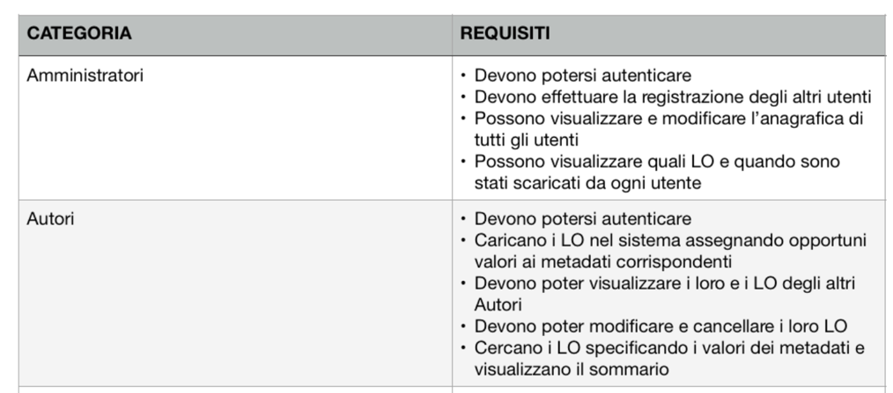

#### 3.3 Requisiti non funzionali

Il modello elenca queste aree:

- Interfaccia utente e fattori umani
- Documentazione
- Considerazioni hardware
- Caratteristiche delle prestazioni
- Gestione errori e condizioni limite
- Interfacciamento del sistema
- Problemi di qualità
- Modifiche del sistema
- Ambiente fisico
- Problemi di sicurezza
- Problemi di risorse e gestione

Anche questi requisiti possono essere presentati in forma tabellare oppure come elenco. Esempio del modello:

> **NFR1: Sicurezza:** le password dei singoli utenti non devono essere visualizzate né rese accessibili dall'esterno.
>
> **NFR2:** …

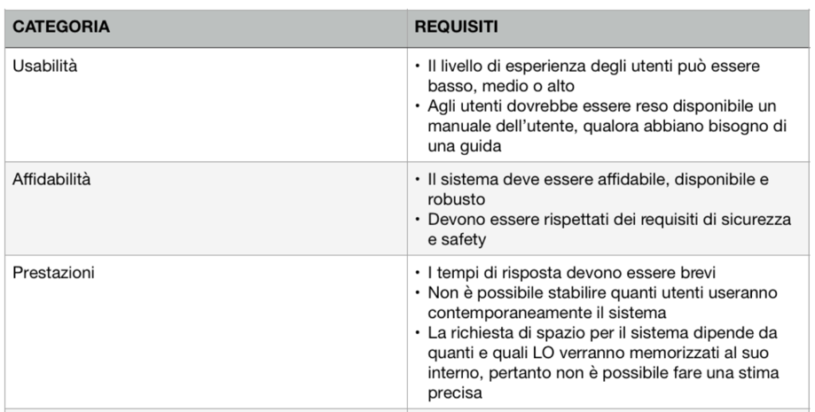

#### 3.4 Vincoli (pseudo-requisiti)

I vincoli sono dettati dal committente o dai limiti hardware e software.

#### 3.5 Modelli del sistema

##### Utenti del sistema

Descrivere gli utenti, i ruoli e il contesto di utilizzo.

##### Scenari

Descrivere gli scenari, gli utenti, i ruoli e il contesto di utilizzo.

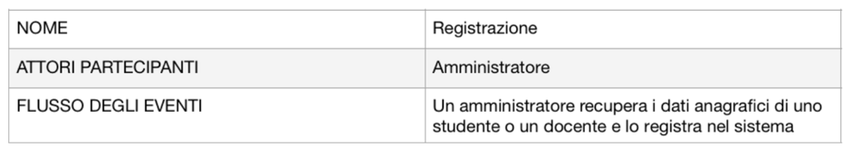

##### Modello dei casi d'uso

Inserire il diagramma UML globale dei casi d'uso.

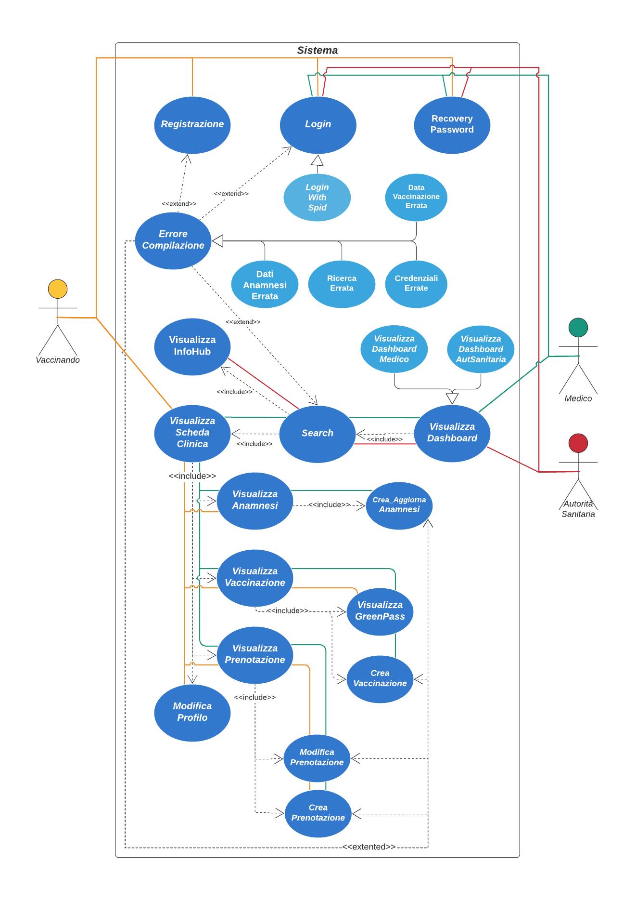

Specificare i casi d'uso in forma tabellare.

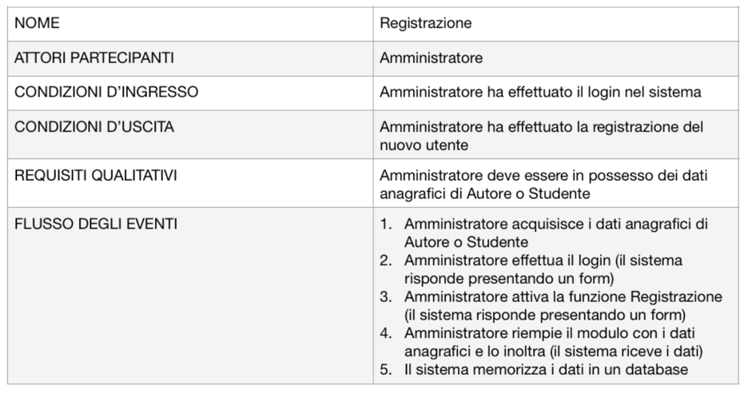

##### Modello degli oggetti

Definire le caratteristiche strutturali e le astrazioni del dominio applicativo. Il modello individua gli oggetti `Entity`, `Boundary` e `Control`, che rappresentano le informazioni persistenti mantenute dal sistema.

**Oggetti entity dei casi d'uso**

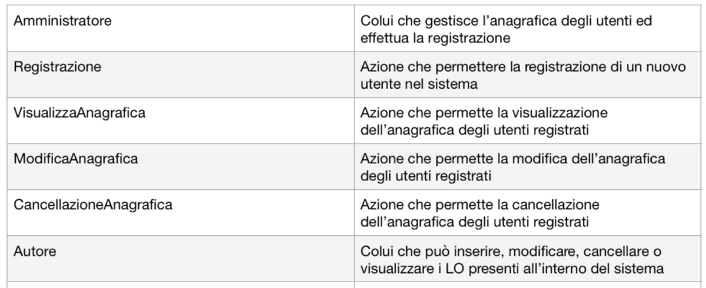

**Oggetti boundary dei casi d'uso**

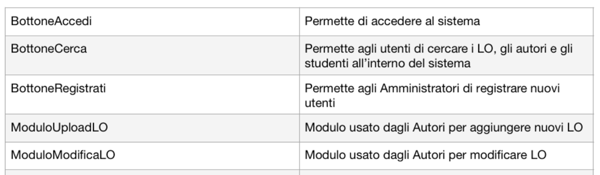

**Oggetti control dei casi d'uso**

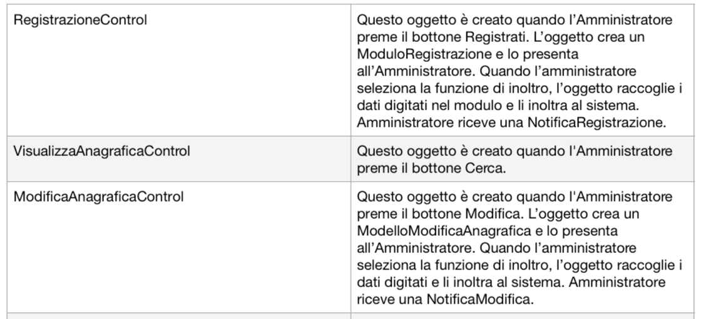

**Diagrammi delle classi**

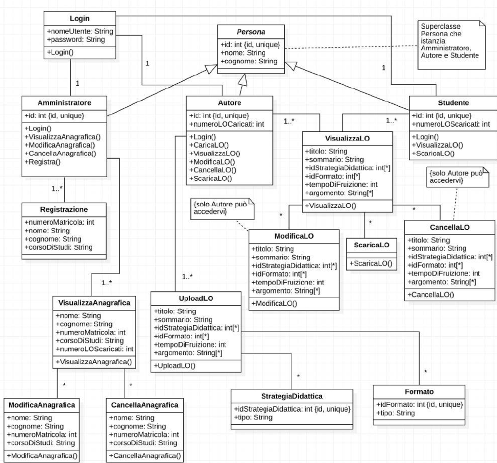

##### Modelli dinamici

Descrivere i diagrammi di sequenza dei casi d'uso più importanti. I modelli dinamici possono comprendere anche diagrammi degli stati e delle attività.

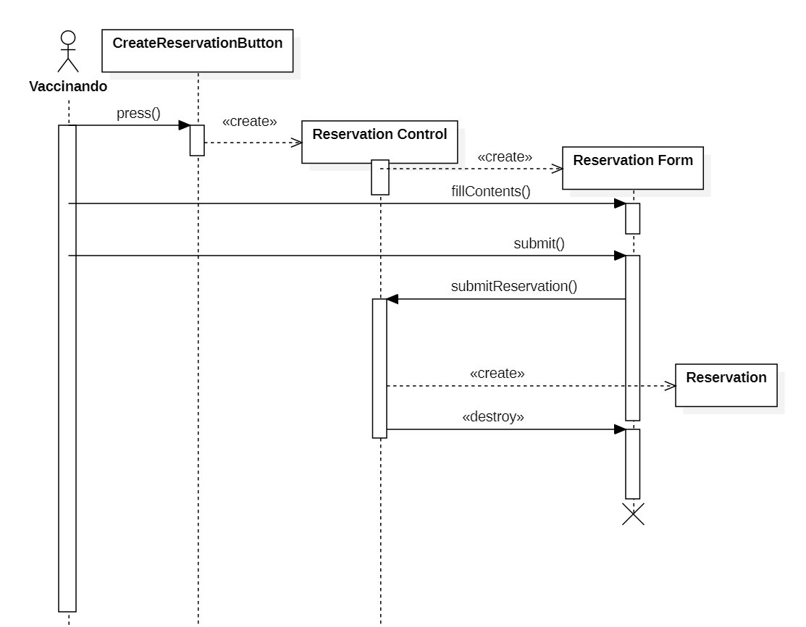

### 4. Interfaccia utente

Il template rimanda al documento separato `indice_template_interfaccia_utente.docx` per l'indice dell'interfaccia.

#### 4.1 Descrizione del prototipo realizzato

Specificare:

- scopo, ruolo, interfaccia e implementazione
- modo d'uso: statico, dinamico o interattivo
- fedeltà: bassa o alta
- completezza funzionale: prototipo orizzontale o verticale
- durata: usa e getta, evolutivo, incrementale o interattivo

#### 4.2 Test di usabilità

Il template richiede di documentare:

- **Obiettivi del test:** descrivere brevemente gli obiettivi.
- **Metodologia:** specificare numero, esperienza e caratteristiche dei partecipanti. Descrivere compiti, scenari, contesto e strumenti. Indicare modalità e durata delle sessioni per ogni partecipante e nel complesso. Elencare le misure raccolte. Descrivere il ruolo degli osservatori e il metodo di analisi.
- **Sintesi delle misure:** fornire una tabella dei risultati, per esempio tempi di esecuzione e percentuale dei compiti completati con successo, per ciascun partecipante e nel complesso.
- **Analisi dei risultati:** descrivere i problemi incontrati da ciascun partecipante durante ogni compito. Allegare screenshot significativi. Assegnare un livello di gravità. Registrare reazioni e commenti. Indicare gli interventi necessari per risolvere i problemi.
- **Sintesi delle interviste:** sintetizzare i risultati delle interviste svolte dopo il test.
- **Raccomandazioni finali:** descrivere gli interventi migliorativi, ordinandoli per priorità e collegandoli ai problemi rilevati.

#### 4.3 Valutazione dell'usabilità

Valutare i principi di ISO 9241-110 e, se possibile, confrontare il sistema con uno simile. Il modello propone un punteggio da 0 a 4 per ciascun principio e la rappresentazione dei punteggi medi in un diagramma a stella.

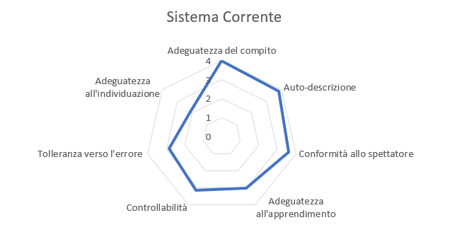

### 5. Allegati

Raccogliere i dati utili acquisiti durante il test.

### 6. Glossario

Definire i termini usati nel documento con le rispettive definizioni, per facilitarne la consultazione da parte dei nuovi sviluppatori.

## Documento di progettazione (SDD)

Il DOCX riporta questo indice per il *System Design Document*:

### 1. Introduzione

#### 1.1 Scopo del sistema
#### 1.2 Obiettivi di progettazione
#### 1.3 Definizioni, acronimi e abbreviazioni
#### 1.4 Riferimenti
#### 1.5 Panoramica

### 2. Sistema corrente

### 3. Sistema proposto

#### 3.1 Panoramica
#### 3.2 Decomposizione del sistema
#### 3.3 Mappatura hardware/software
#### 3.4 Gestione dei dati persistenti
#### 3.5 Controllo degli accessi e sicurezza
#### 3.6 Decisioni sul flusso di controllo globale
#### 3.7 Condizioni limite

### 4. Servizi del sottosistema

### 5. Glossario
