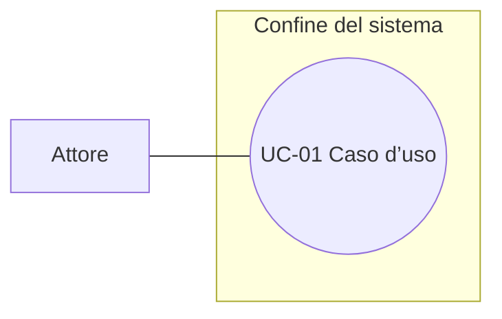

# Documento di Analisi dei Requisiti

| Dato | Valore |
|---|---|
| Progetto | Da compilare |
| Corso o committente | Da compilare |
| Docenti o referenti | Da compilare |
| Autori | Da compilare |
| Anno o versione | Da compilare |

## SOMMARIO

Inserire l’indice delle sezioni mantenendo la numerazione e la gerarchia riportate in questo modello.

## INTRODUZIONE

### 1.1 SCOPO DEL SISTEMA

Descrivere problema, utenti destinatari, obiettivi, funzionalità principali e criteri con cui sarà valutato il successo del sistema. Separare i fatti convalidati dalle ipotesi ancora da verificare.

### 1.2 AREA DI DOMINIO

Descrivere il dominio, i soggetti coinvolti, i sistemi o servizi correlati, i confini del prodotto e l’area geografica o organizzativa considerata.

## SISTEMA CORRENTE

Descrivere sistema, processi e limiti attuali. Se il progetto è greenfield, dichiarare che non è stato fornito un sistema corrente e indicare quali processi e fonti devono essere analizzati prima del rilascio.

## SISTEMA PROPOSTO

### 3.1 PANORAMICA

Descrivere la soluzione, gli utenti, le funzionalità principali, i componenti previsti e i flussi essenziali. Distinguere decisioni approvate, proposte e aspetti da definire.

### 3.2 REQUISITI FUNZIONALI

Ogni requisito descrive un’azione osservabile, indica chi la avvia o la esegue e dichiara la priorità. Usare identificativi stabili e collegare i requisiti ai casi d’uso. Derivare un criterio di accettazione osservabile dal flusso del caso d’uso.

| ID | Attore o sistema responsabile | Azione richiesta | Priorità | Caso d’uso collegato |
|---|---|---|---|---|
| FR-XX | Da definire | Da descrivere con un verbo osservabile e un esito verificabile | Da assegnare | Da collegare |

#### CRITERI DI ACCETTAZIONE FR

Per ogni requisito descrivere un risultato osservabile coerente con il caso d’uso collegato.

| ID | Criterio di accettazione |
|---|---|
| FR-XX | Risultato osservabile ricavato dal flusso del caso d’uso |

### 3.3 REQUISITI NON FUNZIONALI

Descrivere qualità e vincoli misurabili. Ogni riga deve indicare un’azione richiesta, un criterio osservabile e il ruolo responsabile dell’accettazione. Se la persona non è stata designata, dichiararlo. Soglie e metodi non ancora concordati restano da definire.

| ID | Qualità | Azione richiesta | Criterio di verifica | Responsabile dell’accettazione |
|---|---|---|---|---|
| NFR-XX | Da definire | Da descrivere in forma verificabile | Misura, metodo, ambiente e soglia da concordare | Ruolo responsabile, da designare |

Considerare, quando pertinenti, usabilità e accessibilità, performance, scalabilità, sicurezza e privacy, affidabilità, compatibilità, manutenibilità e portabilità.

### 3.4 VINCOLI

Descrivere obblighi normativi, vincoli tecnologici, disponibilità delle fonti, limiti di piattaforma, compatibilità e decisioni imposte dal committente. Indicare fonte, responsabile e stato di ogni vincolo.

| ID | Vincolo | Fonte o responsabile | Stato |
|---|---|---|---|
| C-XX | Da definire | Da indicare | Confermato o da convalidare |

### 3.5 MODELLI DI SISTEMA

#### 3.5.1 UTENTI DEL SISTEMA

Descrivere ruoli, obiettivi, responsabilità, competenze rilevanti, contesto e vincoli d’uso.

| Ruolo | Obiettivi e azioni | Contesto e competenze | Vincoli |
|---|---|---|---|
| Da definire | Da descrivere | Da descrivere | Da descrivere |

#### 3.5.2 SCENARI

Descrivere situazioni concrete e rappresentative. Ogni scenario identifica attore, obiettivo, contesto e sequenza narrativa, senza presentare ipotesi come fatti.

| Scenario | Attore | Obiettivo | Contesto e flusso |
|---|---|---|---|
| Da definire | Da indicare | Da indicare | Da descrivere |

#### 3.5.3 MODELLI DEI CASI D’USO

Inserire un diagramma UML globale dei casi d’uso. Riportare ogni ID usato nelle specifiche e collegare ogni caso a tutti gli attori umani e ai sistemi esterni che vi partecipano. Accompagnare il diagramma con una descrizione testuale di attori, confine del sistema e relazioni rappresentate.

##### Diagramma globale

Descrizione del diagramma: da compilare.

##### Specifiche dei casi d’uso

Ogni scheda riporta identificativo, scopo, attori, precondizioni, postcondizioni, requisiti qualitativi, flusso principale e flussi alternativi o di errore pertinenti. Dichiarare esplicitamente quando un errore modifica o impedisce gli effetti del caso d’uso.

| Campo | Specifica |
|---|---|
| ID e nome | Da assegnare |
| Attore principale e altri attori | Da definire |
| Scopo | Da descrivere |
| Precondizioni | Condizioni vere prima dell’avvio |
| Postcondizioni | Stato garantito al termine con successo. Indicare anche gli effetti in caso di errore rilevante |
| Flusso principale | Passi numerati solo quando necessari alla sequenza |
| Flussi alternativi e di errore | Da descrivere |
| Requisiti collegati | Identificativi FR e NFR |

#### 3.5.4 MODELLO DEGLI OGGETTI

Descrivere concetti, responsabilità, attributi rilevanti e relazioni del dominio. Distinguere oggetti persistenti, interfacce di interazione e coordinatori dei casi d’uso.

##### Oggetti entity dei casi d’uso

| Oggetto | Responsabilità e invarianti |
|---|---|
| Da definire | Da descrivere |

##### Oggetti boundary dei casi d’uso

| Oggetto | Attore o sistema esterno | Informazioni scambiate |
|---|---|---|
| Da definire | Da indicare | Da descrivere |

##### Oggetti control dei casi d’uso

| Oggetto | Caso d’uso coordinato | Responsabilità |
|---|---|---|
| Da definire | Da indicare | Da descrivere |

#### 3.5.5 DIAGRAMMA DELLE CLASSI

Inserire il diagramma delle classi del dominio e descrivere classi, attributi, relazioni e molteplicità. Evitare dettagli implementativi non ancora decisi.

Descrizione del diagramma: da compilare.

#### 3.5.6 DIAGRAMMI DI SEQUENZA

Inserire diagrammi per i casi d’uso principali. Ogni diagramma chiarisce partecipanti, messaggi, condizioni e risultato. Una descrizione testuale ne riassume il significato.

Descrizione dei diagrammi: da compilare per ciascun flusso rappresentato.

## INTERFACCIA UTENTE

Descrivere viste, navigazione, contenuti, feedback, stati vuoti ed errori e modalità di accesso. Per mappe, grafici e immagini fornire sempre una descrizione testuale equivalente.

### 4.1 DESCRIZIONE DEL PROTOTIPO REALIZZATO

Dichiarare lo stato reale del prototipo e documentare:

| Aspetto | Specifica |
|---|---|
| Scopo, ruolo, interfaccia e implementazione | Da descrivere |
| Modalità d’uso | Statica, dinamica o interattiva. Indicare quella effettiva |
| Fedeltà | Bassa o alta. Motivare |
| Completezza funzionale | Orizzontale o verticale. Indicare i flussi coperti |
| Durata | Usa e getta, evolutivo, incrementale o altra modalità. Motivare |

Non dichiarare realizzato un prototipo che esiste solo come proposta o descrizione.

### 4.2 TEST DI USABILITÀ

Indicare se il test è pianificato, in corso o concluso. Non inserire risultati prima della raccolta delle evidenze.

#### 4.2.1 OBIETTIVI DEL TEST

Descrivere le domande di valutazione e i flussi da verificare con criteri osservabili.

#### 4.2.2 METODOLOGIA USATA

Documentare partecipanti e relativa esperienza, compiti e scenari, contesto e strumenti, modalità e durata per sessione e complessiva, misure, consenso, ruolo degli osservatori e metodo di analisi.

| Elemento | Specifica |
|---|---|
| Partecipanti ed esperienza | Da definire o descrivere senza dati identificativi non necessari |
| Compiti e scenari | Da definire |
| Contesto e strumenti | Da definire |
| Modalità e durata | Per sessione e complessiva |
| Misure raccolte | Da definire prima delle sessioni |
| Osservatori e analisi | Da definire prima delle sessioni |

#### 4.2.3 SINTESI DELLE MISURE

Riportare risultati per partecipante e compito, quindi una sintesi aggregata per compito. Definire unità, denominatori e metodo di aggregazione. Proteggere l’identità dei partecipanti.

| Partecipante pseudonimizzato | Compito | Tempo o misura | Completamento | Errori e note |
|---|---|---|---|---|
| Da raccogliere | Da definire | Da raccogliere | Da raccogliere | Da raccogliere |

| Compito | Tempo medio o statistica definita | Successo (%) o misura definita | Errori e note aggregate |
|---|---|---|---|
| Da definire | Da calcolare dai dati individuali | Da calcolare dai dati individuali | Da sintetizzare |

#### 4.2.4 ANALISI DEI RISULTATI

Descrivere problemi per partecipante e compito con evidenze, gravità, reazioni o commenti e intervento richiesto. Omettere o anonimizzare dati identificativi e immagini personali.

| Partecipante anonimizzato e compito | Problema | Evidenza | Gravità | Reazione o commento | Intervento |
|---|---|---|---|---|---|
| Da raccogliere | Da raccogliere | Da raccogliere con consenso | Da definire nel protocollo | Da raccogliere | Da determinare |

#### 4.2.5 SINTESI DELLE INTERVISTE

Riassumere temi e riscontri emersi dopo i test, distinguendo osservazioni, interpretazioni e limiti della raccolta.

#### 4.2.6 RACCOMANDAZIONI FINALI

Collegare ciascun intervento a evidenze e problemi osservati. Ordinare per priorità usando criteri espliciti.

| Problema ed evidenza | Intervento | Priorità e criterio | Stato |
|---|---|---|---|
| Da raccogliere | Da definire | Da assegnare | Da definire |

### 4.3 VALUTAZIONE DELL’USABILITÀ SECONDO ISO 9241-110

Descrivere metodo, valutatori, partecipanti, evidenze e limiti. Non assegnare punteggi senza una valutazione documentata.

#### 4.3.1 DETTAGLIO PUNTEGGI ASSEGNATI

Usare la scala prevista dal protocollo e motivare ogni punteggio con evidenze. Il modello di riferimento usa una scala da zero a quattro.

| Principio | Punteggio | Evidenza e motivazione |
|---|---|---|
| Adeguatezza al compito | Da assegnare | Da documentare |
| Auto-descrittività | Da assegnare | Da documentare |
| Controllo da parte dell’utente | Da assegnare | Da documentare |
| Conformità alle aspettative | Da assegnare | Da documentare |
| Tolleranza agli errori | Da assegnare | Da documentare |
| Adattabilità | Da assegnare | Da documentare |
| Efficienza nell’uso delle risorse | Da assegnare | Da documentare |

#### 4.3.2 PROFILO DI VALUTAZIONE VISIVA

Rappresentare i punteggi effettivamente raccolti con un profilo visivo, preferibilmente un diagramma radar. Accompagnare il grafico con una tabella o una descrizione testuale accessibile e non usare valori ipotetici.

## GLOSSARIO

| Termine | Definizione |
|---|---|
| Da definire | Significato nel contesto del sistema |
